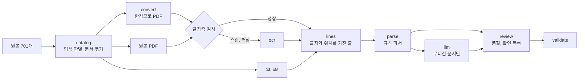
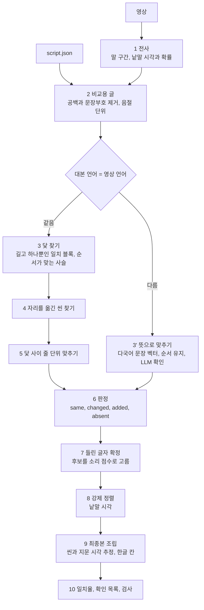

# sink: 문제 정의, 구현, 대본과 전사 맞추기 계획

기준일 2026-11-13. 수치는 `REPORT.md`, `TYPES.md`, `types.csv`(규칙 파서 판 기준)와 디스크 결과물에서 가져왔다.
형식의 정본은 `.omc/specs/deep-interview-sink-format.md`(아래에서 명세), 모듈 사이 약속은 `DESIGN.md` 다.

sink 는 영화 대본 파일 701개를 한 형식으로 통일하고, 영화마다 영상에서 실제로 들린 대사를 기준으로 한 최종 대본(`final.json`)을 만드는 작업이다.
지금은 대본 쪽 전처리가 끝나 문서 684개가 모두 `lines.jsonl` 과 `script.json` 을 갖고 있다.
영상 전사(영상 소리를 받아쓴 글, 명세에서는 받아쓰기)와 대본을 맞추는 단계는 형식만 정해져 있고 구현 전이며, 3장이 그 계획이다.

| 구간 | 상태 |
|---|---|
| 대본 형식 통일(catalog, convert, ocr, lines, parse, review, validate) | 구현과 전체 실행 끝 |
| LLM 파싱 단계(llm) | 구현됨, 대상 문서 실행 중, 아직 커밋 전 |
| 전사, 맞추기, 최종본(asr, align, final) | 스키마와 검사 도구, 손으로 만든 예시만 있음. 영상 파일 대기 |

## 1. 문제 정의

### 1.1 풀려는 문제

세 가지 사실에서 출발했다.

1. 대본 파일은 형식이 제각각이다. 받은 파일 701개를 묶은 문서 684개의 실제 형식이 10가지(HWP3, HWP5, doc, docx, rtf, 글자층 PDF, 스캔 PDF, 열리지 않는 PDF, txt, xls)이고, 확장자와 실제 형식이 다른 파일이 4개 있다. 같은 형식 안에서도 대사를 적는 표기가 8가지다(이름 줄 아래 대사 371문서, 이름 탭 대사 185, 이름 쌍점 대사 87 등, `TYPES.md` 5절).
2. 대본과 영상은 다르다. 촬영과 편집을 거치며 대사가 바뀌고 씬이 빠지거나 자리를 옮긴다. 판본 표시가 있는 문서는 40개뿐이고 644개는 어느 판본인지 모른다.
3. 쓰는 쪽은 영상 기준이 필요하다. 자막은 들린 말로 만들어야 한다. 기존 CBoE 는 대본 줄을 기준으로 두고 들린 말은 차이로만 표시했으며 HWP3, doc, 스캔, 영어 대본을 읽지 못했다.

그래서 문제를 이렇게 정했다.

> 대본 원본 전부를 하나의 형식 체계로 바꾸고, 영화 1편마다 영상에서 실제로 들린 대사를 기준으로 한 최종 대본 하나를 만든다.
> 최종본은 들린 그대로의 대사와 자막용 한글을 담고, 대본에서 가져온 화자, 씬, 지문, 화면 글자, 연기 지시와 대본과의 차이를 표시한다.
> CBoE 같은 도구는 원본 대본 없이 `final.json` 만 읽고 동작해야 한다.

### 1.2 문제를 정한 과정

- **원본 표본 조사**(`notes/script_elements_survey.md`): 파일을 앞 바이트로 나누고 문서 30개를 읽어 요소 종류와 표기 변형을 셌다. 형식이 꼭 담아야 하는 까다로운 경우 11가지(한 대사에 화자 여럿, 화자 꼬리표 조합, 대본 언어와 영상 언어가 다름, 쪽 넘김으로 쪼개진 대사 등)가 여기서 나왔다.
- **형식 사전 조사**(`notes/format_landscape.md`): 대본, 자막, 정렬 형식 15개와 연구 데이터셋 6개의 저장 방식을 견줬다. 대본 구조, 실제 발화, 시간을 함께 담는 표준은 없었고, 연구 데이터셋은 맞추기에 실패한 부분을 대부분 기록 없이 버렸다. 그래서 층을 나눈 구조(ELAN 방식), 연산 표(Kaldi ctm-edits 방식), 사람이 읽는 최종본(Netflix 대사 목록 방식)을 섞기로 했다.
- **질문으로 좁히기**(명세의 Interview Transcript): 범위 확인 1회와 질문 11회로 한 번에 한 가지씩 정했다. 모호도 점수가 81%에서 19.4%로 내려가 기준인 20% 아래가 됐다. 이때 뒤집힌 가정은 아래와 같다.

| 처음 가정 | 정한 것 |
|---|---|
| 파일 제목을 먼저 통일해야 한다 | 원본 이름은 그대로 두고 카탈로그 ID 로 통일한다 |
| 최종본은 CBoE 형식에 맞춘다 | 형식이 기준이고 CBoE 가 이 형식에 맞춘다 |
| 받아쓰기와 연결표도 최종본에 넣는다 | 최종본은 그것만으로 완결이고 기록은 `work/` 에 따로 둔다 |
| 영상 기준이면 대본에만 있는 것은 버린다 | 지문, 씬, 화면 글자, 잘린 대사를 모두 넣고 표시한다 |
| 판본마다 결과를 만든다 | 영화 1편 = 최종본 1개 = 대본 1개 |
| 못 읽은 대본은 빼거나 보류한다 | 읽은 만큼 쓰고 확인 필요 목록으로 알린다 |
| 대사는 정리해서 적는다 | 들린 그대로 적고 차이는 종류로 기록한다 |
| 최종본 한 줄은 소리 기준 발화다 | 대본 대사 줄 하나가 한 줄이다 |
| 최종본 대사는 영상 언어만 담는다 | 한글 칸을 더한다. 들린 말을 번역하고 대본은 참고한다 |

### 1.3 결과물 네 덩어리

| 덩어리 | 파일 | 내용 | 지금 |
|---|---|---|---|
| 카탈로그 | `catalog.csv` | 문서 1개가 1행. 원본 파일, 실제 형식, 언어, 판본, 영화 ID, 대표 대본 여부 | 712행. 영상 칸은 빈칸 |
| 전처리 대본 | `docs/{doc_id}/lines.jsonl`, `script.json` | 형식 통일 줄(글자와 위치), 구조 파싱(요소 7종) | 684문서 |
| 정렬 중간 결과 | `films/{film_id}/work/asr.json`, `align.json` | 전사 기록, 연결과 판정 기록 | 스키마와 예시 |
| 최종본 | `films/{film_id}/final.json` | 영상 기준 대본. CBoE 가 이것만 읽음 | 스키마와 예시 |

문제가 있는 문서, 영화, 줄은 `qa/needs_review.csv` 한 곳에 모은다.

### 1.4 범위 밖으로 둔 것

- 영상 파일 확보. 따로 구하고 카탈로그에는 칸만 둔다.
- CBoE 코드 수정. `final.json` 을 읽게 바꾸는 일은 다음 작업이다(명세 4.9절 대응표가 그 입력).
- 자막 칸 나누기와 효과음 자막. CBoE 의 몫이다.
- 사람이 고친 내용을 보존하는 체계, 공식 한글 자막 수집.

### 1.5 끝났는지 보는 기준

명세의 수락 기준 A(카탈로그), B(전처리 대본), C(정렬 중간 결과), D(최종본), E(공통)로 본다.
대본 쪽인 A1~A3, B1~B5, E1~E2 는 실제 결과물로 확인했다(`REPORT.md` 7절).
C1~C3, D1~D9 는 영상이 있어야 하므로, 스키마와 검사 도구가 그 규칙을 강제하는지까지만 확인했다(`examples/` 의 예시 파일이 검사를 통과).

## 2. 구현

### 2.1 흐름



실행은 `.venv\Scripts\python -I -m sinkprep all` 한 줄이다. 단계마다 입력 지문을 남겨 바뀐 문서만 다시 돈다.

### 2.2 단계별 내용

| 단계 | 코드 | 하는 일 | 결과 |
|---|---|---|---|
| catalog | `catalog.py`, `detect.py` | 앞 바이트와 내부 구조로 실제 형식 판별, 압축 풀기, 파일을 문서로 묶기, 중복과 대본 아닌 파일 제외, 제목에서 판본 읽기 | 712행 = 문서 684 + 제외 28. 영화 638편 |
| convert | `convert.py`, `hancom_worker.py`, `hwp3text.py` | HWP3, HWP5, doc, docx, rtf 를 한컴오피스 자동화로 PDF 로 바꿈. 실패하면 대체 경로로 글자만 얻음. 변환 PDF 와 원본 글자를 견줘 빠진 글자를 검사 | 481개 파일(한컴 473, 대체 경로 8) |
| ocr | `ocr.py`, `textlayer.py` | 스캔 PDF 와 글자층이 깨진 PDF 만 OCR(RapidOCR, 300dpi) | 81개 파일 7,723쪽. 파일별 평균 신뢰도 중앙값 0.956 |
| lines | `lines.py` | 모든 경로의 글자를 물리적인 줄 1개 = 1행으로. 줄마다 쪽, x와 y 위치, 출처, OCR 신뢰도 | 2,163,497줄 |
| parse | `parse.py`, `parse_layout.py`, `parse_text.py` | 줄을 요소 7종(front, scene, action, dialogue, onscreen, transition, unknown)으로. 대사마다 화자, 들리는 방식, 언어, 괄호 지시를 나눔 | `script.json` 684개. 대사 529,240개, 씬 87,285개 |
| llm | `llm.py`, `llm_parse.py` | 규칙 파서가 무너진 문서를 Claude 가 줄마다 라벨링하고, 요소 조립은 결정적인 코드가 함 | 작업 중(커밋 전) |
| review | `review.py` | 대본 언어, 번역 여부, 영화마다 대표 대본을 정하고, 품질 기준 아래 문서를 목록에 올림 | `qa/needs_review.csv` 49건(46문서) |
| validate | `validate.py` | JSON Schema 와 의미 규칙 검사 | 검사 1,375개, 실패 0 |

문서가 어느 형식, 어느 경로, 어느 대사 표기로 갈렸는지는 `TYPES.md` 와 `types.csv` 에 문서별로 정리돼 있다.

### 2.3 구현에서 내린 판단

1. **확장자를 믿지 않는다.** 파일 앞 바이트와 내부 구조로 형식을 정한다. doc 확장자인 RTF 2개, 평문 1개, 알 수 없는 형식 1개를 이렇게 걸렀다.
2. **글자보다 위치를 먼저 지킨다.** 대본에서 이름, 대사, 지문을 가르는 단서는 들여쓰기다. 그래서 한글과 워드 파일에서 글자만 뽑지 않고 한컴오피스로 PDF 를 만들어 쪽 안 위치를 얻는다(파이썬 라이브러리는 HWP3 를 읽지 못한다). 문서 684개 중 471개가 이 경로다.
3. **변환 결과를 원본과 대조한다.** 한컴 2024 가 일부 문서에서 대사를 빠뜨린 PDF 를 만들었다. 대체 경로로 읽은 원본 글자 중 PDF 에 없는 비율을 재서, 1%를 넘으면 확인 목록에 올리고 3%를 넘으면 PDF 를 버리고 원본 글을 쓴다. 3개 문서가 1%를 넘었고 그중 2개는 PDF 를 버렸다.
4. **OCR 은 마지막 수단이다.** 글자층 글자가 OCR 보다 정확하다. 글자층 검사에서 걸려도 글자 좌표로 줄을 다시 만들어 해결되면 OCR 하지 않는다.
5. **줄은 추출한 그대로 두고 정리는 줄 번호로 한다.** 머리말 지우기와 줄 합치기는 `script.json` 에서 줄 번호를 가리켜 처리한다. 모든 줄이 요소 하나 또는 버린 줄 목록에 정확히 한 번 속하므로, 어떤 요소든 원본 줄까지 거슬러 갈 수 있다.
6. **파서는 문서마다 통계로 역할을 정한다.** 고정 좌표나 문서 번호 특례를 쓰지 않는다. 그 문서의 들여쓰기 단계를 구하고, 확신이 높은 표기(이름 탭 대사 등)에서 인물 이름을 모아 확신이 낮은 표기를 읽는 데 쓴다. 설계는 `notes/parser.md`.
7. **못 읽어도 멈추지 않는다.** 종류를 못 정한 줄은 `unknown` 으로 남기고, 품질 지표가 기준 아래인 문서는 목록으로 알린다.
8. **규칙으로 안 되는 꼴은 LLM 이 읽되 결과가 늘 같게 한다.** 모델 ID 를 고정하고 응답을 캐시해, 다시 돌려도 바이트 단위로 같은 결과가 나온다. 대본 글은 신뢰할 수 없는 입력이라 도구를 모두 끄고 부른다.
9. **정확도는 따로 만든 정답 표본으로 잰다.** 구간 18개 790줄에 독립으로 두 번 표시하고 갈린 줄만 판정했다. 파서 개발 중에 보지 않은 확인용 180줄을 따로 뒀다.
10. **원본은 읽기 전용이다.** 원본 폴더에는 쓰지 못하게 막았고, 내려받은 파일이라 파이썬은 늘 `-I`(격리 모드)로 돌린다. 모든 파일은 임시 파일에 쓴 뒤 바꿔치기한다.

### 2.4 결과

| 항목 | 값 |
|---|---|
| 문서 | 684개(한국영화 394, 외국영화 290). 영화 638편 |
| 대본 언어 | ko 404, en 274, mixed 4, es 1, fr 1. 번역 대본 13개 |
| 글자를 얻은 경로(문서 기준) | 한컴 변환 PDF 471, 원본 PDF 글자층 105, OCR 80, 평문 19, 대체 경로 글 8, 엑셀 1 |
| 요소 종류별 줄 비율 | 대사 57.8%, 지문 36.7%, 씬 4.1%, 전환 0.6%, 앞머리 0.6%, 화면 글자 0.1%, unknown 0.0% |
| 파서 정확도(전체 790줄) | 요소 종류 98.4%, 화자 97.8% |
| 파서 정확도(확인용 180줄) | 요소 종류 98.3%, 화자 98.3% |
| 확인 필요 | 49건(46문서): parse_low_dialogue 25, speaker_missing 13, other 9, extract_broken 2 |
| 검사 | 1,375개 실패 0 |

### 2.5 남은 문제

- **규칙 파서가 무너지는 꼴.** 가운데 정렬 이름과 여백 대사, 이름이 붙은 OCR 대사, 두 언어 병기 같은 꼴을 모은 개발용 표본 180줄(2.4절의 확인용 180줄과 다른 표본)에서 규칙 파서 정확도가 종류 75.6%, 화자 62.9%로 떨어진다. LLM 단계가 이 문서들을 다시 읽으며, 같은 180줄에서 100%, 100%가 나왔다. 이 표본은 LLM 단계를 만들 때 쓴 것이라 독립 확인 수치는 아니다(`notes/llm_parse.md`, 커밋 전). 확인한 시점에 20개 문서가 LLM 판이었고 실행은 계속되고 있다.
- **영화 대본이 아닌 문서.** 684문서에는 시놉시스, 드라마 회차, 자막 받아쓰기 같은 문서 8개가 들어 있다(`TYPES.md` 4절). 위의 영화 수와 대사 수에는 이 문서들도 들어 있다.
- **영화 ID.** 638편 모두 임시 ID(`local_`)다. KMDb 와 TMDB 조회를 하지 않았으므로, 영상과 짝지을 때 제목과 연도로 확인해야 한다.
- **대표 대본.** 같은 영화에 문서가 둘 이상인 영화가 41편(87문서)이다. 지금 대표는 번역 아님, 품질, 판본 순으로 고른 임시값이고, 최종 결정은 영상과의 일치율로 한다.

## 3. 대본과 전사 맞추기 (계획, 구현 전)

### 3.1 무엇을 맞추나

입력은 두 가지다.

- **대본**: `script.json` 의 대사 약 53만 개. 대사마다 화자, 들리는 방식(화면 안, 화면 밖, 내레이션, 전화 등), 언어, 괄호 지시를 뗀 말, 속한 씬이 있다.
- **전사**: 영상 소리를 받아쓴 낱말 열. 낱말마다 시작 시각, 끝 시각, 확률이 있다.

출력은 대본 대사 줄마다 영상의 어느 구간에서 어떤 말로 들렸는지다. 대사 한 줄은 아래 넷 중 하나가 된다.

| status | 뜻 | 시각 | 화자 |
|---|---|---|---|
| same | 띄어쓰기와 문장부호를 빼면 대본과 같다 | 있음 | 대본에서 |
| changed | 대본과 다르다(군말만 달라도). 차이 조각마다 종류를 적는다 | 있음 | 대본에서 |
| added | 대본에 없는 말 | 있음 | 모름 |
| absent | 영상에 없는 대본 대사 | 없음 | 대본에서 |

뜻으로 맞춘 줄(3.3절 끝)은 차이 조각을 비워야 하므로 changed 를 쓸 수 없다. 짝이 있으면 same, 없으면 absent 가 된다.

명세에서 이미 정한 원칙이 방법을 묶는다.

- 글자의 기준은 영상이다. 대본은 화자, 씬, 지문을 주고 전사를 바로잡는 참고로만 쓴다.
- 한 줄은 대본 대사 줄 하나다. 전사가 몇 조각으로 흩어져도 대본 줄 단위로 모은다.
- 맞지 않는 곳을 버리지 않고 기록한다. 선행 데이터셋(LSMDC 등)은 맞지 않는 문장을 임계값으로 걸러 버렸다(`notes/format_landscape.md`).
- 전사 기록과 연결 기록을 따로 둔다. 같은 전사로 맞추기만 다시 돌릴 수 있어야 한다.

### 3.2 어긋나는 이유와 대응

| 어긋남 | 이 말뭉치에서 | 대응 |
|---|---|---|
| 판본 차이: 씬이 잘리거나 자리를 옮기고 대사가 바뀜 | 644문서가 판본 모름 | 닻 사슬로 뼈대를 잡고(3단계) 옮겨진 씬을 따로 찾음(4단계). 잘린 대사는 absent |
| 현장에서 더한 말, 군말, 더듬기 | 모든 영화 | added, 또는 changed 에 차이 종류(filler, repeat)로 기록 |
| 전사 오류: 이름, 고유명사, 겹친 말, 음악 속 대사 | 모든 영화 | 대본 글자를 후보로 놓고 소리 점수로 고름(7단계) |
| 짧고 되풀이되는 대사(네, 응, 뭐) | 모든 영화 | 닻으로 쓰지 않고, 닻 사이 좁은 창에서만 자리로 맞춤 |
| 대본 언어와 영상 언어가 다름 | 번역 대본 13개, 두 언어 섞인 문서 4개. 번역이 아니어도 다를 수 있음(불어 대본에 영어 대사인 추락의 해부) | 글자가 아니라 뜻으로 맞춤(3' 단계). 낱말 차이는 판정하지 않음 |
| 소리가 없는 요소: 지문, 씬 머리, 화면 글자, 전환 | 줄의 약 42% | 맞추기에서 빼고, 앞뒤 대사 시각으로 추정 |
| 장면과 따로 움직이는 말: 내레이션, 노래 | 내레이션 약 4,600개 | 닻에서 빼고 줄 단위 맞추기에서만 다룸 |
| 대본 쪽 읽기 오류 | 확인 필요 46문서, 화자를 추정한 대사 약 1,300개 | 추정 화자는 확정값으로 세지 않음. 일치율이 낮으면 확인 목록 |

### 3.3 방법



1. **전사.** 영상에서 소리를 꺼내 말 구간을 찾고, 구간을 25초 안팎으로 묶어 받아쓴다. 낱말마다 시작, 끝, 확률을 남긴다(`asr.json` 의 `plain` 판). CBoE 에서 확인한 함정이 있다. faster-whisper 의 `vad_filter` 는 무음 뒤 첫 낱말의 시각을 앞 구간 끝에 붙인다. 그래서 말 구간 검출을 직접 돌리고 묶음별로 받아쓴다.
2. **비교용 글.** 닻 찾기와 줄 맞추기에 쓰는 글이다. 양쪽 모두 NFC 로 맞추고 문장부호와 공백을 뺀다. 한국어는 공백을 뺀 음절 열로 견주고 어절 경계는 따로 보존한다. 띄어쓰기 차이가 불일치로 부풀지 않게 하기 위해서다. 자리를 찾는 데만 쓰므로 숫자는 읽는 꼴과 아라비아 숫자를 같은 것으로 보고 영어는 소문자 낱말 열로 바꾼다. 대본 쪽은 대사의 말(괄호 지시 뗀 `text`)만 쓰고 지문, 화면 글자, 앞머리는 뺀다.
3. **닻 찾기.** 대본 대사를 차례로 이은 열과 전사 열에서 길게 일치하는 블록을 찾는다. 일정 길이 이상이고 양쪽에서 한 번씩만 나오는 블록만 닻 후보로 삼는다. 후보 가운데 대본 순서와 영상 순서가 함께 늘어나는 가장 긴 사슬을 골라 영화 전체의 뼈대로 쓴다. 전체를 최소 편집 거리로 한 번에 맞추는 방식은 쓰지 않는다. CBoE 에서 그 방식이 놓친 줄을 엉뚱한 글자와 짝짓는 것을 확인하고 긴 블록 기준으로 바꿨다.
4. **자리를 옮긴 씬 찾기.** 편집에서 씬이 옮겨지면 그 씬 대사는 3단계 사슬에서 통째로 빠진다. 사슬에 들지 못한 대본 씬을, 닻이 덮지 못한 전사 구간과 따로 견줘 충분히 길게 맞으면 옮겨진 씬으로 받아들인다. 끝까지 맞는 곳이 없는 씬은 잘린 씬으로 보고 그 대사를 absent 로 둔다.
5. **닻 사이 줄 단위 맞추기.** 이웃한 두 닻 사이에는 대본 줄 몇 개와 전사 낱말 몇십 개만 남는다. 이 좁은 창에서 대본 줄과 전사 낱말 범위를 순서를 지키며 짝짓는다. 줄을 건너뛰는 비용(absent)과 낱말을 남기는 비용(added)을 둔다.
6. **판정.** 판정은 비교용 글이 아니라 명세의 정의로 한다. 띄어쓰기와 문장부호만 빼고 같으면 same, 다르면 changed 이고 차이 조각마다 종류(filler, repeat, word, number, spelling)를 붙인다. 숫자 표기만 달라도 changed(number)다. 어느 줄에도 속하지 않은 전사 낱말은, 이웃 줄에 붙어 있으면 그 줄에 넣고 쉼으로 떨어져 있으면 쉬는 곳에서 잘라 added 줄로 만든다.
7. **들린 글자 확정.** changed 에는 두 경우가 섞여 있다. 배우가 실제로 다르게 말한 경우와 전사가 틀린 경우다. 가르기 위해 후보를 놓고 소리와 견준다. 후보는 `plain` 전사, 대본 창을 문맥으로 주고 다시 받아쓴 전사(`ctx` 판), 대본 글자다. 후보마다 그 구간 소리에 얼마나 맞는지 음향 모델 점수로 재서 가장 높은 것을 들린 글자(`heard`)로 삼는다. 점수 차이가 작으면 앞뒤 대사와 함께 LLM 에 묻고, 그래도 불확실하면 신뢰도를 낮추고 확인 목록에 올린다. 대본을 문맥으로 준 전사는 대본 쪽으로 끌려가 실제로 다르게 말한 곳을 대본대로 적을 수 있다. 그래서 `ctx` 판은 후보로만 쓰고 결정은 소리 점수로 한다.
8. **강제 정렬.** 확정한 글자를 소리에 강제 정렬해 낱말 시각을 얻는다. 이 줄의 시각은 `aligned` 가 된다.
9. **최종본 조립.** 씬 머리, 지문, 화면 글자, 전환은 앞뒤 대사 시각으로 추정한다(`estimated`). absent 줄은 시각 없이 대본 순서대로 앞뒤 항목 사이에 둔다. 화자, 들리는 방식, 괄호 지시, 노래와 겹침 표시는 대본 요소에서 복사한다. 한국어로 말한 줄의 한글 칸은 들린 말 그대로다. 외국어가 하나라도 섞인 줄은 들린 말을 번역해 한글 칸을 채우고, 번역 대본이 있으면 이름, 용어, 말투를 참고한다.
10. **일치율, 확인 목록, 검사.** 문서와 영상의 일치율을 `catalog.csv` 의 `match` 에 적는다. 같은 영화에 대본이 여럿이면(41편) 모두 맞춰 보고 일치율이 가장 높은 것을 대표로 고른다. 일치율이 아주 낮으면 판본이나 영화 자체가 틀렸을 수 있으므로 `version_mismatch` 로 올린다. `validate` 가 수락 기준 C1~C3, D1~D9 를 검사한다.

**3' 언어가 다를 때.** 번역 대본(외국영화의 한국어 대본 12개, 한국영화의 영어 대본 1개)과, 번역은 아니지만 대본 언어가 영상에서 말하는 언어와 다른 문서(불어 대본에 영어 대사)는 글자로 맞출 수 없다. 어느 문서가 여기에 드는지는 영상 언어를 알아야 확정된다. 전사를 문장 단위로 묶고, 대본 대사와 다국어 문장 벡터로 뜻이 가까운 정도를 재서 순서를 지키며 짝짓는다. 번역은 문장을 합치거나 나누므로 1대2, 2대1 짝도 허용한다. 애매한 짝은 LLM 으로 확인한다. 이 경로에서는 화자, 씬, 지문만 가져오고 낱말 단위 차이는 판정하지 않는다(`match` 가 `translation`, `diffs` 는 빈칸). 그래서 status 는 짝이 있으면 same, 없으면 absent 이고, 짝 없는 전사는 added 다.

### 3.4 결과물

형식은 명세 4.5~4.7절에 확정돼 있고 `schema/`, `examples/` 에 스키마와 예시가 있다.

| 파일 | 담는 것 |
|---|---|
| `films/{film_id}/work/asr.json` | 전사 판(pass)마다 낱말 목록(번호, 글자, 시작, 끝, 확률), 말 구간, 묶음 |
| `films/{film_id}/work/align.json` | 연산 1개 = 최종 대사 1줄. 대본 요소 id, 전사 낱말 범위, 후보와 점수, 고른 것, 판정 주체(rule, acoustic, llm, translation) |
| `films/{film_id}/final.json` | 시각 순서의 항목(씬, 지문, 대사, 화면 글자, 전환). 대사는 들린 말, 한글, 낱말 시각, status, 대본 원문과 차이 |

연결 기록 한 줄의 예(명세 4.6절).

```json
{"item": "I0452", "op": "changed", "script_el": "E0122",
 "asr": ["plain:1520", "plain:1524"], "match": "text", "text_score": 0.55,
 "candidates": [{"text": "어제 밤에 어디 있었냐고.", "src": "asr", "score": -12.3},
                {"text": "너 어제 어디 있었어?", "src": "script", "score": -31.0}],
 "chosen": 0, "decided_by": "acoustic"}
```

### 3.5 확인 방법

- **정답 표본.** 영화 몇 편에서 구간을 뽑아 대본 줄마다 실제 시각과 status 를 표시한다. 파서 때와 같이 독립으로 두 번 표시해 갈린 곳만 판정하고, 개발용과 확인용을 나눈다.
- **층을 나눠 뽑는다.** 한국영화에 판본 표시가 있는 대본, 한국영화에 판본 모르는 대본, 영어 영화에 영어 대본, 번역 대본, OCR 로 읽은 대본.
- **재는 수치.** 줄 연결 정확도(대본 줄이 맞는 구간에 붙었는지, 시작 시각 1초 안), status 정확도(특히 absent 와 added), 들린 글자 오류율(음절 단위), 화자가 맞은 대사 비율, 낱말 시각 오차.
- **단계별로 견준다.** 전사만, 닻과 줄 맞추기까지, 소리 점수까지를 따로 채점해 각 단계가 수치를 실제로 올리는지 본다. 올리지 못하는 단계는 뺀다.
- **기준점.** CBoE 의 긴 블록 방식은 26.3분짜리 한 회차에서 대사 줄의 81%를 1초 안에 맞췄다(CBoE 기록). 웹드라마 한 회차라 영화와는 조건이 다르다.

### 3.6 구현 순서

1. 한국영화 1편(대본과 영상 언어가 같고 글자층이 좋은 문서)으로 1~6단계와 9단계를 끝까지 돌려 `asr.json`, `align.json`, `final.json` 이 `validate` 를 통과하게 한다.
2. 정답 표본과 채점 도구를 만든다.
3. 7단계와 8단계를 붙이고 표본으로 견준다.
4. 영어 영화(영어 대본)와 한글 칸 번역.
5. 번역 대본(3' 단계).
6. 전체 실행, 일치율로 대표 대본 확정, 확인 목록.

### 3.7 정해야 할 것

- **영상 범위.** 638편 중 영상이 있는 영화 목록과 파일 위치, 첫 시험 영화.
- **모델.** 전사, 강제 정렬, 소리 점수에 쓸 모델은 정하지 않았다. 한국어 영화 소리로 후보를 정답 표본에서 견줘 고른다. `examples/align.json` 의 방법 이름은 형식 예시일 뿐 결정이 아니다.
- **영화 ID.** 임시 ID 로 둘지 KMDb, TMDB 를 조회할지. 제목이 같은 다른 영화와 섞일 위험이 있다.
- **일치율 계산식.** 시각이 붙은 대본 대사의 비율로 할지, 글자 일치도까지 넣을지.
- **겹친 대사와 노래.** 어디까지 맞출지.
- **한글 칸 번역.** 외국영화의 영어 대본 문서가 273개다. 번역 모델과 비용.
- **정답 표본.** 크기와 표시할 사람.
- **명세의 빈 곳.** 영어 대소문자 차이를 same 으로 볼지, 뜻으로 맞출 때 전사 한 문장이 대본 두 줄에 걸리면 낱말을 어떻게 나눌지.
- **영화 대본이 아닌 문서 8개.** 맞추기 대상에 넣을지.
