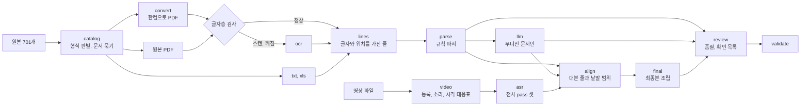
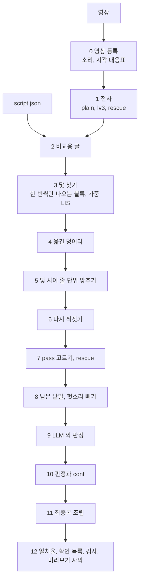

# sink: 문제 정의, 구현, 대본과 전사 맞추기

기준일 2026-11-15. 디스크 결과물(`catalog.csv`, `docs/`, `qa/needs_review.csv`, `films/`, `cache/`)로 셀 수 있는 수치는 이날 다시 셌다. 나머지(띄어쓰기·탭 손실, 대사 이어짐 규칙으로 바뀐 줄 수, 파서 정확도, turbo 와 large-v3 비교, Silero 말 확률, 창 단위 말 구간 실험, 대응표 교차상관 검증, 판정단 채점)는 2026-11-13~15 작업 보고의 측정값을 옮긴 것이다.
문서별 형식 분류는 `TYPES.md` 와 `types.csv`(규칙 파서 판 기준)에, 디스크에서 다시 센 수치 보고는 `REPORT.md` 에 있다. 셋 모두 2026-11-15 에 lines 0.4.1·parse 0.3.2 와 추격자 영상 쪽 결과를 반영해 다시 만들었다(생성기 `tools/make_types.py --rules`, `tools/make_report.py`).
형식의 정본은 `.omc/specs/deep-interview-sink-format.md`(아래에서 명세), 모듈 사이 약속은 `DESIGN.md` 다.

sink 는 영화 대본 파일 701개를 한 형식으로 통일하고, 영화마다 영상에서 실제로 들린 대사를 기준으로 한 최종 대본(`final.json`)을 만드는 작업이다.
대본 쪽 전처리는 끝나 문서 684개가 모두 `lines.jsonl` 과 `script.json` 을 갖고 있다.
영상 쪽 단계(영상 등록, 영상 전사, 맞추기, 최종본)도 구현했고, 영화 한 편(추격자, 문서 `fm55664`, 영화 `local_0270`)으로 처음부터 끝까지 돌렸다. 전사는 영상 소리를 받아쓴 글이고 명세에서는 받아쓰기라 부른다. 3장이 맞추기에서 구현한 방법이다.
영상 쪽은 대본 언어와 영상 언어가 같은 한국어 영화만 끝까지 간다. 외국어 줄의 번역(한글 칸)과 번역 대본을 뜻으로 맞추는 일은 구현하지 않았다. 그래서 시각 있는 대사 가운데 들린 글로 봐도 외국어인 줄(외국영화의 영상 등)이 남으면 `final` 이 `translation_unmatched` 로 멈추고, 그러면 `validate` 의 D1 이 실패해 `sinkprep all` 이 늘 1로 끝난다. 그때의 차례와 영상 등록 해제(`video --unregister`)는 2.2절에 있다.

| 구간 | 상태 |
|---|---|
| 대본 형식 통일(catalog, convert, ocr, lines, parse, review, validate) | 구현과 전체 실행 끝. lines 0.4.1, parse 0.3.2 |
| LLM 파싱 단계(llm) | 구현과 실행 끝. 기본 대상 38문서 가운데 37문서를 다뤄 29문서가 LLM 판. 새로 대상이 된 fm56307 1문서는 아직 부르지 않아 규칙 판 |
| 영상 등록, 전사(video, asr) | 구현. 추격자 1편 실행 |
| 맞추기, 최종본(align, final) | 구현. 추격자 1편 실행(LLM 짝 판정 덧단계 포함) |
| 번역(한글 칸), 번역 대본 맞추기 | 구현하지 않음 |

## 1. 문제 정의

### 1.1 풀려는 문제

세 가지 사실에서 출발했다.

1. 대본 파일은 형식이 제각각이다. 받은 파일 701개를 묶은 문서 684개의 실제 형식이 10가지(HWP3, HWP5, doc, docx, rtf, 글자층 PDF, 스캔 PDF, 열리지 않는 PDF, txt, xls)이고, 확장자와 실제 형식이 다른 파일이 4개 있다. 같은 형식 안에서도 대사를 적는 표기가 8가지다(이름 줄 아래 대사 371문서, 이름 탭 대사 185, 이름 쌍점 대사 87 등, `TYPES.md` 5절).
2. 대본과 영상은 다르다. 촬영과 편집을 거치며 대사가 바뀌고 씬이 빠지거나 자리를 옮긴다. 판본 표시가 있는 문서는 40개뿐이고 644개는 어느 판본인지 모른다.
3. 쓰는 쪽은 영상 기준이 필요하다. 자막은 들린 말로 만들어야 한다. 기존 CBoE 는 대본 줄을 기준으로 두고 들린 말은 차이로만 표시했으며 HWP3, doc, 스캔, 영어 대본을 읽지 못했다.

그래서 문제를 이렇게 정했다.

> 대본 원본 전부를 하나의 형식 체계로 바꾸고, 영화 1편마다 영상에서 실제로 들린 대사를 기준으로 한 최종 대본 하나를 만든다.
> 최종본은 들린 그대로의 대사와 자막용 한글을 담고, 대본에서 가져온 화자, 씬, 지문, 화면 글자, 연기 지시와 대본과의 차이를 표시한다.
> CBoE 같은 도구는 원본 대본 없이 `final.json` 만 읽고 동작해야 한다.

### 1.2 문제를 정한 과정

- **원본 표본 조사**(`notes/script_elements_survey.md`): 파일을 앞 바이트로 나누고 문서 30개를 읽어 요소 종류와 표기 변형을 셌다. 형식이 꼭 담아야 하는 까다로운 경우 11가지(한 대사에 화자 여럿, 화자 꼬리표 조합, 대본 언어와 영상 언어가 다름, 쪽 넘김으로 쪼개진 대사 등)가 여기서 나왔다.
- **형식 사전 조사**(`notes/format_landscape.md`): 대본, 자막, 정렬 형식 15개와 연구 데이터셋 6개의 저장 방식을 견줬다. 대본 구조, 실제 발화, 시간을 함께 담는 표준은 없었고, 연구 데이터셋은 맞추기에 실패한 부분을 대부분 기록 없이 버렸다. 그래서 층을 나눈 구조(ELAN 방식), 연산 표(Kaldi ctm-edits 방식), 사람이 읽는 최종본(Netflix 대사 목록 방식)을 섞기로 했다.
- **질문으로 좁히기**(명세의 Interview Transcript): 범위 확인 1회와 질문 11회로 한 번에 한 가지씩 정했다. 모호도 점수가 81%에서 19.4%로 내려가 기준인 20% 아래가 됐다. 이때 뒤집힌 가정은 아래와 같다.

| 처음 가정 | 정한 것 |
|---|---|
| 파일 제목을 먼저 통일해야 한다 | 원본 이름은 그대로 두고 카탈로그 ID 로 통일한다 |
| 최종본은 CBoE 형식에 맞춘다 | 형식이 기준이고 CBoE 가 이 형식에 맞춘다 |
| 받아쓰기와 연결표도 최종본에 넣는다 | 최종본은 그것만으로 완결이고 기록은 `work/` 에 따로 둔다 |
| 영상 기준이면 대본에만 있는 것은 버린다 | 지문, 씬, 화면 글자, 잘린 대사를 모두 넣고 표시한다 |
| 판본마다 결과를 만든다 | 영화 1편 = 최종본 1개 = 대본 1개 |
| 못 읽은 대본은 빼거나 보류한다 | 읽은 만큼 쓰고 확인 필요 목록으로 알린다 |
| 대사는 정리해서 적는다 | 들린 그대로 적고 차이는 종류로 기록한다 |
| 최종본 한 줄은 소리 기준 발화다 | 대본 대사 줄 하나가 한 줄이다 |
| 최종본 대사는 영상 언어만 담는다 | 한글 칸을 더한다. 들린 말을 번역하고 대본은 참고한다 |

### 1.3 결과물 네 덩어리

| 덩어리 | 파일 | 내용 | 지금 |
|---|---|---|---|
| 카탈로그 | `catalog.csv` | 문서 1개가 1행. 원본 파일, 실제 형식, 언어, 판본, 영화 ID, 대표 대본 여부, 영상 칸, 영상과의 일치율 | 712행. 영상 칸은 1편(추격자)만 채움 |
| 전처리 대본 | `docs/{doc_id}/lines.jsonl`, `script.json` | 형식 통일 줄(글자와 위치), 구조 파싱(요소 7종) | 684문서 |
| 정렬 중간 결과 | `films/{film_id}/work/asr.json`, `align.json` | 전사 기록, 연결과 판정 기록 | 1편 |
| 최종본 | `films/{film_id}/final.json` | 영상 기준 대본. CBoE 가 이것만 읽음 | 1편. 확인용 자막 `preview.srt` 를 곁에 둠 |

문제가 있는 문서, 영화, 줄은 `qa/needs_review.csv` 한 곳에 모은다.
등록한 영상(`videos/`)과 영화별 결과물(`films/`)은 영상 파일, 전사 전문, 대본 대사를 담고 있어 git 에 넣지 않는다. 반면 `catalog.csv` 의 영상 칸은 git 에 들어가므로, 영상과 전사 캐시가 없는 새 클론에서는 `validate` D1 이 실패한다(2.2절).

### 1.4 범위 밖으로 둔 것

- 영상 파일 확보. 사용자가 따로 구하고 `video` 명령으로 등록한다(2.2절).
- CBoE 코드 수정. `final.json` 을 읽게 바꾸는 일은 다음 작업이다(명세 4.9절 대응표가 그 입력).
- 자막 칸 나누기와 효과음 자막. CBoE 의 몫이다. `preview.srt` 는 맞춘 결과를 눈으로 보는 확인용이다.
- 사람이 고친 내용을 보존하는 체계, 공식 한글 자막 수집.

### 1.5 끝났는지 보는 기준

명세의 수락 기준 A(카탈로그), B(전처리 대본), C(정렬 중간 결과), D(최종본), E(공통)로 본다.
대본 쪽인 A1~A3, B1~B5, E1~E2 는 실제 결과물로 확인했다(`REPORT.md` 7절, `sinkprep validate`).
C1~C3, D1~D9 는 영상이 있는 영화 한 편(추격자)의 실제 `asr.json`, `align.json`, `final.json` 을 `validate` 가 검사한다. 2026-11-15 `sinkprep all` 기준 검사 1,378개(catalog, needs_review, 문서 684개의 두 파일, 예시 5개, 추격자 3개)가 통과했다.
영화가 한 편뿐이라 D1(영상이 있는 영화마다 `final.json`)도 한 편에 대한 확인이다. D9 는 대본에서 복사한 칸이 대본과 같은지까지 검사하고, CBoE 가 `final.json` 만으로 실제로 동작하는지는 CBoE 를 고치지 않아 확인하지 않았다.

## 2. 구현

### 2.1 흐름



대본 쪽 실행은 `.venv\Scripts\python -I -m sinkprep all` 한 줄이다. 단계마다 입력 지문을 남겨 바뀐 것만 다시 돈다.
`all` 은 catalog → convert → ocr → lines → parse → llm → asr → align → final → review → validate 차례다. 구독을 쓰거나 몇 시간 걸리는 일은 하지 않는다: llm 은 캐시에 있는 응답만 쓰고, asr 는 전사 모델을 열지 않고 캐시만으로 `asr.json` 을 조립하며, align·final 은 `work/asr.json` 이 있는 영화만 다룬다.
영상 등록(video)과 처음 전사는 `all` 밖에서 따로 돌린다(2.2절).

### 2.2 영상 쪽 실행

**명령 하나로 돌리기.** 대본 파일과 영상 파일을 주면 등록부터 미리보기 자막까지 한 번에 돈다.

```
sink-film.cmd "C:\경로\대본.hwp" "C:\경로\영상.mkv"
```

`sink-film.cmd` 는 저장소 맨 위에 있고 `.venv\Scripts\python -I -m sinkprep film` 을 부른다(배치 파일이라 `python` 을 앞에 붙이지 않고 바로 실행한다). 아래 차례 가운데 review 와 전체 validate 를 뺀 것(video → asr → align --llm → final → 그 영화의 결과 파일 검사 → `final_to_srt.py --absent`)을 차례로 돌고, 끝에 수치와 결과 위치를 찍는다.

- 두 인자는 순서가 바뀌어도 된다. ffprobe 로 영상 줄이 있는 파일이 영상이다.
- 대본은 파일 sha1 로 catalog 문서를 찾는다. 제외된 중복 문서면 원래 문서로, 대표 대본이 아니면 대표 대본으로 돈다. 파일 대신 doc_id(`fm847721`)나 제목을 줘도 된다.
- catalog 에 없는 대본 파일, 한국어가 아니거나 번역인 대본, 다른 영상이 이미 등록된 영화(`--force` 로 바꿈)는 아무것도 하지 않고 종료 코드 2로 멈춘다. 통일해 둔 문서에 없는 대본을 새로 넣는 길은 없다.
- 처음 받아쓰는 영상은 `--device` 를 주지 않으면 GPU 로만 시작한다. GPU 를 못 쓰면(여유 VRAM 부족, CUDA 라이브러리 없음) 받아쓰지 않고 까닭을 찍고 멈춘다. CPU 로 돌리려면 `--device cpu` 를 직접 준다.
- LLM 짝 판정은 기본으로 claude 를 부른다(`--no-llm` 이면 캐시만). 중간에 끊기면 같은 명령을 다시 친다. 끝난 단계는 건너뛴다.
- 이 명령은 가짜 백엔드 시험과 대본·영상 찾기까지만 확인했고(2026-11-15), 새 영화를 끝까지 돌린 기록은 아직 이 문서에 없다.

**단계를 하나씩 돌리기.** 영화 한 편을 처음부터 돌리는 차례다. `<영상 경로>` 는 영상 파일, `<doc_id>` 는 그 영화의 대본 문서, `<film_id>` 는 그 문서의 영화 ID 다. 둘 다 `catalog.csv` 에서 제목(`title_norm` 칸, 원본 파일 이름은 `files` 칸)으로 찾은 행의 `doc_id`·`film_id` 칸이고, 같은 영화의 문서가 여럿이면 `is_primary` 가 true 인 행을 쓴다. 추격자는 `fm55664`·`local_0270` 이다.

```
.venv\Scripts\python -I -m sinkprep video <영상 경로> --docs <doc_id> --lang ko
.venv\Scripts\python -I -m sinkprep asr --docs <doc_id> --passes plain=large-v3-turbo,lv3=large-v3 --rescue
.venv\Scripts\python -I -m sinkprep align --docs <doc_id>
.venv\Scripts\python -I -m sinkprep final --docs <doc_id>
.venv\Scripts\python -I -m sinkprep review
.venv\Scripts\python -I -m sinkprep validate
.venv\Scripts\python -I tools\final_to_srt.py <film_id> --absent
```

LLM 짝 판정(3.3절 9단계)까지 하려면 align 을 `--llm` 으로 돌리고 바로 캐시를 묶는다. `--llm` 은 캐시에 없는 창을 claude 로 묻고(구독 사용), 옵션이 없으면 캐시에 있는 판정만 쓴다.

```
.venv\Scripts\python -I -m sinkprep align --docs <doc_id> --llm
.venv\Scripts\python -I tools\llm_cache_zip.py pack
```

pack 이 갱신한 `data/llm_cache.zip` 은 결과와 함께 커밋한다. 빠지면 다른 PC 에서 그 판정이 빠져 `decisions_sha1` 이 달라지고 align.json·final.json 이 바뀐다.

- `video` 는 영상을 `videos/{film_id}{확장자}`(원본 확장자를 소문자로, 추격자는 `.mp4`)로 하드링크하고(안 되면 복사) 소리와 시각 대응표를 만든 뒤 catalog 영상 칸 넷을 채운다. 원본 영상은 옮기거나 고치지 않는다. `--lang` 은 영상 말소리 언어이고, 지역 꼬리가 붙은 값(`ko-KR`)은 기본 언어(`ko`)로 줄여 적는다.
- `asr` 는 옵션을 주지 않으면 그 영화를 앞서 받아쓴 값을 이어 쓴다. 중간에 끊기면 같은 명령을 다시 돌린다. 끝난 묶음은 캐시에 있어 건너뛴다. `--docs` 로 대표가 아닌 문서를 줘도 그 영화의 대표 문서로 돈다.
- `align` 은 catalog 에 일치율(match)과 `aligned` 를, `final` 은 `done` 을 적는다. `review` 가 확인 목록을 다시 쓰고, `validate` 가 C1~C3, D1~D9 를 검사한다.
- `final_to_srt.py` 는 `films/<film_id>/preview.srt` 를 쓴다. 영상 플레이어(팟플레이어, VLC 등)에서 영상을 열고 이 파일을 자막으로 불러와 맞춘 결과를 눈으로 본다. 글은 들린 그대로이고 화자 이름이 앞에 붙는다(앞 대사에서 이어받은 추정 화자는 `이름?:`). 대본에 없는 말은 `[+]` 가 붙는다. `--absent` 를 주면 영상에 없는 대본 대사가 앞 대사가 끝난 자리에 `[없음] 이름: 대본 글` 로 0.5~2초 끼어든다. 맞춘 두 줄 사이의 absent 는 한 자막으로 묶여, 둘까지는 한 줄씩, 셋 이상이면 첫 줄 아래에 `[없음] … 외 N줄` 로 나온다(추격자: absent 257줄이 자막 131개, 그 가운데 '외' 묶음 30개). 확인용이라 자막이 길거나 겹치는 곳이 있다(3.5절 알려진 문제).
- 영상을 등록한 영화는 `final.json` 까지 만들어야 `validate` 를 통과한다. D1 이 catalog 에서 영상이 있는 대표 문서마다 `films/{film_id}/final.json` 을 요구하고, `sinkprep all` 은 validate 의 종료코드를 그대로 돌려준다. 그래서 `final` 이 멈춘 영화(`translation_unmatched`, 낡은 align.json, 검사 실패)가 하나라도 있으면 `all` 이 1로 끝난다. `catalog.csv` 는 git 에 들어가고 `films/`·`videos/`·`cache/` 는 들어가지 않으므로, 커밋한 저장소를 새로 받은 곳에서는 영상과 전사 캐시를 옮겨 와 final 까지 다시 만들기 전까지 D1 이 '`films/local_0270/final.json` 이 없음'으로 실패한다.

**final 이 `translation_unmatched` 로 멈췄을 때.** final 은 시각 있는 대본 대사의 lang 이 영상 언어와 달라도 들린 글이 영상 언어 글자로 적혔으면(영상 언어가 ko 면 글자의 절반 이상이 한글) 그 줄을 영상 언어로 말한 줄로 둔다(3.3절 11단계). 그래도 외국어 줄이 남을 때만 멈춘다. 그때는 이렇게 한다.

1. `cache/problems/final/<film_id>.json`(또는 `review` 뒤 `qa/needs_review.csv` 의 영화 수준 행)의 detail 에서 시각 있는 대사 수와 언어별 외국어 줄 수를 본다. 대사 글은 적지 않으므로 어느 줄인지는 `work/align.json` 의 ops(`script_el`)를 `script.json` 요소의 lang 과 견줘야 하고, 이를 보여 주는 명령은 없다.
2. 대본의 언어 표시가 틀린 것이면 파서를 고쳐야 한다(문서 하나의 lang 을 손으로 고치는 명령은 없다). 실제로 외국어로 말한 줄이면 번역 단계가 생길 때까지 이 영화는 최종본을 만들 수 없다.
3. 그동안 이 영화를 영상 쪽에서 빼려면 등록을 지운다. 영화의 모든 문서 행에서 영상 칸 넷과 match 를 비우고, status 가 aligned·done 이면 parsed 로 되돌리고, asr·align·final 문제 기록을 지운다. `videos/<film_id>.*` 는 다른 하드링크가 있는 파일만 지우고, 링크가 하나뿐인 파일(링크를 못 해 복사한 사본이거나 원본 자체)은 `--force` 일 때만 지운다. `films/<film_id>/`, `cache/audio`, `cache/asr`, `cache/state` 는 남기고 남은 것을 출력한다.

```
.venv\Scripts\python -I -m sinkprep video --unregister --docs <doc_id>
.venv\Scripts\python -I -m sinkprep review
```

**전사 장치.** `--device auto`(기본)는 여유 VRAM 이 5000MiB 이상이면 GPU(cuda, float16), 아니면 CPU(int8)다. 여유 VRAM 은 PATH 에 있는 `nvidia-smi` 로 잰다. nvidia-smi 가 없거나 실패하면 여유를 0 으로 보아 경고 없이 CPU 로 간다(추격자 길이면 CPU 로 약 3시간). GPU 로 돌리려면 venv 에 CUDA 라이브러리가 있어야 한다.

```
.venv\Scripts\python -m pip install -e .[asr,asr-gpu]
```

`asr-gpu` 는 `nvidia-cublas-cu12` 와 `nvidia-cudnn-cu12`(9.x)다. 2026-11-15 에 설치한 판은 cublas 12.9.2.10, cudnn 9.28.1.4 다. `asr.py` 가 `site-packages/nvidia/*/bin` 을 DLL 찾는 길에 더한다. 이 패키지가 없으면 `Library cublas64_12.dll is not found` 로 cuda 를 열지 못한다. 그때 CPU 로 떨어지는 것은 장치가 `auto` 일 때뿐이고, `--device cuda` 이거나 단계 지문의 장치가 cuda 인 영화(추격자)는 오류(`AsrUnavailable`)로 멈춘다. ffmpeg 와 ffprobe 는 PATH 에 따로 있어야 한다.

| 장치 | 묶음 하나(평균) | 추격자 전체 |
|---|---|---|
| CPU int8 | turbo 약 5.2초, large-v3 약 7.2초 | plain 44분, lv3 약 62분, rescue 창 669개 합 77분(마지막 회차 612창 69분, 앞서 57창) |
| GPU cuda float16 | turbo 약 0.24초, large-v3 약 0.5초 | 세 벌 합쳐 780초(13분. 묶음 기록의 받아쓰기 시간 합 765초에 모델 올리는 시간) |

시간은 묶음 캐시 기록마다 남은 받아쓰기 시간(`seconds`)을 더한 값이다.
처음에는 다른 프로그램이 GPU 를 쓰고 있어 CPU 로 받아썼고, 그 뒤 GPU 로 다시 받아썼다. 지금 `asr.json` 과 그 뒤 결과는 GPU 판이다. GPU 경로는 이날 처음 실제로 돌렸다. 장치와 계산형이 묶음 캐시 폴더 이름에 들어가므로 두 판의 캐시는 따로 남는다(추격자는 CPU 판·GPU 판 모두 plain·lv3 묶음 514개와 rescue 창 669개가 빠짐없이 있다).

**장치를 바꾸면 asr.json 이 조용히 바뀐다.** asr.json 을 어느 판의 캐시로 조립할지는 그 실행에서 정해진 장치가 정한다. 추격자의 단계 지문(`cache/state/asr/local_0270.json`)은 `device=cuda` 다. `--device` 를 주지 않거나 `cuda` 로 주면 GPU 판이 그대로다. `--device cpu` 를 주거나, `--device auto` 를 줬는데 GPU 가 바쁘거나(여유 VRAM 5000MiB 미만) CUDA 라이브러리가 없어 cpu 로 풀리면, 지문이 달라져 다시 받아쓰지 않고 이미 있는 CPU 판 캐시로 몇 초 만에 asr.json 을 갈아 쓴다. 경고는 없고, 그 뒤 `all` 의 align·final 도 그 판을 따라 바뀐다. GPU 판을 지키려면 `--device` 를 주지 않거나 `cuda` 로 준다.
지문의 장치는 풀린 장치가 아니라 준 인자 글자다. 그래서 끝난 추격자에 `--device auto` 를 주면 auto 가 cuda 로 풀려도 지문(`cuda`)과 달라 다시 조립한다. 이때 asr.json 은 같은 GPU 판 캐시로 조립되지만, 묶음이 모두 캐시에 있어도 cuda 를 열어 보느라 모델을 GPU 에 한 번씩 올렸다 내린다. 그 뒤 지문의 장치는 `auto` 로 남아, 다음에 다시 조립할 일(`--force`, VERSION 변경)이 생기면 그때의 GPU 상태가 판을 정한다. 이 단락은 `asr.py` 를 읽어 확인한 것이고 실제로 돌려 보지는 않았다.

### 2.3 단계별 내용

| 단계 | 코드 | 하는 일 | 결과 |
|---|---|---|---|
| catalog | `catalog.py`, `detect.py` | 앞 바이트와 내부 구조로 실제 형식 판별, 압축 풀기, 파일을 문서로 묶기, 중복과 대본 아닌 파일 제외, 제목에서 판본 읽기 | 712행 = 문서 684 + 제외 28. 영화 638편 |
| convert | `convert.py`, `hancom_worker.py`, `hwp3text.py` | HWP3, HWP5, doc, docx, rtf 를 한컴오피스 자동화로 PDF 로 바꿈. 실패하면 대체 경로로 글자만 얻음. 변환 PDF 와 원본 글자를 견줘 빠진 글자를 검사 | 481개 파일(한컴 473, 대체 경로 8) |
| ocr | `ocr.py`, `textlayer.py` | 스캔 PDF 와 글자층이 깨진 PDF 만 OCR(RapidOCR, 300dpi) | 81개 파일 7,723쪽. 파일별 평균 신뢰도 중앙값 0.956 |
| lines | `lines.py` | 모든 경로의 글자를 물리적인 줄 1개 = 1행으로. 줄마다 쪽, x와 y 위치, 출처, OCR 신뢰도. 한컴 PDF 글자층에 띄어쓰기가 없던 파일은 원본 글에서 공백과 이름 뒤 탭을 되살림 | 2,163,497줄. 띄어쓰기를 되살린 문서 10개 |
| parse | `parse.py`, `parse_layout.py`, `parse_text.py` | 줄을 요소 7종(front, scene, action, dialogue, onscreen, transition, unknown)으로. 대사마다 화자, 들리는 방식, 언어, 괄호 지시를 나눔 | `script.json` 684개(규칙 파서 0.3.2 655, LLM 판 29). 대사 529,905개, 씬 87,309개 |
| llm | `llm.py`, `llm_parse.py` | 규칙 파서가 무너진 문서를 Claude 가 줄마다 라벨링하고, 요소 조립은 결정적인 코드가 함 | 기본 대상 38문서 가운데 37문서를 다뤄 29문서가 LLM 판, 8문서는 규칙 판 유지. fm56307 은 parse 문제(speaker_missing)로 새로 대상이 됐지만 캐시가 없어 `all` 에서 규칙 판으로 남았다(`sinkprep llm --docs fm56307` 로 부른다) |
| video | `video.py`, `media.py` | 영상을 `videos/` 에 잇고 소리를 꺼냄. 소리 시각과 영상 시각의 대응표. `--unregister` 로 등록 해제 | 1편. 추격자는 시각 틈 750곳, 합 42.088초 |
| asr | `asr.py` | 말 구간 검출, 25초 이하 묶음별 전사. pass 셋(plain, lv3, rescue) | 1편. 낱말 plain 4,012, lv3 4,104, rescue 270 |
| align | `textnorm.py`, `align.py`, `align_llm.py`, `timeline.py` | 대본 대사 줄마다 들린 낱말 범위를 찾고 same, changed, added, absent 를 판정 | 1편. 수치는 3.5절 표 |
| final | `final.py`, `timeline.py` | 대본 요소 전부를 시각 순서로 조립하고 쓰기 전에 스스로 검사 | 1편. `tools/final_to_srt.py` 로 확인용 자막 |
| review | `review.py` | 대본 언어, 번역 여부, 영화마다 대표 대본을 정하고, 품질 기준 아래 문서와 영화 쪽 문제를 목록에 올림 | 문서 수준 22건(22문서). 영화 쪽 항목 수준 행은 3.5절 표 |
| validate | `validate.py` | JSON Schema 와 의미 규칙 검사 | 검사 1,378개, 실패 0 |

문서가 어느 형식, 어느 경로, 어느 대사 표기로 갈렸는지는 `TYPES.md` 와 `types.csv` 에 문서별로 정리돼 있다(2026-11-15 판, lines 0.4.1·parse 0.3.2 반영. 다시 만들려면 `python -I tools/make_types.py --rules`).

### 2.4 구현에서 내린 판단

1. **확장자를 믿지 않는다.** 파일 앞 바이트와 내부 구조로 형식을 정한다. doc 확장자인 RTF 2개, 평문 1개, 알 수 없는 형식 1개를 이렇게 걸렀다.
2. **글자보다 위치를 먼저 지킨다.** 대본에서 이름, 대사, 지문을 가르는 단서는 들여쓰기다. 그래서 한글과 워드 파일에서 글자만 뽑지 않고 한컴오피스로 PDF 를 만들어 쪽 안 위치를 얻는다(파이썬 라이브러리는 HWP3 를 읽지 못한다). 문서 684개 중 471개가 이 경로다.
3. **변환 결과를 원본과 대조한다.** 한컴 2024 가 일부 문서에서 대사를 빠뜨린 PDF 를 만들었다. 대체 경로로 읽은 원본 글자 중 PDF 에 없는 비율을 재서, 1%를 넘으면 확인 목록에 올리고 3%를 넘으면 PDF 를 버리고 원본 글을 쓴다. 3개 문서가 1%를 넘었고 그중 2개는 PDF 를 버렸다. 띄어쓰기도 견준다. 원본의 낱말 경계 가운데 PDF 줄에 공백도 탭도 없는 비율이 0.15 를 넘는 파일(10문서)은 원본 문서 글에 맞춰 공백과 이름 뒤 탭을 되살린다. 글자, 줄 수, 위치는 그대로다.
4. **OCR 은 마지막 수단이다.** 글자층 글자가 OCR 보다 정확하다. 글자층 검사에서 걸려도 글자 좌표로 줄을 다시 만들어 해결되면 OCR 하지 않는다.
5. **줄은 추출한 그대로 두고 정리는 줄 번호로 한다.** 머리말 지우기와 줄 합치기는 `script.json` 에서 줄 번호를 가리켜 처리한다. 모든 줄이 요소 하나 또는 버린 줄 목록에 정확히 한 번 속하므로, 어떤 요소든 원본 줄까지 거슬러 갈 수 있다.
6. **파서는 문서마다 통계로 역할을 정한다.** 고정 좌표나 문서 번호 특례를 쓰지 않는다. 그 문서의 들여쓰기 단계를 구하고, 확신이 높은 표기(이름 탭 대사 등)에서 인물 이름을 모아 확신이 낮은 표기를 읽는 데 쓴다. 설계는 `notes/parser.md`.
7. **못 읽어도 멈추지 않는다.** 종류를 못 정한 줄은 `unknown` 으로 남기고, 품질 지표가 기준 아래인 문서는 목록으로 알린다.
8. **규칙으로 안 되는 꼴은 LLM 이 읽되 결과가 늘 같게 한다.** 모델 ID 를 고정하고 응답을 캐시해, 다시 돌려도 바이트 단위로 같은 결과가 나온다. 대본 글은 신뢰할 수 없는 입력이라 도구를 모두 끄고 부른다.
9. **정확도는 따로 만든 정답 표본으로 잰다.** 구간 18개 790줄을 Claude 서브에이전트(claude-opus-5-5) 둘이 따로 표시하고, 갈린 줄은 셋째 서브에이전트가 판정했다. 사람이 붙인 정답이 아니다. 파서 개발 중에 보지 않은 확인용 180줄을 따로 뒀다. 규칙 파서가 무너지는 꼴의 구간 8개(360줄)도 같은 방법으로 만들었다. LLM 단계도 같은 모델이라, LLM 판의 채점은 같은 모델이 붙인 정답과 견준 값이다.
10. **원본은 읽기 전용이다.** 원본 폴더에는 쓰지 못하게 막았고, 내려받은 파일이라 파이썬은 늘 `-I`(격리 모드)로 돌린다. 모든 파일은 임시 파일에 쓴 뒤 바꿔치기한다.

### 2.5 결과

| 항목 | 값 |
|---|---|
| 문서 | 684개(한국영화 394, 외국영화 290). 영화 638편 |
| 대본 언어 | ko 404, en 274, mixed 4, es 1, fr 1. 번역 대본 13개 |
| 글자를 얻은 경로(문서 기준) | 한컴 변환 PDF 471, 원본 PDF 글자층 105, OCR 80, 평문 19, 대체 경로 글 8, 엑셀 1 |
| 요소 종류별 줄 비율 | 대사 58.1%, 지문 36.4%, 씬 4.2%, 전환 0.6%, 앞머리 0.5%, 화면 글자 0.1%, unknown 0.0% |
| 파서 정확도(규칙 파서, 전체 790줄) | 요소 종류 98.4%, 화자 97.8% |
| 파서 정확도(규칙 파서, 확인용 180줄) | 요소 종류 98.3%, 화자 98.3% |
| 정답 표본의 출처 | Claude 서브에이전트 둘이 따로 표시하고 셋째가 갈린 줄을 판정(2.4절 9). 위 두 줄은 이 정답에 대한 값 |
| 추격자 대본(원본 HWP 문단 구조와 대조) | 말 차례 1,034개의 화자 전부, 씬 195개 일치. 규칙을 이 문서의 참값을 보며 고쳤으므로 일반화 근거는 아니다 |
| 확인 필요(문서 수준) | 22건(22문서): other 9, parse_low_dialogue 7, speaker_missing 4, extract_broken 2 |
| 검사 | 1,378개 실패 0 |

### 2.6 남은 문제

- **규칙 파서가 무너지는 꼴.** 가운데 정렬 이름과 여백 대사, 이름이 붙은 OCR 대사, 두 언어 병기 같은 꼴을 모은 개발용 표본 180줄(2.5절의 확인용 180줄과 다른 표본)에서 규칙 파서 정확도가 종류 75.6%, 화자 62.9%로 떨어진다. LLM 단계가 이 문서들을 다시 읽으며, 같은 180줄에서 100%, 100%가 나왔다. 이 표본은 LLM 단계를 만들 때 쓴 것이라 독립 확인 수치는 아니다(`notes/llm_parse.md`). 지금 29문서가 LLM 판이다.
- **문턱 아래 문서의 띄어쓰기·탭 손실.** 띄어쓰기를 되살린 것은 손실이 문턱(0.15)을 넘은 10문서뿐이다. 이름 뒤 탭이 공백이 된 줄이 20줄 이상인 문서가 48개(8,678줄), 띄어쓰기가 통째로 사라진 줄이 27문서 405줄 남아 있다(2026-11-15 측정). 넓히면 그 문서들의 줄 행과 대사 요소가 바뀌므로 손대지 않았다.
- **대사 이어짐 규칙(`tight_cont`).** 지문 앞에 늘 빈 줄을 두는 문서에서 대사 바로 아래 붙여 쓴 들여쓴 줄을 앞 대사의 이어짐으로 본다. 규칙이 켜진 문서는 46개(지금 `docs/` 의 규칙 판 44개와 LLM 판으로 바뀐 2개. 켜진 문서는 `quality.notes` 에 `대사 이어짐:` 이 남는다)이고, 그 가운데 줄이 실제로 바뀐 39문서에서 2,857줄이 지문에서 대사로 간다. 무작위 70줄을 읽어 모두 이어지는 말이었지만 정답 표본에 이 줄들이 없어 수치 근거는 없다. 넣어 둔 채 결정을 기다린다.
- **대사 언어.** parse 0.3.1 까지는 괄호 지시의 동사 '일어서며'·'일어나며' 등을 일본어 표시로 읽어, 한국영화의 한국어 대표 대본 368개 가운데 248개에 lang 이 ko 가 아닌 대사가 2,460줄(ja 1,121, en 1,074 등) 있었고 그 가운데 동사 오판이 337줄이었다. parse 0.3.2 는 언어 이름이 낱말로 서 있을 때만 언어 표시로 본다(DESIGN.md 'parse 0.3.2'). 지금은 141문서 2,121줄(en 1,073, ja 783, zh 125, ru 72, de 44 등)이 남고, 출처를 되짚어 세면 진짜 언어 표시 581줄과 대본 글자로 정한 줄 1,540줄이며 동사 오판은 0이다. 최종본은 시각 있는 대사의 들린 글이 한글 과반이면 lang 을 ko 로 두므로(3.3절 11단계), 외국어 lang 인 줄이 영상과 맞춰지고 들린 글도 한글 과반이 아닐 때만 그 영화가 `final` 에서 멈춘다. 대본 글 자체가 외국 글자인 줄이 있는 111문서(1,586줄)가 그런 후보이고, 실제로 멈추는지는 그 영화를 받아써야 안다. 이 규칙도 한계가 있다: 영어로 말했는데 받아쓰기(영상 언어로 고정)가 한글로 적은 줄은 ko 가 되어 번역 대상에서 빠지고, 들린 글이 숫자뿐인 줄은 판정하지 못해 대본 lang 이 남는다. 추격자는 대사 1,034개가 모두 ko 이고 `quality.lang_from_heard` 는 0 이다.
- **영화 대본이 아닌 문서.** 684문서에는 시놉시스, 드라마 회차, 자막 받아쓰기 같은 문서 8개가 들어 있다(`TYPES.md` 4절). 위의 영화 수와 대사 수에는 이 문서들도 들어 있다.
- **영화 ID.** 638편 모두 임시 ID(`local_`)다. KMDb 와 TMDB 조회를 하지 않았으므로, 영상과 짝지을 때 제목과 연도로 확인해야 한다. 임시 ID 는 차례 번호(`local_{i:04d}`, 문서 번호 순)라 catalog 를 다시 만들 때 원본 문서가 늘거나 줄면 번호가 밀린다. 그러면 `carry_over` 가 film_id 가 바뀐 문서에 영상 칸·match·status 를 넘기지 않아 영상 등록이 catalog 에서 소리 없이 빠지고, 영상 쪽 단계가 그 영화를 대상에서 뺀다. 옛 `films/local_XXXX` 는 이제 다른 영화의 ID 가 된다. 그때는 `video` 로 다시 등록하고 옛 `videos/`, `films/`, `cache/state/*/{film_id}.json` 을 정리해야 한다.
- **대표 대본.** 같은 영화에 문서가 둘 이상인 영화가 41편(87문서)이다. review 는 영상과 맞춰 본 문서(match 있음)를 먼저 고르지만, align 은 지금 대표 문서 하나만 맞추므로 판본 여럿을 맞춰 일치율로 고르는 흐름은 아직 없다.

## 3. 대본과 전사 맞추기 (구현한 방법)

2026-11-13 의 계획을 바탕으로 구현했고, 추격자로 돌리며 여러 곳을 바꿨다. 바꾼 곳은 3.3절 끝에 까닭과 함께 적었다.

### 3.1 무엇을 맞추나

입력은 두 가지다.

- **대본**: `script.json` 의 대사 약 53만 개. 대사마다 화자, 들리는 방식(화면 안, 화면 밖, 내레이션, 전화 등), 언어, 괄호 지시를 뗀 말, 속한 씬이 있다.
- **전사**: `asr.json` 의 pass 여럿. pass 하나는 같은 방식으로 받아쓴 낱말 열이고, 낱말마다 번호, 글자, 시작 시각, 끝 시각, 확률이 있다. 추격자는 plain(large-v3-turbo), lv3(large-v3), rescue(말 구간 검출이 놓친 곳) 셋이다.

출력은 대본 대사 줄마다 영상의 어느 구간에서 어떤 말로 들렸는지다. 대사 한 줄은 아래 넷 중 하나가 된다.

| status | 뜻 | 시각 | 화자 |
|---|---|---|---|
| same | 띄어쓰기와 문장부호를 빼면 대본과 같다 | 있음 | 대본에서 |
| changed | 대본과 다르다(군말만 달라도). 차이 조각마다 종류를 적는다 | 있음 | 대본에서 |
| added | 대본에 없는 말 | 있음 | 모름 |
| absent | 영상에 없는 대본 대사 | 없음 | 대본에서 |

명세에 있는 뜻으로 맞추기(`match=translation`, 번역 대본용)는 구현하지 않았다. 지금 모든 줄은 글자로 맞춘다(`match=text`).

명세에서 이미 정한 원칙이 방법을 묶는다.

- 글자의 기준은 영상이다. 대본은 화자, 씬, 지문을 주고 맞출 자리를 찾는 참고로만 쓴다. 들린 글자(`heard`)는 언제나 어느 한 pass 의 이어진 낱말 범위 그대로이고, 대본 글을 `heard` 로 쓰지 않는다.
- 한 줄은 대본 대사 줄 하나다. 전사가 몇 조각으로 흩어져도 대본 줄 단위로 모은다. 다만 한 줄의 낱말 범위는 한 pass 안에서 이어져야 한다.
- 맞지 않는 곳을 버리지 않고 기록한다. 선행 데이터셋(LSMDC 등)은 맞지 않는 문장을 임계값으로 걸러 버렸다(`notes/format_landscape.md`).
- 전사 기록과 연결 기록을 따로 둔다. 같은 `asr.json` 과 받아쓰기 묶음 캐시(`cache/asr`), LLM 캐시(`cache/llm`, 9단계 판정)로 맞추기만 다시 돌릴 수 있다. 맞추기는 버릇 글귀(8단계)를 묶음 캐시의 rescue 창 기록에서 읽으므로, 그 캐시나 asr 단계 지문이 없으면 버릇 글귀 거르기가 조용히 빠진 다른 `align.json` 이 나온다.

### 3.2 어긋나는 이유와 대응

| 어긋남 | 이 말뭉치에서 | 대응 |
|---|---|---|
| 판본 차이: 씬이 잘리거나 자리를 옮기고 대사가 바뀜 | 644문서가 판본 모름 | 영화 전체의 닻 사슬로 뼈대를 잡고(3단계), 사슬 밖 블록에서 옮겨진 덩어리를 찾음(4단계). 잘린 대사는 absent |
| 현장에서 더한 말, 군말, 더듬기 | 모든 영화 | added. 대본 줄에 근거가 있거나 아주 짧을 때만 옆 줄에 붙이고 changed 에 차이 종류(filler, repeat)로 기록 |
| 전사 오류: 이름, 고유명사, 겹친 말, 음악 속 대사 | 모든 영화 | 두 전사 모델의 글 가운데 줄마다 대본에 더 닮은 쪽을 고름(7단계). 자모가 닮은 짝을 다시 짝지음(6단계). 들린 글자는 전사 그대로 둠 |
| 말 구간 검출이 놓친 대사: 조용한 말, 흐느낌, 소음 속 말 | 추격자에서 확인 | 소리 전체를 창 두 벌로 다시 받아쓴 rescue pass(1단계) |
| 전사 헛소리: 자막 제작 문구, 방송 인사말 | 추격자의 말 없는 구간에서 확인 | rescue 에서 여러 창에 똑같이 나온 글귀(버릇 글귀)를 버림(1단계). added 로 남을 낱말 가운데 자막 제작 문구와 버릇 글귀는 added 로도 만들지 않고 `method.noise_dropped` 에만 기록(8단계). 인사말·되풀이 꼴 added 는 conf 를 낮춤 |
| 짧고 되풀이되는 대사(네, 응, 뭐) | 모든 영화 | 3글자 이하 줄은 글자가 그대로 같아야 하고, 대본 이웃 줄이 맞춰져 20초 안에 있을 때만 남김. 다시 짝짓기에서는 그 말이 창에 우연히 있을 기대 횟수가 낮을 때만 받음(6단계) |
| 영상 소리 시각의 틈 | 조각을 이어 붙인 영상(추격자 750곳) | 대응표로 소리 시각을 영상 시각으로 옮김(0단계) |
| 대본 언어와 영상 언어가 다름 | 번역 대본 13개, 두 언어 섞인 문서 4개. 번역이 아니어도 다를 수 있음(불어 대본에 영어 대사인 추락의 해부) | 번역은 구현하지 않음. 시각 있는 대사의 들린 글이 영상 언어 글자면 영상 언어 줄로 두고(대본의 언어 표시가 틀렸거나 배우가 영상 언어로 말함), 그래도 한국어 아닌 줄이 남으면 그 영화의 최종본은 만들지 않고 `translation_unmatched` 로 알림 |
| 소리가 없는 요소: 지문, 씬 머리, 화면 글자, 전환 | 줄의 약 42% | 맞추기에서 빼고, 앞뒤 대사 시각으로 추정 |
| 장면과 따로 움직이는 말: 내레이션, 노래 | 내레이션 약 4,600개 | 따로 다루지 않음. 다른 대사와 같이 맞춤 |
| 대본 쪽 읽기 오류 | 확인 필요 22문서, 화자를 추정한 대사 약 1,250개 | 추정 화자는 최종본에서 `speaker_from=unknown`. 일치율이 낮으면 확인 목록 |

### 3.3 방법



3~6단계는 pass 마다 따로 돌고, 7단계가 줄마다 pass 를 고른다.

0. **영상 등록과 시각.** 결과물의 모든 시각은 영상 시각(컨테이너 PTS − 컨테이너 시작 시각)이다. 플레이어와 자막이 쓰는 시각이고 catalog 의 영상 길이와 같은 기준이다. 추격자 영상은 약 10초 조각의 경계 750곳에서 소리·영상 PTS 가 0.047~0.067초씩 건너뛴다(합 42.088초). 그래서 컨테이너 길이는 7548.093초인데 실제 소리는 7506.005초다. 소리는 틈을 메우지 않고 꺼내고(무음을 끼우면 낱말 한가운데 구멍이 생긴다), 패킷 표로 만든 대응표로 소리 시각을 영상 시각으로 옮긴다. 대응표 검증에 실패할 때만 틈을 무음으로 메워 뽑는다. 메워 뽑은 소리와 교차상관으로 따로 견줘 보니 구간 748개의 어긋남이 −0.007~+0.008ms 였다(2026-11-15 작업 중 따로 잰 값이다. 검증 스크립트와 기록은 저장소에 남기지 않았다).
1. **전사.** 말 구간을 찾고(faster-whisper 에 든 Silero, 문턱 0.35) 25초 이하 묶음으로 묶어 묶음마다 따로 받아쓴다. CBoE 에서 faster-whisper 의 `vad_filter` 가 무음 뒤 첫 낱말의 시각을 앞 구간 끝에 붙이는 것을 확인해서, `vad_filter` 는 쓰지 않고 말 구간 검출을 직접 돌린다. 앞 글 조건과 힌트도 주지 않는다. pass 는 셋이다.
   - `plain`: large-v3-turbo. 기준 pass.
   - `lv3`: large-v3 로 같은 묶음을 받아쓴 대안 후보.
   - `rescue`: 소리 전체를 약 25초 창 두 벌로 다시 받아쓴다. 두 벌은 경계가 서로 엇갈리고 경계를 조용한 곳에 둔다. plain 묶음 밖에서 두 벌이 같은 시각에 닮은 글을 낸 조각만 남긴다. 헛소리는 창이 달라지면 같은 시각에 같은 글로 다시 나오지 않기 때문이다. 여러 창에서 똑같이 나온 버릇 글귀(자막 제작 문구, 방송 인사말)는 버린다.

   묶음 결과는 캐시에 남아 끊겨도 이어 하고, 같은 캐시면 `asr.json` 이 바이트까지 같다. 추격자는 말 구간 1,156개(합 약 1,895초), 묶음 514개다. 낱말은 plain 4,012개(평균 확률 0.765), lv3 4,104개(0.786), rescue 270개(0.688)다.
2. **비교용 글.** 같은지 판정하는 열쇠와 자리를 찾는 글을 나눈다(`textnorm.py`). 열쇠는 NFC, 영문 소문자, 공백·문장부호·기호를 뺀 글자열이고 same 판정에만 쓴다. 숫자에 붙은 소수점, %, 숫자 줄 사이 경계는 열쇠에 남긴다(1.5 와 15 는 다른 글). 자리 찾기 글은 숫자와 짧은 영문 약어를 맞은편 글에 있는 읽는 꼴로 바꾼다(2시 / 두 시, TV / 티비). 대본 쪽은 대사의 말(괄호 지시 뗀 `text`)만 쓰고, 글자가 없는 대사(말줄임표나 지시뿐인 차례)는 맞추기에서 뺀다.
3. **닻 찾기.** 대본 대사를 차례로 이은 글과 전사 글에서 양쪽에 한 번씩만 나오는 k-gram 블록을 씨앗으로 찾고(영화 전체에서는 5글자 조각만 쓰고, 4·3글자 조각은 대본 글자 수 × 전사 글자 수가 작은 좁은 틈에서만 쓴다), 대본 순서와 영상 순서가 함께 늘어나는 사슬 가운데 일치 글자 합이 가장 큰 것을 영화 전체의 뼈대로 고른다(가중 LIS). 같은 내용이 두 번 든 대본처럼 하나뿐인 조각이 거의 없으면 더 긴 조각을 몇 번 나와도 씨앗으로 쓴다. 전체를 최소 편집 거리로 한 번에 맞추지 않는다. CBoE 에서 그 방식이 놓친 줄을 엉뚱한 글자와 짝짓는 것을 확인했다.
4. **자리 옮긴 덩어리.** 뼈대에 못 든 블록에서 다시 사슬을 뽑아, 가까이 모인 블록의 일치 글자 합이 20 이상이면 옮겨진 덩어리로 받아들인다. 씬이 아니라 블록 단위로 찾는다.
5. **닻 사이 줄 단위 맞추기.** 이웃한 닻 사이에서 줄마다 이어진 낱말 범위 후보의 정확히 맞은 글자 수(LCS)를 재고, 순서를 지키며 합이 가장 큰 짝을 고른다(DP). 1~3글자 줄은 글자 그대로 같아야 하고, 4~7글자 줄은 맞은 글자 60% 이상, 8글자 이상은 40% 이상이고 둘 다 글자 닮음 0.4 이상이어야 받는다. 8글자 이상 이어진 닻 블록이 있으면 20%로도 받는다(줄의 일부만 말한 경우). 1~3글자 줄은 대본 이웃 줄이 맞춰져 20초 안에 있을 때만 남긴다.
6. **다시 짝짓기.** 맞춘 두 줄 사이 창에서 못 맞춘 줄과 남은 낱말을 순서대로 다시 짝짓는다. 같은 뜻의 짧은 대답(예/네, 응/어, 아니요/아뇨), 자모가 닮은 줄, 줄의 일부만 말한 줄을 받는다. 짧은 말은 그 창에 우연히 있을 기대 횟수가 낮을 때만 받고, 조금 흔한 말은 이웃 맞춘 줄에서 20초 안일 때만 받는다. 이웃 줄과 순서만 바꿔 말한 줄도 되찾는다.
7. **pass 고르기와 rescue.** 기준(plain)과 대안(lv3)을 따로 맞춘 뒤 줄마다 고른다. 기준이 대본과 같으면 기준, 대안이 같으면 대안, 둘 다 다르면 대안이 대본과 0.02 넘게 더 닮을 때만 대안이다. 견주기 전에 두 범위를 서로 같은 소리만큼 넓히고, 욕설을 가려 적은 후보('X됐다', 자음만 적은 꼴)는 다른 후보가 있으면 고르지 않는다. 두 pass 모두 대본을 보지 않은 받아쓰기라 대본 쪽으로 끌린 후보가 없으므로 소리 점수 없이 규칙으로 정한다(`decided_by=rule`). 한 번 난 소리는 한 줄에만 담는다. rescue 낱말은 아무도 못 맞춘 줄을 찾는 데 쓰고, 줄에 안 쓰인 rescue 낱말은 기준 pass 가 받아쓰지 않은 곳에 있을 때만 added 가 된다. 그 뒤 고른 줄 사이 창에서 기준과 rescue 의 남은 낱말로 한 번 더 다시 짝짓는다.
8. **남은 낱말과 헛소리 빼기.** 고른 줄에 쓰이지 않은 기준·rescue 낱말은 대본 줄과 더 닮아질 때, 또는 그 줄의 안 맞은 쪽 글자 수 + 2글자 이하로 이어져 있을 때만 옆 줄에 붙이고, 나머지는 0.8초 쉼에서 잘라 added 로 남긴다. added 로 남을 낱말 가운데 자막 제작 문구(`textnorm.NOISE_CREDIT` 이 걸린 낱말과 바로 뒤의 짝말, 'by' 와 그 뒤 이름)와 그 영화의 버릇 글귀(1단계 rescue 가 찾은 글귀와 글자 닮음 0.8 이상인 이어진 범위)는 added 로 만들지 않고 `align.json` 의 `method.noise_dropped` 에만 남긴다. 이 낱말은 `final.json` 에 나오지 않는다. 문구 뒤에 이어 받아써진 말은 added 로 둔다.
9. **LLM 짝 판정.** 규칙으로 못 짝지은 줄(소리만 닮았거나 바꿔 말한 줄)과 맞춘 줄에서 떨어진 머리·꼬리를 claude 가 글로 판정하는 덧단계다(`sinkprep align --llm`, `align_llm.py`). 이웃한 두 맞춘 줄 사이 창을 묶어 묻고, 답은 번호와 열거값만 받는다. 확신(sure)한 판정 가운데 구조 제약(한 pass 안 이어진 범위, 그 창의 낱말, 판정끼리 안 겹침, 대본 차례와 시각 차례가 맞음, 다른 pass 의 줄과 같은 소리가 아님)을 지키는 것만 받아들이고 `decided_by=llm` 으로 적는다. 모델을 고정하고 응답을 캐시하며, `all` 은 캐시만 쓴다. 추격자에서는 claude 를 11번 불러 줄 23개와 떨어진 머리 7개, 꼬리 5개를 받아들였다(3.5절).
10. **판정과 conf.** 열쇠가 같으면 same, 다르면 changed 이고 차이 조각마다 종류를 붙인다. 종류는 틀림없을 때만 붙인다: 같은 수를 달리 적은 것만 number, 소리가 같거나 굳은 표기 흔들림만 spelling, 그 자리에서 군말인 것만 filler, 남은 말을 되풀이한 것만 repeat, 나머지는 word. conf 는 같은 줄의 글자 닮음과 낱말 확률을 반씩 섞고, 다른 pass 가 같은 글을 적었으면 올리고 다른 글이면 낮춘다. LLM 이 정한 줄은 소리를 듣지 않은 판정이라 0.8배로, LLM 이 헛소리로 본 낱말이 절반 이상인 added 는 0.3배로 낮춘다. absent 의 conf 는 그 줄이 있을 만한 시간 창에 설명 안 된 말이 얼마나 있는지로 낮춘다. 글자가 없는 대사는 absent 로 두고 conf 를 비운다. 계산식은 `align.json` 의 `method.conf` 와 `final.json` 의 `made.conf` 에 글로 남는다.
11. **최종본 조립.** 대본 요소 전부(scene, action, dialogue, onscreen, transition)가 정확히 한 번씩 시각 순서로 나온다. 대사 아닌 요소는 대본 순서로 앞뒤 대사 사이를 글 길이에 비례해 나눈 추정 시각이고(`estimated`), 한 씬의 요소는 그 씬의 대사 덩어리 곁에 둔다. absent 줄은 시각 없이 대본 순서로 앞뒤 항목 사이에 끼운다. added 줄의 씬은 시각상 앞뒤 대본 대사의 씬 가운데 쉼으로 잰 거리가 가까운 쪽이다. 낱말 시각은 글자와 차례를 두고 넷만 바로잡는다: 영상 길이를 넘은 시각은 영상 끝으로, 앞 낱말보다 이른 시작은 앞 낱말의 시작으로, 시작보다 이른 끝은 시작으로 맞추고, 줄 전체가 한 순간이면 끝을 0.02초 늘린다. 바로잡은 줄 수는 `quality.time_fixed` 에 남고, 네 규칙은 `made.timing` 에 적힌다. 화자, 들리는 방식, 괄호 지시, 노래와 겹침 표시는 대본 요소에서 복사한다. 앞 대사에서 이어받은 추정 화자는 `speaker_from=unknown` 으로 둔다. 줄 언어(lang)도 대본 요소에서 오지만, 시각 있는 대본 대사는 글자의 기준인 영상을 따른다. 대본 lang 이 영상 언어와 달라도 들린 글이 영상 언어 글자로 적혔으면(글자 가운데 영상 언어 글자가 절반 이상, `textnorm.spoken_lang`) 영상 언어로 두고, 그런 줄 수를 `quality.lang_from_heard` 에, 줄마다 항목 수준 other 를 확인 목록에 남긴다. absent 는 대본 lang 그대로, added 는 영상 언어다. 한국어 줄의 한글 칸은 들린 말 그대로다(`ko = heard`). 외국어 줄의 번역은 구현하지 않았으므로, 그래도 시각 있는 대사에 lang 이 ko 가 아닌 줄이 하나라도 남으면 그 영화는 최종본을 만들지 않고 `translation_unmatched` 를 남긴다. 쓰기 전에 임시 파일을 `validate` 로 검사해 통과해야 `final.json` 이 된다.
12. **일치율, 확인 목록, 검사, 미리보기.** 일치율은 same·changed 줄에서 대본 글자와 정확히 맞은 글자 수의 합을 말 있는 대본 대사 전체의 글자 수로 나눈 값이다. `catalog.csv` 의 `match`, `align.json` 의 `method.stats.match`, `final.json` 의 `film.script.match` 가 같은 값이다. 일치율이 0.3 아래면 `version_mismatch`, 말 있는 대사의 absent 비율이 0.5 위면 `absent_many`, conf 가 0.2 아래인 줄은 항목 수준 `asr_low_conf`(영화당 50개까지)로 확인 목록에 올린다. `validate` 가 수락 기준 C1~C3, D1~D9 를 검사하고, `tools/final_to_srt.py` 가 확인용 자막을 만든다.

**계획과 다르게 한 것.**

- **소리 점수로 후보를 고르지 않는다.** 계획은 전사, 대본 문맥을 준 재전사(ctx), 대본 글을 후보로 놓고 음향 모델 점수로 고르는 것이었다. 실제로는 대본을 보지 않은 두 전사 모델(turbo, large-v3)의 글을 줄마다 규칙으로 고른다. 같은 묶음 24개(CPU)에서 대본과의 4글자 조각 겹침이 turbo 40.1%, large-v3 43.1%로 차이가 작았고, 둘이 서로 다른 곳에서 틀렸으며, large-v3 는 욕설을 'X됐다' 꼴로 가려 적는 버릇이 있었다. 그래서 한쪽으로 갈아타지 않고 줄마다 고른다. 두 후보 모두 대본에 끌리지 않았으므로 대본에 더 닮은 쪽을 고르는 규칙이 대본 글을 들린 글로 둔갑시키지 않는다. 대본 글은 후보로만 기록하고 고르지 않는다.
- **ctx pass 를 만들지 않았다.** 대본을 문맥으로 준 재전사는 대본 쪽으로 끌려 실제로 다르게 말한 곳을 대본대로 적을 수 있어, 소리 점수 없이는 믿고 쓰기 어렵다. `align.py` 에는 ctx pass 를 받으면 낱말 확률로 견주는 갈래(`decided_by=acoustic`)가 있지만, pass 를 만드는 코드는 없고 그 갈래는 가짜 영화로만 시험했다.
- **강제 정렬을 따로 돌리지 않는다.** 들린 글자가 언제나 전사 낱말 그대로이므로 낱말 시각도 전사의 시각(Whisper cross-attention DTW)을 그대로 쓴다. 강제 정렬을 돌리지 않고 DTW 시각을 쓴다는 것은 `align.json` 의 `method.forced` 와 `final.json` 의 `made.timing` 에 적는다. 묶음 첫 낱말의 시작이 잘라 낸 조각 맨 앞에 붙어 나오는 성질만 묶음 시작 + 0.05초로 당겨 고치고, 이 보정은 `asr.json` 의 `passes[].model` 문자열(`firstword +0.05`)에 적는다.
- **rescue pass 를 더했다.** 계획에 없던 것이다. Silero 를 영화 전체에 한 번에 돌리면 상태가 끌려가 조용한 대사를 놓친다. 같은 소리의 말 확률이 영화 처음부터 돌리면 0.075, 그 자리부터 돌리면 0.879 였다. 묶음 규칙을 바꾸면 끝난 전사를 다시 해야 하므로 plain 의 말 구간은 그대로 두고 rescue 로 되찾는다. 창마다 말 구간 검출을 새로 돌려 헛소리를 거르는 방법은 실험해 보고 버렸다. 진짜 대사 조각의 20%도 거기서 말로 잡히지 않았다.
- **옮긴 씬을 씬 단위가 아니라 블록 덩어리로 찾는다.** 계획은 사슬에 못 든 대본 씬을 따로 견주는 것이었다. 실제로는 씬 경계를 쓰지 않고 영화 전체의 닻 사슬 밖 블록에서 덩어리를 찾는다. 씬 경계는 대본 파싱에 달려 있는데(추격자도 수리 전에는 씬 머리 53개를 놓쳤다), 덩어리 방식은 씬 파싱이 틀려도 돈다.
- **닻 사이를 글자 편집 연산이 아니라 줄 단위로 맞춘다.** 줄마다 이어진 낱말 범위를 후보로 두므로 범위가 처음부터 이어져 있고, 놓친 줄이 엉뚱한 글자와 짝지어지지 않는다.
- **다시 짝짓기를 더했다.** 짧은 대답 같은 말 묶음, 자모 닮음, 줄의 일부만 말한 경우는 계획의 닻·줄 맞추기만으로는 absent 와 added 로 갈렸다.
- **남은 낱말 붙이기에 한도를 뒀다.** 명세의 '이웃 줄에 붙어 있으면 그 줄에 넣는다'는 근거가 있거나 한도(안 맞은 쪽 글자 수 + 2) 안일 때만 지킨다. 다른 화자의 말을 붙이는 것보다 added 로 남기는 쪽을 택했다.
- **헛소리 낱말은 added 로도 만들지 않는다.** 명세는 대본에 없는 말을 붙어 있는 줄에 넣거나 새 줄(added)로 만든다고 정한다(명세의 '한 줄 = 대본 대사 줄 하나' 원칙). align 0.4.0 은 자막 제작 문구와 그 영화의 버릇 글귀에 해당하는 낱말을 어느 줄에도 넣지 않고 `align.json` 의 `method.noise_dropped` 에만 남긴다(8단계). 말 없는 소리에 전사 모델이 지어낸 글이라 들린 말로 볼 근거가 없어서다. 그래서 이 낱말은 `final.json` 에 나오지 않는다.
- **LLM 의 쓰임이 바뀌었다.** 계획은 소리 점수 차이가 작은 줄을 LLM 에 묻는 것이었다. 지금은 규칙이 못 짝지은 줄을 글로 판정하는 덧단계다(9단계).
- **내레이션과 노래를 따로 다루지 않는다.** 계획은 닻에서 빼는 것이었지만 지금은 다른 대사와 같이 맞춘다.

### 3.4 결과물

형식은 명세 4.5~4.7절에 확정돼 있고 `schema/`, `examples/` 에 스키마와 예시가 있다.

| 파일 | 담는 것 |
|---|---|
| `films/{film_id}/work/asr.json` | 전사 pass 마다 낱말 목록(번호, 글자, 시작, 끝, 확률)과 모델·옵션 문자열, 말 구간, 묶음 |
| `films/{film_id}/work/align.json` | 연산 1개 = 최종 대사 1줄. 대본 요소 id, 전사 낱말 범위(한 pass 안), 후보와 낱말 확률, 고른 것, 판정 주체(rule, acoustic, llm), 방법과 상수와 통계(`method`) |
| `films/{film_id}/final.json` | 시각 순서의 항목(씬, 지문, 대사, 화면 글자, 전환). 대사는 들린 말, 한글, 낱말 시각, status, 대본 원문과 차이, conf. 영화 수준 집계(`quality`)와 계산식 글(`made`) |
| `films/{film_id}/preview.srt` | 확인용 자막. `final.json` 의 낱말만 읽어 만든다 |

연결 기록 한 줄의 모양(글은 줄임).

```json
{"item": "I0010", "op": "changed", "script_el": "E0010",
 "asr": ["rescue:0", "rescue:3"], "match": "text", "text_score": 0.909,
 "candidates": [{"text": "…", "src": "asr:rescue", "score": -0.2298},
                {"text": "…", "src": "script", "score": null}],
 "chosen": 0, "decided_by": "rule"}
```

`candidates` 는 그 줄을 맞춘 pass 마다의 글과 평균 로그 확률, 그리고 대본 글이다. 대본 글은 고르지 않고 기록만 한다.

### 3.5 확인 방법과 결과

사람이 소리를 듣고 만든 정답 표본은 없다. 계획했던 맞추기 정답 표본(층을 나눈 구간, 두 사람 독립 표시)은 만들지 않았고, 아래 세 가지로 봤다. 맞추기의 문턱 값들은 영화 한 편(추격자)과 가짜 영화로 골랐다.

- **(가) 가짜 영화 채점**(`tools/eval_align_synth.py`, 생성기 `tools/align_synth.py`). 실제 대본으로 가짜 전사를 만든다: 글자 오류, 낱말 바꿈, 씬 자르기와 옮기기, 대본 밖 말, 짧은 대답 바꿔 말하기, 이웃 줄 순서 바꿈, 문장부호 빼기, 대안 pass 와 rescue 낱말. 문장부호 누락과 낱말 사이 틈 0 의 비율은 추격자 전사에서 잰 값에 맞췄다. 정답을 알므로 자리 정밀도와 재현율(줄 글자 수별), 상태 정확도, absent·added 정밀도와 재현율, 옮긴 씬, pass 고르기 정확도, conf 가 맞고 틀린 판정을 가르는 정도를 잰다. 문서 5개 × 씨앗 3으로 기준값을 견줬다. 가짜 전사는 오류가 서로 독립이라 실제보다 쉬우므로, 알고리즘과 기준값을 견주는 데만 쓴다.
- **(나) 판정단 채점.** 언어 모델 10개가 추격자 결과를 열 조각으로 나눠 맡아, 줄마다 대본 글과 들린 글을 읽고 짝이 맞는지, absent 줄의 말이 근처 added 에 들어 있는지, added 가 대본 줄의 말인지 판정한다. 소리를 듣지 않고 글만 보므로 사람 정답을 대신하지 못한다. CPU 판 전사로 두 번, GPU 판 전사로 한 번 했다.
  - 1회차: 짝 674줄 가운데 틀림 0(판단 보류 2). absent 301줄 가운데 74줄은 근처에 그 말이 들어 있다. added 458줄 가운데 148줄은 대본 줄의 말이다.
  - 1회차 지적 166건을 원인별로 묶어 규칙을 고친 뒤 2회차: 짝 697줄 틀림 0. absent 278줄 가운데 52줄, added 415줄 가운데 108줄.
  - GPU 판 전사에 LLM 짝 판정까지 한 뒤 3회차: 짝 718줄 가운데 틀림 0(판단 보류 2). LLM 이 정한 35건도 틀림 0. absent 257줄 가운데 30줄, added 389줄 가운데 92줄. added 가운데 36줄은 헛소리로 보였다(대부분 conf 가 낮은 한두 낱말).
  - 남은 지적은 대부분 같은 pass 안의 근거 없는 머리·꼬리, 크게 뭉갠 전사, 한 대사가 두 pass 에 갈린 경우, 헛소리다. 1·2회차와 3회차는 전사 판이 달라 수치의 바탕이 조금 다르다.
- **(다) 미리보기 자막.** `tools/final_to_srt.py` 가 만든 `preview.srt` 를 사람이 영상에 띄워 시각과 글을 본다.

**추격자 결과(GPU 판 전사)**

| 항목 | 값 |
|---|---|
| 대본 | 요소 1,707개, 대사 1,034개(말 있는 대사 975, 말 없는 대사 59), 씬 195개 |
| 영상 | 7548.093초. 시각 틈 750곳, 합 42.088초 |
| 전사 | 말 구간 1,156개(약 1,895초), 묶음 514개. 낱말 plain 4,012, lv3 4,104, rescue 270 |
| same / changed / absent(말 있는 대사) / added | 228 / 490 / 257 / 389 |
| 일치율 / 줄 덮기 | 0.613 / 0.736 |
| 최종본 항목 수 | 2,096개(대사 1,423, 지문 468, 씬 195, 화면 글자 8, 전환 2) |
| 고른 줄: plain / lv3 / rescue | 512 / 160 / 46 (added 는 plain 323줄, rescue 66줄) |
| LLM 짝 판정: 창 / 요청 / 받아들인 줄 | 126 / 11 / 23 (떨어진 머리 7, 꼬리 5 도 받아들임. 구조 제약으로 버린 판정 1) |
| 판정단 채점(3회차): 짝 틀림 / absent 중 근처에 말 있음 / added 중 대본 줄의 말 | 718줄 중 0 / 257줄 중 30 / 389줄 중 92 |
| 확인 필요(항목 수준) | 27건(asr_low_conf) |
| 미리보기 자막 수 | 1,251개 |
| 들린 글자로 lang 을 바꾼 줄(`quality.lang_from_heard`) | 0 |

**알려진 문제(추격자, 코드는 아직 고치지 않음).** 4번의 소리 크기는 wav 로 잰 작업 보고 값이고, 나머지는 2026-11-15 에 final·align·asr.json·preview.srt 에서 다시 셌다. 원인 가운데 '추측'이라고 적은 것은 확인하지 않았다.

1. **rescue 줄의 첫 낱말이 앞 침묵 쪽으로 늘어나 있다.** 줄의 첫 낱말 길이 중앙값이 rescue 112줄은 0.72초(90% 1.40초)로, plain 835줄 0.37초와 lv3 160줄 0.41초보다 길다. rescue 에서 1초 넘는 것이 28줄, 3초 넘는 것이 3줄(I0339 3.32초, I0341 4.71초, I0343 3.70초)이다. plain 에도 1초 넘는 것이 43줄 있다. 첫 낱말 보정(+0.05초)은 묶음 첫 낱말에만 걸리고 rescue 창 안 세그먼트의 첫 낱말은 DTW 시작 그대로라서, 그 줄의 시작 시각과 미리보기 자막이 이르다.
2. **한 줄이 긴 침묵을 건너 떨어진 말까지 묶는다.** 줄 범위는 이어진 낱말 번호로만 정하고 시간 틈은 보지 않는다(DP 점수에도 틈 벌점이 없다). 줄 안 낱말 틈이 5초를 넘는 줄이 6개(모두 changed. I0113 은 틈 12.88초에 줄 길이 17.51초, I0218 은 9.73초에 17.2초)이고, 10초 넘는 줄이 21개다.
3. **길이 0 낱말.** final 의 낱말 20개가 시작과 끝이 같다(0.05초 미만은 48개). 조립이 받아쓰기 DTW 의 0길이 낱말을 그대로 두기 때문이다(asr.json 의 plain 21개, lv3 23개, rescue 4개). added I1802 와 I1803 은 같은 순간(5502.317초)에 시작하고, `quality.time_fixed` 1 은 I1802 의 끝을 0.02초 늘린 것이다. 이어진 rescue 낱말 둘이 왜 두 줄로 갈렸는지는 확인하지 않았다.
4. **소리가 거의 없는 곳에 놓인 줄 2개.** 시각 있는 대사의 소리 크기(RMS) 중앙값은 −31.5 dBFS 인데 I0567(lv3 same, 2336.491~2336.991초)은 −55.6 dB, I1222(rescue added, 3738.479~3739.939초)는 −52.1 dB 다. I0567 은 대본과 글자가 같은 대안을 고르는 규칙 때문에 plain 보다 0.3초 이른 시각을 쓴 것이다. I1222 는 3초 앞 plain 줄의 메아리이거나 헛것으로 보이고(추측), 이 줄이 SC079 씬 구간의 시작을 정한다.
5. **헛소리 added 가 남는다.** 자막 제작 문구와 버릇 글귀를 빼도(3.3절 8단계) 판정단 3회차는 added 389줄 가운데 36줄을 헛소리로 봤다(대부분 conf 가 낮은 한두 낱말). rescue added 는 다른 줄의 시간 범위와 겹치는지 보지 않으므로(DESIGN.md 맞추기 약속의 rescue) 66줄 가운데 8줄이 다른 줄과 시간이 겹치고(I0484 가 I0485 를 품음), 낱말 하나뿐인 rescue added 가 씬 구간을 크게 늘리기도 한다(SC190 은 I2058 하나로 76초 늘어남).
6. **align.json 과 final.json 의 씬 구간이 다르다.** align 의 `scenes` 는 대본 대사만으로 잡고, final 은 그 씬으로 분류한 added 까지 넣는다. 구간 있는 align 씬 93개 가운데 51개가 다르고, 가장 크게 늘어난 씬은 SC037 +103.8초, SC190 +76.4초, SC138 +46.3초다. CBoE 가 읽는 것은 final 쪽이다.
7. **미리보기 자막이 길거나 겹친다.** 자막 1,251개 가운데 7초 넘는 것이 41개(가장 긴 것 22.9초), 앞 자막과 겹치는 것이 79개(가장 큰 겹침 2.605초, 0.5초 넘는 것 17개)다. 긴 줄은 글자 수로만 나누고 시간으로는 나누지 않는다. 겹친 79개 가운데 35개는 앞 자막이 `[없음]` 인데, `[없음]` 자막은 다음 자막과 겹쳐도 0.5초는 보이게 놓기 때문이다. 나머지는 줄끼리 시간이 겹친 곳으로 보인다(추측).

### 3.6 구현 순서

1. 한국영화 1편(대본과 영상 언어가 같고 글자층이 좋은 문서)으로 끝까지 돌려 `asr.json`, `align.json`, `final.json` 이 `validate` 를 통과하게 한다. **끝남**(추격자).
2. 정답 표본과 채점 도구. 채점은 가짜 영화와 판정단으로 대신했고, 사람이 소리를 듣고 만든 정답 표본은 **아직 없다**.
3. 소리 점수와 강제 정렬. 두 전사 모델 고르기와 rescue 로 **바꿨다**(3.3절 끝). 강제 정렬, 소리 점수 모델, ctx pass 는 하지 않았다.
4. LLM 짝 판정 덧단계. **끝남**(추격자: 요청 11번, 받아들인 판정 35건).
5. 영어 영화(영어 대본)와 한글 칸 번역. **안 함**.
6. 번역 대본(뜻으로 맞추기). **안 함**.
7. 전체 실행, 일치율로 대표 대본 확정, 확인 목록. 대본 쪽은 전체 실행이 끝났다. 영상 쪽은 영상이 있는 영화가 1편뿐이고, 대표 아닌 판본까지 맞춰 고르는 흐름은 없다.

### 3.7 정해야 할 것

**정해진 것**

- **첫 시험 영화.** 추격자(`fm55664`, `local_0270`). 같은 영화의 다른 문서 하나는 같은 파일의 중복이라 제외돼 있다.
- **모델.** 전사는 faster-whisper 1.2.1 의 large-v3-turbo(기준 plain)와 large-v3(대안 lv3), 말 구간은 faster-whisper 에 든 Silero(문턱 0.35)다. 강제 정렬과 소리 점수 모델은 지금 쓰지 않는다.
- **일치율 계산식.** 시각이 붙은 줄의 비율이 아니라 글자 일치를 넣은 값이다(3.3절 12단계). 줄 덮기(same + changed ÷ 말 있는 대사)는 `final.json` 의 `quality.line_coverage` 로 따로 적는다.
- **conf 계산식과 시각의 뜻.** `method.conf`, `made.conf`, `made.timing` 에 글로 적는다.
- **영어 대소문자.** 열쇠가 영문을 소문자로 바꾸므로 대소문자만 다르면 same 이다.
- **말 없는 대사.** 글자 없이 문장부호나 지시뿐인 대사는 absent 로 두고 conf 를 비우며 일치율과 absent 비율의 분모에서 뺀다.
- **rescue 낱말의 added.** 기준 pass 가 받아쓰지 않은 곳의 rescue 낱말은 added 로 만든다.
- **결과물과 git.** `films/`, `videos/` 는 git 에 넣지 않는다.
- **대사 언어 오판의 처리.** 파서의 언어 단서를 고치고(parse 0.3.2), 최종본은 시각 있는 대사의 줄 언어를 들린 글자로 정한다(2.6절, 3.3절 11단계).
- **영상 등록 해제.** `video --unregister`(2.2절).

**남은 것**

- **영상 범위.** 나머지 637편 가운데 영상이 있는 영화 목록과 파일.
- **영화 ID.** 임시 ID 로 둘지 KMDb, TMDB 를 조회할지. 제목이 같은 다른 영화와 섞일 위험과 번호 밀림(2.6절).
- **한 대사가 두 pass 에 갈린 경우.** rescue 머리와 plain 줄처럼 한 대사가 두 pass 에 나뉘면 지금은 한 줄로 묶지 못한다. op 의 낱말 범위가 한 pass 안이어야 한다는 명세를 바꿀지 정해야 한다(판정단 1회차 지적 166건 가운데 16건).
- **LLM 짝 판정을 남길지.** 결과를 보고 정한다.
- **판본 고르기.** 같은 영화의 문서가 여럿인 41편에서 판본마다 맞춰 일치율로 대표를 고를지.
- **숫자 표기.** 붙임표로 나눈 전화번호와 붙여 쓴 번호(016-9265-4885 와 01692654885)를 same 으로 볼지. 지금은 changed(number)다. 붙임표를 이으면 '2-3일' 과 '23일' 도 same 이 된다.
- **전사의 무작위성.** faster-whisper 의 온도 되돌이가 켜져 있어(씨앗 없음) 온도가 0 보다 큰 세그먼트가 든 묶음은 캐시를 지우고 다시 받아쓰면 달라질 수 있다(캐시가 기록이다). GPU 판에서 그런 묶음은 plain 48/514(9.3%), lv3 10/514(1.9%), rescue 창 144/669(21.5%)이고, CPU 판은 plain 10.3%, lv3 2.7%, rescue 창 19.6%다. rescue 가 가장 많이 흔들린다. 온도를 0 으로 고정하면 모든 전사를 다시 해야 한다.
- **전사 캐시 사본.** `cache/asr/{video_sha1}`(CPU·GPU 판, turbo·large-v3 묶음 캐시 네 폴더와 `vad.json`, `windows.json`)은 씨앗 없는 온도 되돌이로 받아쓴 것이라 다시 만들 수 없고, `cache/` 는 git 에도 들어가지 않는다. 맞추기도 이 캐시에서 버릇 글귀를 읽는다(3.1절). 추격자의 캐시 3,396개 파일은 `backup/asr_cache_20261115.zip` 에 사본이 있다(2026-11-15 에 바이트로 대조해 모두 같음). 다만 `backup/` 도 gitignore 라 같은 PC 에만 있고, PC 밖 사본은 아직 없다.
- **겹친 대사와 노래.** 어디까지 맞출지.
- **한글 칸 번역.** 외국영화의 영어 대본 문서가 273개다. 번역 모델과 비용.
- **정답 표본.** 맞추기 정답 표본의 크기와 표시할 사람. 파서 정답 표본도 지금은 모델이 표시한 것이라(2.4절 9) 사람이 확인할지 정해야 한다.
- **명세의 빈 곳.** 뜻으로 맞출 때 전사 한 문장이 대본 두 줄에 걸리면 낱말을 어떻게 나눌지.
- **영화 대본이 아닌 문서 8개.** 맞추기 대상에 넣을지.
