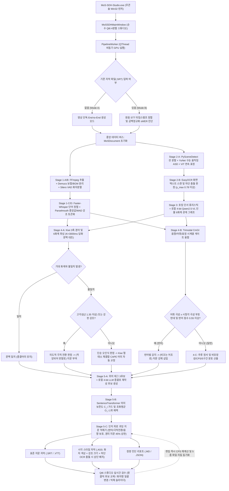

# FigJam 붙여넣기용 MoS-SDH Studio 흐름도 모음

## 방법 1. 벡터 다이어그램 통째로 붙여넣기 (가장 깔끔함 · 추천)
1. 같은 폴더의 **`MoS-SDH_FigJam_흐름도.svg`** 파일을 열려 있는 **FigJam 보드 화면 위로 그대로 드래그 앤 드롭**하거나,
2. PowerShell에서 아래 한 줄을 실행해 클립보드에 복사한 뒤 FigJam 보드에서 **`Ctrl + V`** 를 누르면 모든 박스와 화살표, 텍스트가 깨짐 없이 편집 가능한 벡터 카드 그룹으로 즉시 붙여넣어집니다.

```powershell
Get-Content -Path ".\MoS-SDH_FigJam_흐름도.svg" -Raw -Encoding UTF8 | Set-Clipboard
```

---

## 방법 2. FigJam [Mermaid] 플러그인 / 위젯에 코드 붙여넣기
FigJam 상단/하단 툴바의 **Plugins/Widgets → `Mermaid`** 위젯을 열고 아래 코드를 그대로 붙여넣으면 FigJam 네이티브 자석 커넥터 도형으로 변환됩니다. (FigJam 파서 호환성을 위해 특수기호와 HTML 태그를 모두 안전하게 이스케이프했습니다.)

### 2-1. 전체 5-Stage 파이프라인 & 네이티브 앱 흐름도

