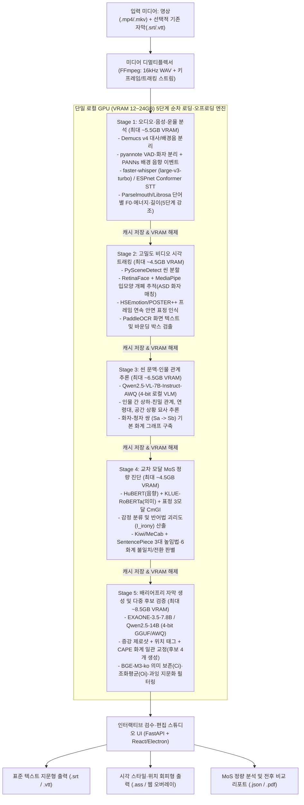
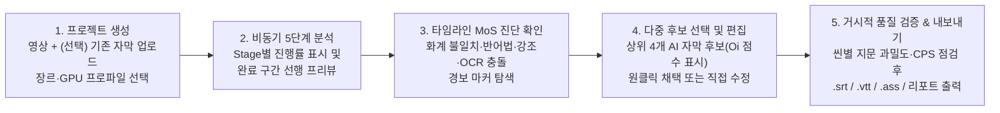

# MoS-SDH Studio 제품·시스템 기획서 (PRD)

> **부제**: 고밀도 시청각(Audio-Visual) 화법(Manner of Speech) 정량 분석 기반 한국어 배리어프리(SDH/CC) 자막 프로토타입 생성 및 검수 스튜디오  
> **기반 문헌**: `manner_of_speech_ai_literature_report.pdf` (동료심사 AI 문헌 14편 전수 매핑)  
> **문서 버전**: v1.0 (MVP 상세 기획안)  
> **작성일**: 2026-11-15  

---

## 1. 문서 개요 및 프로젝트 비전 (Executive Summary)

### 1.1 기획 배경 및 문제 정의
기존 자동음성인식(STT/ASR) 기반 자막 생성기와 일반 자막 파일은 발화의 **명제적 의미(Propositional Content, "무엇을 말했는가")**만 텍스트로 옮길 뿐, 사회적 관계·감정·운율·표정으로 실현되는 **화법(Manner of Speech, MoS, "어떻게 말했는가")** 정보를 소실한다.

특히 **드라마·영화** 장르에서 청각 정보를 제한적으로 수용하는 농·난청인 시청자(배리어프리 SDH/CC 이용자)에게는 다음과 같은 심각한 감상 단절이 발생한다.

1. **경어·화계 맥락 손실 및 오인식**: 배경음악·소음·감정 연기 구간에서 한국어 종결 어미(`-요`, `-다`, `-네`)나 선어말 어미(`-시-`)가 오인식되면 인물 간 상하·친밀 관계가 왜곡된다. 반대로 극적 갈등 상황에서 인물이 **의도적으로 존댓말에서 반말로 전환**하는 핵심 연출 포인트가 단순 텍스트만으로는 충분히 전달되지 않는다.
2. **반어법·냉소(Irony/Sarcasm) 오독 위험**: 대사 텍스트는 긍정(`"참 잘~ 하십니다"`)이지만 음성 운율(낮은 피치·비꼬는 억양)과 안면 표정(냉소·무표정)이 부정일 때, 어조 해설 없는 평문 자막은 정반대의 의미로 오해된다.
3. **준언어적 강조·비음성·비유창성 단서 누락**: 특정 단어에 실린 강한 음향적 강조, 말문 막힘·더듬거림(당황 연기), 한숨·웃음·울먹임 등 서사 이해에 필수적인 준언어 단서가 누락되거나 기존 상용 STT의 임의 자동 교정(Auto-correct)으로 삭제된다.
4. **화면 내 텍스트와의 시각적 충돌**: 영화·드라마 내 시간/장소 자막이나 휴대폰 메시지 화면 위에 배리어프리 자막이 겹쳐 가독성을 해친다.

### 1.2 제품 비전 및 핵심 목표
**MoS-SDH Studio**는 외부 유료 API 의존 없이 **단일 로컬 GPU(VRAM 12~24GB)** 환경에서 동작하는 오픈소스 기반 통합 자막 분석·프로토타이핑 스튜디오다. 고밀도 시청각(오디오 운율 + 안면 표정·입모양 추적 + 화면 OCR + 씬 상황 인식) 데이터를 결합해 발화의 MoS를 정량 분석하고, 이를 **표준 텍스트 지문형(`.srt`/`.vtt`)**과 **시각 스타일형(`.ass`/웹 프리뷰)** 배리어프리 자막 프로토타입으로 생성·검수한다.

### 1.3 듀얼 입력 워크플로우 지원
* **Mode A — 무자막 영상 직행 파이프라인 (Video-Only End-to-End)**  
  원본 영상 파일만 입력하면 `음원 분리·화자 분할 → STT 전사 → 고밀도 시청각 MoS 정량 분석 → 배리어프리 자막 후보 생성 및 검증`까지 일괄 수행한다.
* **Mode B — 기존 자막 MoS 진단 및 업그레이드 (Video + Existing Subtitle QA)**  
  영상과 기존 일반 자막(`.srt`/`.vtt`)을 함께 입력하면 원음·화면 대비 기존 자막의 **MoS 결손 구간(화계 혼용, 반어법 미표기, 음향 강조 누락, 비음성 미기재)**을 타임라인에 하이라이트하고, 개선 전후(Before/After) MoS 정량 점수와 수정 자막 후보를 제시한다.

---

## 2. 문헌 보고서(14편) 핵심 이론·수식 시스템 매핑

본 기획서의 모든 분석 지표와 생성 모듈은 폴더 내 기술 보고서(`manner_of_speech_ai_literature_report.pdf`)에 수록된 14편의 동료심사 논문을 공학적으로 통합 설계한 결과다.

| 보고서 분류 | 논문 (연도) | 핵심 이론·수식·알고리즘 | MoS-SDH Studio 내 구현 모듈 및 역할 |
| :--- | :--- | :--- | :--- |
| **1-A. 영어/범용 TST** | **Jin et al. (2022)** | 내용 잠재표현 $\boldsymbol{z} \triangleq E(\boldsymbol{x})$와 속성 $a$ 분리, 템플릿 $\boldsymbol{x}\setminus\text{Marker}_a(\boldsymbol{x})$, TST 3대 평가축(강도·의미·유창성) 및 평가기 분리 원칙 | 명제적 대사 내용($\boldsymbol{z}$)과 화법($a$) 분리 아키텍처 설계 및 **생성기-평가기 독립 검증 체계** 수립 |
| **1-A. 영어/범용 TST** | **Madaan et al. (2020)** | 상대 TF-IDF 마커 추출 $\eta_1^2(w), p_1^2(w)$ (식 1–2), 중립문에 위치별 `[TAG]_t`를 삽입하는 **Add-Tagger & Generator** (식 4–5) | 화법 표지가 결여된 평문 STT/일반 자막에 문두 `[화자/어조 지문]`, 문내 `[강조 부사]`, 문미 `[화계 어미]`를 위치 인식 태그로 삽입 |
| **1-A. 영어/범용 TST** | **de Rivero et al. (2021)** | VRAM 규모별 프로파일링, 다중 후보 생성 시간 모델 $t(i,o)$ (식 4), 정규화 문장 임베딩 내적 의미 보존 $C_i$ (식 3) 및 조화평균 $O$ (식 5) | 로컬 GPU 메모리 예산 설계, AI 추천 배리어프리 자막 다중 후보의 **의미 보존도($C_i$)·화법 적합도 조화평균($O_i$) 랭킹 UI** |
| **1-A. 영어/범용 TST** | **Reif et al. (2022)** | `{ }` 중괄호 구분자 + 고정 재작성 데모 기반 **증강 제로샷 프롬프팅** ($k=40, p=0.6$), 원문 BLEU 최대화 후보 선택 | 로컬 LLM 자막 재작성 시 파싱 실패 억제(0.6% 수준) 및 원 대사에 없는 줄거리 **환각(Hallucination) 필터링** |
| **1-A. 영어/범용 TST** | **Sun et al. (2024)** | 4대 하위 차원(상호작용·정서·생동감·구어성), 다중 윈도우 $\text{Score}_{\text{text}}$ (식 2), 구간 분포 $\text{Score}_{\text{dist}}$ (식 3), 객관식 QA 의미 검증 | 씬 단위 **과잉 지문화(Over-stylization, 자막 피로도) 억제**, 구간별 지문 편중 진단 및 대사 핵심 정보 누락 QA 검증 |
| **1-B. 한국어 경어** | **Hwang et al. (2021)** | 한국어 3대 높임법·**6화계 체계**, 자막 시간 창 $0 < \Delta t_{\text{start}} \le 3000\text{ ms}$ 문맥 추출, **HCE + CAPE** 일관성 사후교정, 어미 `EF*` 휴리스틱 | 드라마 연속 대사 내 **6화계·주체/객체 높임 자동 판별**, 오인식 화계 불일치 교정(CAPE) 및 Phase 2 영한 번역 경어 추론 |
| **1-B. 한국어 경어** | **Jeong et al. (2021)** | **형태소 분석기 + SentencePiece** 결합 토큰화 우위 입증, 단일언어 내 반말·비속어↔존댓말 변환 및 층수 민감도 분석 | 한국어 교착 어미·조사 정밀 분리를 위한 형태소+서브워드 전처리 및 단일 한국어 내 화계 변환 후보 생성 |
| **2-A. 음성/준언어** | **Graave et al. (2024)** | 연령 불일치($F_0$, 포먼트, 모음 길이)와 **발화 스타일 불일치**(낭독체 vs 자유발화체: 휴지 빈도, $F_0$ 평균·분산) 분리, 노이즈 발화 필터링 | 배우의 경직·격식 발화 대 자발적 감정 발화 음향 프로파일링, 화자 연령대 음향 단서 추출 및 비정상 세그먼트 필터링 |
| **2-A. 음성/준언어** | **Tokuyama et al. (2021)** | 단어별 5단계 음향 강조($e_i \in \{0..4\}$), 어휘 팽창 없는 **`Emph-1-Token` (`<toe_k>`)** 삽입 및 정도 부사 변환, 강조 F-score 평가 | 단어 단위 피치·강도·지속시간 기반 5단계 강조 토큰화 → `.srt` 정도 부사 보강 및 `.ass` 글자 굵기·크기 시각 렌더링 |
| **2-A. 음성/준언어** | **Gao et al. (2024)** | CTC+감정 다중과제 손실(식 1–2), 프레임·서브워드 시간 축을 보존하는 **시간 인식 게이트 융합(CmGI)** (식 3–7) 기반 감정·반어 인식 | 음향($x_a$)·대사 의미($x_l$)·안면 표정($x_v$) 3모달 시간 인식 게이트 융합으로 **감정 분류 및 반어법(Irony) 정밀 탐지** |
| **2-A. 음성/준언어** | **Qian & Xiao (2023)** | 구음장애 발화 변이 분류, **안면·입술 비디오 결합 멀티모달 ASR** 및 저자원 화자 적응 고찰 | 드라마 내 속삭임·울먹임·취중·발음 불분명 구간에서 **입모양(Lip) 시각 특징 결합 음성인식 보완** |
| **2-B. 한국어 STT** | **Bang et al. (2020)** | 자유발화 이중 전사 및 비음성 기호(`b/` 숨소리, `l/` 웃음, `o/` 중첩, `/` 간투사, `+` 자기수정), **공백 정규화 `sWER`** (Algorithm A1, A2) | 배리어프리 비음성 지문(`(한숨)`, `(웃음)`, 동시 발화 분리) 자동 태깅 및 한국어 띄어쓰기 불변 전사 정확도(`sWER`) 측정 |
| **2-B. 한국어 STT** | **Kim et al. (2024)** | 간투사(`FW`)·자기수정(`SR`)·비문(`GE`) 밀도 정량화 및 **비유창성 무교정 보존 전사** | 인물의 당황·주저함 연기를 나타내는 의도적 말더듬(`SR`)·간투사(`FW`) 보존 대 불필요 잡음 정제 판별 |
| **2-B. 한국어 STT** | **Park & Hong (2025)** | STFT·Log-Mel 전처리(식 1–3), 한국어 음운 변동·비선형 발화에 강건한 **Conformer + GTN-CTC**(식 4–8), 지속시간·피치·에너지 $(d,p,e)$ 모델링(식 9) | 음향 특징 추출 표준 프론트엔드($S_{\text{LogMel}}$), 운율 편차 벡터 $(d,p,e)$ 산출 및 한국어 연음·축약·비정형 발화 정렬 |

---

## 3. 타깃 사용자 및 드라마·영화 핵심 유스케이스

### 3.1 주요 타깃 사용자 (Personas)
1. **배리어프리 자막 전문 제작자·검수자 (Primary)**  
   기존에 수작업으로 수십 번 돌려보며 입력하던 `(비꼬듯)`, `(한숨)`, 화자 구분, 화계 오류 교정을 AI 초안과 타임라인 MoS 지표로 60% 이상 단축하고자 하는 실무자.
2. **OTT·방송사·영화제 접근성 품질 관리(QA) 담당자**  
   납품된 자막이 원작의 감정선·인물 관계(6화계)·강조 포인트를 충실히 반영했는지 정량 점수(`MoS Alignment Score`)로 검수하고 개선 리포트를 발행하는 담당자.
3. **독립영화 감독 및 영상 크리에이터**  
   외부 클라우드 유출 걱정 없이(미개봉 편집본 로컬 보안 유지) 단일 PC GPU만으로 고품질 배리어프리(`.srt`/`.ass`) 자막 프로토타입을 자체 제작하려는 창작자.

### 3.2 드라마·영화 MVP 4대 핵심 시나리오
* **시나리오 1: 인물 간 6화계 관계 추론 및 '오인식 불일치' vs '극적 반말 전환' 분리**  
  직장 상사(A)와 부하(B)의 대화 씬을 로컬 VLM(복장·연령·자리 배치)과 초기 대사로 파악해 $(B \to A)$ 기본 화계를 `합쇼체/해요체`로 설정한다. 소음 구간에서 STT가 `"알겠어"`로 오인식하면 **비의도적 불일치 오류**로 진단해 `"알겠습니다/알겠어요"` 후보를 제안하되, B의 음성 에너지·피치와 분노 표정이 급등하며 `"그래, 나 못 해!"`라고 외친 경우에는 **의도적 화계 전환(극적 갈등)**으로 판별해 원문을 유지하고 `(격앙되어 반말로)` 지문 후보를 생성한다.
* **시나리오 2: 시청각-의미 대조 기반 반어법(Irony) 및 복합 감정 지문화**  
  대사 텍스트는 `"참 대단한 일 하셨네요"`(긍정 의미 + 존칭 선어말 어미 `-시-`)이나, 음성 피치 변동이 평탄·하강하고 입꼬리 비대칭(냉소 표정)이 감지되면 시간 인식 게이트 모델이 높은 반어 괴리도를 산출하여 `[지연] (차가운 미소로 비꼬듯) 참 대단한 일 하셨네요.` 프로토타입을 생성한다.
* **시나리오 3: 입모양 추적(ASD) 기반 화면 내·외 화자 구분 및 중첩 발화 처리**  
  다인물 대화 씬에서 입술 개폐 움직임(Lip Landmarks)과 음성 화자 분리 결과를 동기화해 누가 말하고 있는지 정확히 `[화자명]`을 부착하고, 화면 밖 인물의 목소리는 `(화면 밖 민수의 목소리)`로, 두 인물의 동시 발화(`o/`)는 2단 분리 자막으로 배치한다.
* **시나리오 4: 화면 내 텍스트(OCR) 맥락 활용 및 자막 가림 회피**  
  화면에 등장하는 `"2018년 서울중앙지검"` 자막이나 스마트폰 메시지 내용을 OCR로 읽어 상황 문맥(법조계 격식체 단서)에 반영하고, 하단에 자체 편집 텍스트가 존재할 경우 `.ass` 자막 위치를 상단(`{\an8}`) 또는 비충돌 좌표로 자동 이동시킨다.

---

## 4. 고밀도 시청각 MoS 분석 지표 및 수리적 모델링 명세

### 4.1 음향 프론트엔드 및 단어 수준 5단계 준언어 강조 정량화
입력 영상에서 분리된 대사 오디오 파형 $x(n)$에 대해 **Park & Hong (2025, 식 1–3)** 의 단시간 푸리에 변환(STFT) 및 로그-Mel 스펙트로그램 $S_{\text{LogMel}}$을 표준 음향 입력으로 산출한다.

$$X(\tau, \omega) = \sum_{n=-\infty}^{\infty} x(n) \cdot \omega_{\text{win}}(n - \tau) \cdot e^{-j\omega n}$$

$$S_{\text{Mel}} = H \cdot |X(\tau, \omega)|^2, \qquad S_{\text{LogMel}} = \log(S_{\text{Mel}} + \varepsilon)$$

강제 정렬(Forced Alignment)로 획득한 발화 내 각 단어 $w_i$ ($i \in \{1, \dots, L\}$) 구간마다 지속시간(음절당 평균 길이 $d_i$), 기본주파수($p_i = F_{0,i}$), 음향 에너지($e_{\text{eng}, i}$)를 추출하고, 동일 화자의 발화 기준선($\mu_s, \sigma_s$) 대비 표준화(Z-score) 합성 강조 지수 $z_{\text{emph}}(w_i)$를 계산한다.

$$z_{\text{emph}}(w_i) = \beta_p \frac{p_i - \mu_{p,s}}{\sigma_{p,s}} + \beta_e \frac{e_{\text{eng},i} - \mu_{e,s}}{\sigma_{e,s}} + \beta_d \frac{d_i - \mu_{d,s}}{\sigma_{d,s}} \quad (\beta_p + \beta_e + \beta_d = 1)$$

이를 **Tokuyama et al. (2021)** 의 5단계 이산 강조 레벨 $e_i \in \{0, 1, 2, 3, 4\}$ (`0: 보통` ~ `4: 매우 강함`)로 양자화한 뒤, 어휘 공간 팽창을 막는 **`Emph-1-Token` 규칙**에 따라 $e_k > 0$인 강조 단어 $w_k$ 직전에만 단일 제어 토큰 `<toe_k>`를 내부 시퀀스에 삽입한다.

### 4.2 시청각-의미 3모달 시간 인식 게이트 융합(Trimodal CmGI) 및 반어법 지수
단일 평균 풀링이 발화 내 국소 감정 변화와 반어법을 놓치는 한계를 해결하기 위해 **Gao et al. (2024, 식 3–7)** 의 시간 인식 게이트 상호작용(CmGI) 구조를 **음향($x_a \in \mathbb{R}^{t \times d}$) · 대사 의미($x_l \in \mathbb{R}^{t \times d}$) · 연속 안면 표정($x_v \in \mathbb{R}^{t \times d}$)** 3모달로 확장한다.

1. **교차 모달 어텐션 투영**: 시간 축 $t$(서브워드·프레임 정렬 시퀀스) 위에서 음향-의미 교차 특징 $(c_a, c_l)$ 및 시각-의미 교차 특징 $c_v$를 산출한다.
   $$c_a = \text{softmax}\!\left(\frac{(s_a W_Q)(s_l W_K)^\top}{\sqrt{d_k}}\right)(s_l W_V), \qquad c_l = \text{softmax}\!\left(\frac{(s_l W_Q)(s_a W_K)^\top}{\sqrt{d_k}}\right)(s_a W_V)$$
2. **프레임·토큰 시간 차원 보존 게이트 융합**: 특정 시점의 STT 오인식이나 무표정 연기에 동적으로 가중치를 조절하는 행렬 게이트 $G_a, G_l, G_v \in \mathbb{R}^{t \times d}$를 계산한다.
   $$G_a = f(\sigma(\text{concat}(s_a, c_a))), \quad G_l = f(\sigma(\text{concat}(s_l, c_l))), \quad G_v = f(\sigma(\text{concat}(s_v, c_v)))$$
   $$\text{output}_m = \text{concat}\!\left(s_m \odot G_m,\; c_{\bar{m}} \odot (1 - G_m)\right) \quad (m \in \{a, l, v\})$$
3. **반어법·냉소 괴리도 ($\mathcal{I}_{\text{irony}}$) 산출**: 대사 텍스트 단독 감성 극성 점수 $\text{Pol}_{\text{lex}}(x_l) \in [-1, 1]$과 시청각(운율+표정) 감정 극성 점수 $\text{Pol}_{\text{AV}}(x_a, x_v) \in [-1, 1]$ 간의 부호 반대 괴리 크기에 게이트 신뢰도를 곱해 반어법 경보 지수를 정의한다.
   $$\mathcal{I}_{\text{irony}} = \mathbb{I}\!\left[\text{Pol}_{\text{lex}}(x_l) \cdot \text{Pol}_{\text{AV}}(x_a, x_v) < 0\right] \cdot \frac{|\text{Pol}_{\text{lex}}(x_l) - \text{Pol}_{\text{AV}}(x_a, x_v)|}{2} \in [0, 1]$$
   $\mathcal{I}_{\text{irony}} \ge \tau_{\text{irony}}$ (기본값 $0.65$)일 때 타임라인에 **반어법 주의 마커**를 생성하고 `(비꼬는 어조로)` / `(냉소 지으며)` 지문 태그를 활성화한다.

### 4.3 한국어 3대 높임법·6화계 정량 분류 및 문맥 일관성 모델
**Hwang et al. (2021)** 및 **Jeong et al. (2021)** 에 기반하여 형태소 분석기(`Kiwi`/`MeCab-ko`) + `SentencePiece` 결합 토크나이저로 문장 내 높임 표지를 3축으로 파싱한다.

* **주체 높임**: 주격 조사 `-께서`, 용언 선어말 어미 `-시-/-신-/-셨-` 유무 ($h_{\text{subj}} \in \{0, 1\}$)
* **객체 높임**: 부사격 조사 `-께`, 특수 어휘(`여쭙다`, `드리다`, `뵙다`, `모시다`) 유무 ($h_{\text{obj}} \in \{0, 1\}$)
* **상대 높임 6화계 분류** (종결 어미 `EF*` 및 보조사 `요` 결합 규칙 + 문맥 분류기):
  * **경어군 (Honorific)**: `합쇼체` `[공손 High / 격식 High]`, `해요체` `[공손 High / 격식 Low]`
  * **중립·비경어군 (Non-Honorific)**: `하오체` `[Neutral / High]`, `하게체` `[Neutral / Low]`, `반말체(해체)` `[Low / High]`, `해라체` `[Low / Low]`

**담화 문맥 추출 및 의도적 화계 전환 분리 규칙**:  
현재 발화 $u_t$(화자 $S_a \to$ 청자 $S_b$)에 대해 (1) **Hwang et al. (2021)** 의 근접 담화 시간 창 제약 $0 < t_{\text{start}}(u_t) - t_{\text{start}}(u_{\text{ctx}}) \le K$ ($K = 3000\text{ ms}$, 직전 최대 2문장)과 (2) 동일 씬 내 동일 화자-청자 방향 쌍 $(S_a \to S_b)$의 누적 화계 분포 $P_{\text{hist}}(H \mid S_a \to S_b)$를 함께 참조한다.  
기존 주류 화계 $H^*$와 현재 감지된 화계 $\hat{H}_t$가 불일치($\hat{H}_t \neq H^*$)할 때:
* 음향 감정 각성도(Arousal: $\Delta F_0, \Delta E_{\text{eng}}$) 및 표정 변화량이 임계치 미만이고 STT 종결 어미 토큰 신뢰도가 낮으면 → **ASR/번역 화계 불일치 오류**로 판정하여 **CAPE(문맥 인식 사후교정)** 후보 제시.
* 음향 각성도 및 분노·충격 표정 점수가 임계치 이상이고 종결 어미 발음 신뢰도가 높으면 → **의도적 극적 화계 전환**으로 판정하여 원 화계를 보존하고 배리어프리 감정·화계 변화 배지를 부여.

### 4.4 비음성·비유창성 전사 규약 및 한국어 `sWER` 정확도 모델
* **비음성·준언어 기호 매핑 (Bang et al., 2020 KsponSpeech 확장)**:  
  오디오 이벤트 및 비음성 세그먼트에서 탐지된 숨소리/한숨(`b/`), 웃음(`l/`), 울음/흐느낌(`c/`), 발화 중첩(`o/`), 배경 핵심 효과음(`n/`)을 배리어프리 표준 지문으로 사상한다.
* **비유창성 보존 대 정제 판별 (Kim et al., 2024 L2S 지표 응용)**:  
  발화 내 토큰당 간투사 밀도($\text{FW} = C_{\text{FW}} / N_{\text{tok}}$)와 연속 어절 반복·자기수정 밀도($\text{SR} = C_{\text{SR}} / N_{\text{tok}}$)를 측정한다. 불안·당황·공포 감정 점수가 동반된 `SR` 구간은 극적 연기 표현으로 간주해 보존(`"아, 아니 그게..."`)하고, 일상 설명 대사의 단순 습관성 간투사는 가독성 기준(CPS: 초당 글자 수) 초과 시 정제 후보를 제안한다.
* **한국어 공백 정규화 어절 오류율 (`sWER`, Bang et al., 2020 Algorithm A1 & A2)**:  
  기존 자막과 STT/개선 자막 비교 시 한국어의 유연한 띄어쓰기로 인해 일반 `WER`이 부풀려지는 현상을 막기 위해, 선행 공백 기호 `_`를 제거한 순수 음절 일치 여부로 동적 계획법(DP) 누적 비용 행렬 $\text{scores}_{h,r}$를 정렬한 뒤 역추적(Traceback)에서 공백을 동기화한다.
  $$\text{sub\_or\_cor} = \text{scores}_{h-1, r-1} + \begin{cases} 0 & \text{if } \text{remove\_space}(hyp_{h-1}) = \text{remove\_space}(ref_{r-1}) \\ 1 & \text{otherwise} \end{cases}$$
  $$\text{scores}_{h, r} = \min(\text{sub\_or\_cor},\; \text{scores}_{h-1, r} + 1,\; \text{scores}_{h, r-1} + 1)$$

### 4.5 배리어프리 자막 생성, 다중 후보 랭킹 및 거시적 과잉 지문화 제어
1. **위치 인식 태그 생성 (Madaan et al., 2020 식 1–5 응용)**:  
   코퍼스 상대 TF-IDF 비율 $\eta_1^2(w)$ 및 평활화 확률 $p_1^2(w) = \frac{\eta_1^2(w)^\gamma}{\sum_{w'} \eta_1^2(w')^\gamma}$ ($\gamma=0.75$)로 구축한 배리어프리 어조·강조 표지 사전을 참조하여, 원 대사 핵심 내용어는 유지한 채 문두 태그 `[TAG]_0`(화자·감정·비음성 지문), 문내 태그 `[TAG]_t`(강조 부사), 문미 태그 `[TAG]_T`(교정된 6화계 어미) 위치에만 변형을 가한다.
2. **증강 제로샷 프롬프팅 및 다중 후보 종합 점수 $O_i$ (Reif et al., 2022; de Rivero et al., 2021 식 3, 5)**:  
   로컬 LLM에서 `{ }` 구분자와 고정 재작성 데모를 사용해 $N=4$개의 배리어프리 자막 후보 $\{y^{(1)}, \dots, y^{(4)}\}$를 샘플링($k=40, p=0.6$)한다. 각 후보 $y^{(i)}$에서 괄호 지문을 분리한 순수 대사 $\tilde{y}^{(i)}$와 원 대사 $x_{\text{in}}$의 정규화 의미 임베딩 벡터($R \in [-1, 1]^d$, `BGE-M3-ko`) 내적 $C_i$와 목표 화법 부합도 $S_{\text{MoS}, i} \in [0, 1]$의 **조화평균 종합 점수 $O_i$**로 후보 순위를 매긴다.
   $$C_i = \frac{R_{\text{input}} \cdot R_{\text{output}_i}}{\|R_{\text{input}}\| \|R_{\text{output}_i}\|}, \qquad O_i = \frac{2 \cdot S_{\text{MoS}, i} \cdot C_i}{S_{\text{MoS}, i} + C_i}$$
   이때 원문에 없는 어휘 환각을 억제하기 위해 $C_i < 0.80$이거나 표면 음절 중첩도가 급락한 후보는 자동 기각한다.
3. **씬 단위 다중 윈도우 화법 밀도 및 과잉 스타일화 방지 (Sun et al., 2024 식 2–3)**:  
   모든 대사마다 감정 지문과 강조 태그가 과도하게 붙으면 농·난청인 시청자의 읽기 피로도가 급증한다. 이를 진단하기 위해 한 씬($M$개 연속 자막) 내 연속 $n \in \{1, 2, 3, 4\}$개 자막 슬라이딩 윈도우의 지문·강조 밀도 평균 $\text{Score}_{\text{text}}$와 5등분 구간 분포 벡터 $\text{Score}_{\text{dist}}$를 계산한다.
   $$\text{Score}_{\text{text}} = \frac{1}{4} \sum_{n \in \{1,2,3,4\}} \text{mean}(\text{Score}_{\text{seq-}n}), \qquad \text{Score}_{\text{dist}} = [s_1, s_2, s_3, s_4, s_5]$$
   구간 밀도가 권장 상한(초당 읽기 속도 $\text{CPS} \le 14$자/초 및 지문 부착 비율 $\le 45\%$)을 초과하면 경미한 감정·강조 태그를 자동 축약(Pruning)한다.

---

## 5. 시스템 아키텍처: 단일 로컬 GPU(12~24GB) 최적화 파이프라인

### 5.1 하드웨어 제약 분석 및 순차 오프로딩 설계 원칙
고밀도 시청각 모델(음원 분리, STT, 얼굴·입모양 추적, 표정 인식, OCR, VLM, 로컬 LLM)을 동시에 VRAM에 상주시키면 40GB 이상의 메모리가 필요하다. 본 시스템은 **단일 소비자용 GPU(RTX 3060 12GB ~ RTX 4090 24GB)** 환경에서 OOM(메모리 부족) 없이 안정적으로 구동되도록 **5단계 순차 실행 및 VRAM 즉시 회수(Sequential DAG Execution & Model Offloading)** 아키텍처를 채택한다. 각 Stage의 중간 산출물은 로컬 SQLite + Parquet/JSON 아티팩트 스토어에 직렬화된다.

### 5.2 전체 파이프라인 아키텍처 다이어그램

### 5.3 Stage별 오픈소스 모델 스택 및 리소스 예산 명세

| 파이프라인 단계 | 세부 처리 역할 | 채택 오픈소스 모델 / 라이브러리 | 정밀도 | 피크 VRAM | 10분 드라마 영상 예상 처리 시간 (RTX 4070 12GB 기준) |
| :--- | :--- | :--- | :--- | :--- | :--- |
| **Stage 1: 오디오·STT·운율** | 보컬/배경음 분리, 화자 분할, 비음성 이벤트, 한국어 STT 및 단어 정렬, 운율 추출 | `htdemucs`, `pyannote.audio 3.1`, `PANNs`, `faster-whisper (large-v3-turbo)` + `WhisperX` (보조: `ESPnet Conformer-CTC`), `Parselmouth` | FP16 / INT8 | **~5.5 GB** | 약 1분 20초 |
| **Stage 2: 고밀도 시각 분석** | 씬 전환 감지, 얼굴·입모양 발화자 매칭(ASD), 연속 표정(FER), 화면 자막 OCR | `PySceneDetect`, `RetinaFace` + `MediaPipe` + `TalkNet-ASD`, `HSEmotion`, `PaddleOCR v4 (ko)` | FP16 | **~4.5 GB** | 약 1분 40초 (5~10 fps 적응형 샘플링) |
| **Stage 3: 시청각 관계·상황** | 씬별 대표 프레임 기반 인물 관계(상사/가족/초면), 복장·배경 상황 설명 추출 | `Qwen2.5-VL-7B-Instruct-AWQ` (또는 `InternVL2.5-8B-4bit`) | INT4 (AWQ) | **~6.5 GB** | 약 50초 (씬 전환 키프레임 단위 추론) |
| **Stage 4: 교차 모달 MoS 진단** | 3모달 시간 인식 게이트 감정·반어법 탐지, 한국어 6화계·높임법 분류 및 불일치 진단 | `HuBERT-large` + `KLUE-RoBERTa-base` + `Trimodal CmGI Head`, `kiwipiepy` / `MeCab-ko` + `SentencePiece` | FP16 | **~4.5 GB** | 약 30초 |
| **Stage 5: 자막 생성·랭킹** | 배리어프리 다중 후보 생성, CAPE 화계 교정, 의미 유사도·과잉 지문화 검증 | `EXAONE-3.5-7.8B-Instruct` (12GB 환경 기본) 또는 `Qwen2.5-14B-Instruct` (16~24GB 선택, 4-bit) + `BGE-M3` | INT4 (GGUF/AWQ) | **~6.8 ~ 9.5 GB** | 약 1분 30초 (문제·이벤트 구간 집중 후보 생성) |

> **실시간 편집 반응성 보장**: 전체 5단계 파이프라인은 초기 영상 로드 시 비동기 배치로 1회 실행되며, 이후 사용자가 스튜디오 UI에서 특정 대사의 스타일 강도나 화계를 수동 재요청할 때는 **Stage 5 경량 LLM + `BGE-M3`만 상주 모드**로 전환하여 문장당 1~2초 내 즉각 응답한다.

### 5.4 Phase 2 확장 아키텍처: 외국어→한국어 배리어프리 번역 모듈
MVP(한국어 영상→한국어 SDH) 완성 후 외국어(영·일 등) 영상을 수용할 때는 Stage 1의 STT 출력을 원어 텍스트 + `<toe_k>` 강조 토큰으로 유지하고, Stage 4와 Stage 5 사이에 **문맥 인식 번역 어댑터(Hwang et al., 2021 HCE 문맥 창 $K=3000\text{ ms}$ + Stage 3 시각 화자 관계 그래프 주입 번역 프롬프트)**만 플러그인 형태로 삽입하여 하위 파이프라인 수정 없이 한국어 6화계 배리어프리 번역 자막을 생성한다.

---

## 6. 배리어프리(SDH/CC) 듀얼 출력 규격 명세

동일한 내부 `MoS-Annotated Subtitle JSON` 데이터로부터 사용 환경에 맞춰 **범용 플레이어 호환 `.srt`/`.vtt`**와 **시각 표현 특화 `.ass`/웹 프리뷰** 두 가지 프로토타입을 동시 출력한다.

### 6.1 MoS 분석 요소별 듀얼 렌더링 규칙표

| MoS 분석 항목 | 내부 정량 표현 / 태그 | 표준 텍스트 지문형 (`.srt` / `.vtt`) 변환 규칙 | 시각 스타일형 (`.ass` / 웹 프리뷰) 변환 규칙 |
| :--- | :--- | :--- | :--- |
| **화자 식별 & 화면 외 발화** | `speaker_id`, `on_screen: bool` | `[민수]`, 화면 밖일 때 `[민수(화면 밖)]` | 화자 고유 파스텔 색상 배정 + 발화자 화면 좌/우 위치에 맞춘 자막 정렬, 화면 밖은 이탤릭체(`{\i1}`) |
| **감정 및 반어법** | `emotion` $\in \{\text{분노, 슬픔, 기쁨, 공포, 중립}\}$, $\mathcal{I}_{\text{irony}} \ge 0.65$ | 감정 전환 첫 대사에 `(분노하며)`, 반어법 감지 시 `(비꼬는 어조로)` / `(차가운 웃음으로)` 지문 삽입 | 감정별 자막 외곽선 색상 변화 + 반어법 구간 전용 물결 밑줄/아이콘 배지 표시 |
| **5단계 음향 강조** | 단어 앞 `<toe_1>` ~ `<toe_4>` (*Tokuyama et al.*) | $e_k \in \{1,2\}$: 생략(과잉 지문 방지), $e_k \in \{3,4\}$: 문맥 부합 정도 부사(`정말`, `절대`) 제안 또는 작은따옴표/느낌표 보강 | `{\b1}` 굵게 + 강조 단계 비례 글자 크기 스케일링 ($e_2$: `108%`, $e_3$: `116%`, $e_4$: `125%` + 강조색 하이라이트) |
| **6화계 변화 / 오류 교정** | `speech_level` $\in$ 6화계, `shift_type` $\in \{\text{error, dramatic}\}$ | `error`: 문맥 화계로 어미 교정(`-어` $\to$ `-어요`), `dramatic`: 원문 유지 + 필요시 `(반말로 내뱉듯)` | 스튜디오 타임라인에 화계 전환 마커 표시, `.ass` 선택 옵션으로 화자명 옆 화계 관계 배지 표시 가능 |
| **비음성·배경 음향** | `b/`(한숨), `l/`(웃음), `c/`(울음), `o/`(중첩), `sfx` | `(깊은 한숨)`, `(낮게 웃으며)`, `(불길한 음악 고조)`, 중첩 발화는 `- [화자A] ...\n- [화자B] ...` | 독립 효과음 박스 상단/우측 분리 렌더링, 동시 발화자 좌/우 분할 배치 |
| **의도적 비유창성** | `SR`/`FW` 보존 플래그 = `True` (*Kim et al.*) | 말더듬·휴지 부호 유지 (`"그, 그게… 제가 한 게 아닙니다."`) | 휴지 길이에 맞춘 단어별 노래방식 순차 페이드인(`{\k}` 태그 선택 지원) |
| **화면 OCR 충돌 회피** | `ocr_bbox` 하단 영역 침범 감지 | 텍스트 내 화면 자막 중복 기재 생략 (대사만 표기) | 하단 OCR 바운딩 박스와 겹치는 시간 구간 동안 자동으로 상단 중앙(`{\an8}`) 또는 비간섭 좌표(`{\pos(x,y)}`)로 이동 |

### 6.2 실제 드라마 씬 변환 비교 예시
* **원본 음성 및 화면 상황**: 부장(50대, 굳은 표정) 앞에서 대리(30대)가 서류를 떨어뜨린다. 부장이 차가운 미소를 지으며 낮고 느린 억양으로 `"참~ 일 처리 깔끔하게 잘하시는군요"`라고 말한 뒤 한숨(`b/`)을 쉰다. 하단에는 `"제3화: 균열"` 방송 자막이 떠 있다.
* **기존 단순 STT 자막**:  
  `참 일 처리 깔끔하게 잘하시는군요` *(반어법 오해 소지, 한숨 누락, 하단 방송 자막과 겹침)*
* **MoS-SDH `.srt` 출력**:  
  `[박 부장] (비꼬는 어조로) 참, 일 처리 '깔끔하게' 잘하시는군요. (한숨)`
* **MoS-SDH `.ass` 출력**:  
  `{\an8}[박 부장] {\c&HFFD700&}(비꼬는 어조로){\r} 참, 일 처리 {\b1\fscx120\fscy120}깔끔하게{\r} 잘하시는군요. {\i1}(한숨){\i0}` *(하단 `"제3화: 균열"` OCR 영역을 피해 상단 `{\an8}`에 배치)*

---

## 7. 인터랙티브 검수·편집 스튜디오 UI/UX 및 기능 명세

### 7.1 핵심 사용자 흐름 (User Journey)

### 7.2 스튜디오 화면 4분할 레이아웃 (Workspace UI)
1. **좌상단 — 멀티모달 비디오 프리뷰 플레이어**
   * `.srt` 평문 모드 ↔ `.ass` 시각 스타일 모드 실시간 토글.
   * 디버그 오버레이 레이어 켜기/끄기: 얼굴·입모양 활성 화자 박스(초록색), 안면 표정 감정 라벨, 화면 OCR 감지 영역(노란색 점선 박스).
2. **우상단 — 인물 관계 6화계 그래프 & 씬 요약 패널**
   * 씬 내 등장인물 노드와 방향성 화살표 $(S_a \to S_b)$ 위에 주류 화계(예: `합쇼체 92%`) 표시. 클릭 시 해당 인물 쌍의 대화만 필터링.
   * 우측 상단 게이지로 현재 씬의 **지문 밀도 분포($\text{Score}_{\text{dist}}$)** 및 평균 CPS 표시(과잉 스타일화 경고등).
3. **중단 — 멀티트랙 MoS 타임라인 (동기화 스크러버)**
   * **Track 1**: 대사 음성 파형 + $F_0$ 피치 곡선 및 5단계 강조 피크 마커.
   * **Track 2**: 시청각 감정 색상 바 + 반어법 경보 아이콘(`⚡ Irony`).
   * **Track 3**: 6화계 흐름 바 (`🔴 화계 오인식 의심` vs `🟠 의도적 반말 전환` 구분 표시).
   * **Track 4**: 자막 블록 및 OCR 위치 충돌 구간 표시.
4. **하단 — 자막 Diff 테이블 (좌) & AI 다중 후보 인스펙터 (우)**
   * 좌측 테이블: 타임스탬프, 화자, 기존/초안 자막, 현재 채택된 배리어프리 자막, CPS 경고 표시.
   * 우측 인스펙터: 선택된 대사의 세부 MoS 분석 근거(음성 감정 확률, 표정 감정 확률, 반어 괴리도 $\mathcal{I}_{\text{irony}}$, 형태소 높임 파싱 결과)와 **AI 생성 후보 4선 카드**(각 후보 옆에 의미 보존 $C_i$, 화법 적합도 $S_{\text{MoS}, i}$, 종합 점수 $O_i$ 막대 표시 + 원클릭 적용 버튼).

### 7.3 기능 요구사항 명세표 (Functional Requirements)

| ID | 구분 | 기능명 | 상세 요구사항 명세 | 우선순위 |
| :--- | :--- | :--- | :--- | :---: |
| **FR-01** | 입력 | 미디어 및 자막 로드 | `.mp4, .mkv, .mov, .avi` 영상 단독 입력(Mode A) 및 `.srt, .vtt` 기존 자막 동반 입력(Mode B) 지원 | **P0** |
| **FR-02** | 오디오 | 대사 분리 및 한국어 STT | 배경음악·효과음 분리 후 단어 타임스탬프 포함 한국어 전사 및 비음성 구간(`b/, l/, o/`) 추출 | **P0** |
| **FR-03** | 오디오 | 단어별 5단계 음향 강조 산출 | 화자 정규화 피치·에너지·지속시간 합성 지수로 단어별 $e_i \in \{0..4\}$ 추정 및 `<toe_k>` 태깅 | **P0** |
| **FR-04** | 비디오 | 입모양 기반 활성 화자 매칭 | 얼굴·입술 개폐 움직임과 오디오 화자 분리 세그먼트를 매칭하여 화면 내/외 발화자 구분 | **P0** |
| **FR-05** | 비디오 | 연속 안면 표정 및 화면 OCR | 대사 구간 프레임 표정 벡터 추출 및 화면 내 텍스트 내용·바운딩 박스 좌표 기록 | **P0** |
| **FR-06** | 문맥 | 인물 관계 및 상황 추론 | 로컬 VLM으로 씬 내 인물 간 상하·친밀 관계 단서 및 비언어적 핵심 상황 묘사 추출 | **P1** |
| **FR-07** | MoS 진단 | 3모달 감정 및 반어법 탐지 | Trimodal CmGI 게이트 융합으로 감정 분류 및 대사 극성 대 시청각 극성 괴리도($\mathcal{I}_{\text{irony}}$) 계산 | **P0** |
| **FR-08** | MoS 진단 | 6화계 분류 및 불일치/전환 판별 | 주체·객체·상대 6화계 파싱 후 $K=3000\text{ ms}$ 문맥 및 화자 쌍 이력 대비 오류 대 극적 전환 분리 | **P0** |
| **FR-09** | MoS 진단 | 의도적 비유창성 보존 판별 | 간투사(`FW`)·자기수정(`SR`) 밀도와 감정 점수를 결합해 연기성 말더듬 보존 대 잡음 정제 결정 | **P1** |
| **FR-10** | 생성 | 다중 배리어프리 후보 생성 | 로컬 LLM 증강 제로샷 + 위치 태그 방식으로 구간별 4개 수정 후보 생성 및 $C_i, O_i$ 자동 채점 | **P0** |
| **FR-11** | 품질제어 | 과잉 지문화 및 CPS 억제 | 씬 단위 $\text{Score}_{\text{dist}}$ 편중 및 줄당 글자 수/CPS 초과 시 경미한 지문 자동 축약 옵션 제공 | **P1** |
| **FR-12** | 편집 UI | 멀티트랙 타임라인 및 후보 선택 | 파형·감정·반어·화계 마커 클릭 이동, 기존 자막 Diff 비교, 후보 원클릭 채택 및 수동 편집 | **P0** |
| **FR-13** | 출력 | 듀얼 포맷 및 리포트 내보내기 | `.srt, .vtt`(표준 지문형), `.ass`(시각 강조 + OCR 위치 회피형), MoS 전후 비교 리포트(`.json/.md`) 출력 | **P0** |
| **FR-14** | 확장 | 외국어→한국어 번역 플러그인 | 원어 STT + 시각 인물 관계 문맥 결합 한국어 6화계 배리어프리 번역 모듈 연결 인터페이스 | **P2** |

---

## 8. 정량 성능 검증 및 품질 평가 체계 (Evaluation Plan)

**Jin et al. (2022, Section 3)** 의 권고에 따라, 자막 생성에 사용된 로컬 LLM·분류기와 **평가용 분류기·임베딩 모델을 엄격히 분리**하여 메트릭 해킹을 방지한다.

### 8.1 자동 정량 평가 지표 및 MVP 목표치

| 평가 영역 | 정량 평가 지표 | 산출 근거 (보고서 논문) | MVP 목표 기준 |
| :--- | :--- | :--- | :--- |
| **전사 정확도** | 한국어 음절 오류율(`CER`) 및 공백 정규화 어절 오류율(**`sWER`**) | *Bang et al. (2020)* Algorithm A1, A2 | 드라마 대사 클린 구간 `sWER` $\le 12\%$, 소음·감정 구간 `sWER` $\le 18\%$ |
| **경어·화계 정합성** | 6화계 분류 정확도 및 오인식 불일치 교정률 / 의도적 전환 보존 F1 | *Hwang et al. (2021)*; *Jeong et al. (2021)* | 경어/비경어 이진 일치율 $\ge 92\%$, 6화계 세분류 정확도 $\ge 80\%$ |
| **운율·감정·반어** | 감정 비중가중/가중 정확도(**`UA` / `WA`**), 반어법 탐지 F1, 강조 단어 **`F-score`** | *Gao et al. (2024)*; *Tokuyama et al. (2021)* | 4대 감정 `UA` $\ge 75\%$, 강한 강조($e_k \ge 3$) 탐지 F-score $\ge 70\%$ |
| **원의미 보존성** | 순수 대사 임베딩 유사도 평균($\bar{C}$) 및 씬별 세부 사실·논리 **객관식 QA 정답률** | *de Rivero et al. (2021)*; *Sun et al. (2024)* | 원 대사 대비 $\bar{C} \ge 0.88$, 씬 QA 정답 유지율 $\ge 90\%$ |
| **배리어프리 가독성** | 구간별 지문 밀도 편차($\text{std}(\text{Score}_{\text{dist}})$), 권장 CPS($\le 14$자/초) 준수율, OCR 비충돌률 | *Sun et al. (2024)* + 국내 자막방송 가이드라인 | CPS 준수율 $\ge 95\%$, 하단 OCR 텍스트 비충돌률 $99\%$ |

### 8.2 인간 평가(Human Evaluation) 프로토콜
* **평가단 구성**: 농·난청인 당사자 패널 4인 + 배리어프리 자막 제작 경력자 2인 (최소 2인 이상 교차 채점 및 평가자 간 일치도 **Cohen's $\kappa$ / Krippendorff's $\alpha \ge 0.70$** 보고 — *Jin et al., 2022*; *Sun et al., 2024*).
* **평가 표본**: 한국어 드라마·영화 대표 클립 100개 세그먼트(화계 갈등 씬, 반어법 씬, 다화자 중첩 씬, 무대사 비음성·상황 씬 균등 배분).
* **5점 척도 평가 항목**: (1) 인물 관계·어조 이해도, (2) 감정·강조 전달 자연스러움, (3) 대사 원의미 왜곡 없음, (4) 자막 피로도 적정성(과잉 지문 여부), (5) 수작업 대비 편집 시간 단축 체감도.

---

## 9. 개발 로드맵 및 리스크 관리 방안

### 9.1 단계별 개발 로드맵 (MVP → 고도화 → 확장)

| 단계 | 기간(권장) | 핵심 마일스톤 목표 | 주요 산출물 |
| :--- | :---: | :--- | :--- |
| **Phase 1-A: 코어 분석 엔진 PoC** | 1~4주차 | 오디오 분리·STT(`sWER` 측정)·운율 5단계 강조 추출(Stage 1) 및 한국어 6화계 형태소 파서·불일치 탐지(Stage 4 일부) CLI 구현 | 로컬 Python 분석 패키지, 드라마 샘플 JSON 리포트 |
| **Phase 1-B: 시청각 융합 & 생성기** | 5~8주차 | 입모양 ASD·연속 표정·OCR(Stage 2), 로컬 VLM 관계 추론(Stage 3), Trimodal CmGI 반어법 탐지 및 로컬 LLM 다중 후보 생성·랭킹(Stage 5) 통합 | 5단계 순차 VRAM 오프로딩 백엔드(FastAPI) 및 `.srt/.ass` 변환기 |
| **Phase 1-C: 스튜디오 MVP 완성** | 9~12주차 | 멀티트랙 MoS 타임라인, 비디오 오버레이 프리뷰, 후보 원클릭 선택 UI 구현 및 드라마 클립 벤치마크·사용성 검증 | **MoS-SDH Studio v1.0 (로컬 구동형 데스크톱/웹 앱)** |
| **Phase 2: 고도화 및 다국어 확장** | 13~16주차 | 드라마 감정·반어 데이터셋 기반 CmGI 경량 미세조정, 구음장애·비정형 발화 Conformer-CTC 보강, 영·일→한 배리어프리 번역 플러그인 추가 | v2.0 다국어 배리어프리 확장판 |

### 9.2 핵심 기술 리스크 및 완화 전략

1. **로컬 GPU(12GB) 환경에서의 VRAM 피크 초과 위험**  
   * *완화 전략*: Stage 간 프로세스 격리(워커 서브프로세스 종료로 CUDA 컨텍스트 100% 반환 보장) + 12GB 이하 감지 시 VLM/LLM을 7B~8B 4-bit 양자화 모델로 자동 전환하는 하드웨어 적응형 프로파일러 내장.
2. **어두운 조명·측면 촬영·마스크 착용 씬에서의 입모양/표정 추적 실패**  
   * *완화 전략*: Trimodal CmGI 게이트($G_v$)에 시각 랜드마크 검출 신뢰도를 입력하여 얼굴 미검출 구간에서는 자동으로 시각 가중치를 $0$으로 수렴시키고 **음향($x_a$) + 의미($x_l$) 2모달 폴백 모드**로 끊김 없이 동작하도록 설계.
3. **로컬 중소형 LLM(7B~14B)의 대사 임의 변형 및 지문 남발**  
   * *완화 전략*: LLM이 대사 전문을 새로 쓰지 못하도록 **Madaan et al. (2020) 위치 태그 방식**을 적용(원 대사 어절은 고정하고 `[지문 태그]`와 `[종결 어미]` 슬롯만 생성 옵션 기본 활성화) + `BGE-M3` 유사도 하한($C_i \ge 0.80$) 필터 강제 적용.
4. **장편 영화(2시간 분량) 전체 분석 시 초기 대기 시간 발생**  
   * *완화 전략*: FFmpeg/PySceneDetect로 영상을 5분(또는 씬) 단위 청크로 분할해 **스트리밍 파이프라인**으로 처리함으로써, 앞부분 첫 5분 청크가 완료되는 즉시(약 1~2분 내) 사용자가 스튜디오에서 검수·편집을 시작하고 백그라운드에서 나머지 청크를 순차 분석하도록 구성.
