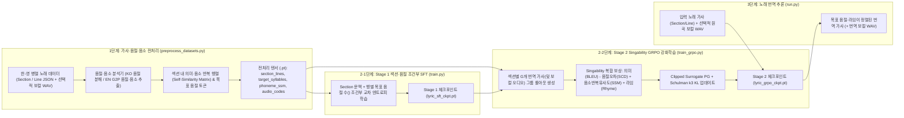

# arXiv:2309.11093 기반 노래(가사·보컬) 번역 시스템 구축 가이드 및 이전 세션 작업 요약

이 문서는 **EDarch 영-한 실시간 스트리밍 동시통역 코드베이스**에서 확립한 아키텍처·코딩 컨벤션·모듈화 표준을 그대로 계승하여, 새 세션에서 **[arXiv:2309.11093 — *K-pop Lyric Translation: Dataset, Analysis, and Neural-Modelling* (Kim et al., LREC-COLING 2024)](https://arxiv.org/abs/2309.11093)** 기반의 **노래(Singable Lyric & Vocal) 번역 시스템**을 일관되게 구축하기 위한 핸드오프 가이드입니다.

---

## 1. 이전 세션에서 확립한 엔지니어링 원칙 및 작업 요약

새 세션에서 코드를 작성할 때도 아래 **6가지 핵심 규칙**을 동일하게 적용합니다.

### 1.1 코드 스타일 및 구조 규칙 (필수 준수)
1. **주석 사용 금지 (Docstring Only)**:
   - 모든 `.py` 파일에서 `#`으로 시작하는 인라인·블록·구분선 주석을 **절대 사용하지 않습니다.**
   - 모든 설명은 모듈·클래스·함수·메서드 상단의 **닥스트링(`"""..."""`)** 으로만 작성합니다.
2. **단일 파일 1,000줄 미만 모듈화**:
   - 어떤 파이썬 파일도 1,000줄을 넘지 않도록 역할별로 모듈을 분리합니다.
   - 예: 전처리는 `dataset_parsing.py`(탐색·JSON 파싱) + `dataset_builder.py`(`.pt` 변환·실행) + `preprocessing_common.py`(공통 구조체·슬라이서·조립기)로 분리하고, 강화학습은 `grpo_rollout.py`(프롬프트 데이터셋·롤아웃·보상 산출) + `grpo.py`(Clipped Surrogate + k3 KL 손실·학습 루프)로 분리합니다.
3. **얇은 실행 전용 루트 스크립트 (Thin CLI Runners) + `libs/` 코어 패키지**:
   - 루트 디렉터리에는 실행 전용 진입점 스크립트(`preprocess_datasets.py`, `train.py`, `train_grpo.py`, `run.py`, `verify.py` — 각 30~55줄)만 둡니다.
   - 루트 스크립트는 PyTorch 설치 전에도 동작하도록 순수 표준 라이브러리 모듈인 `libs.cli`와 `libs.env`만 먼저 임포트하고, `ensure_venv_and_reexec()` 완료 후 `libs.*` 내부 함수를 지연 임포트해 실행만 위임합니다.
   - `libs/__init__.py`는 PEP 562 `__getattr__` 기반 지연 로딩(`_EXPORT_MAP`)을 사용하여 가벼운 심볼 임포트 시 무거운 딥러닝 모듈이 로드되지 않도록 합니다.
4. **학습-롤아웃-추론 간 수치·분포 완전 정합**:
   - Stage 1 보조 손실 가중치 제거 로더(`load_state_dict_for_inference`)를 통해 Stage 1 체크포인트를 Stage 2(GRPO)와 추론기에서无缝(무결점) 로드합니다.
   - `compute_token_log_probs`는 롤아웃 샘플링 시 적용된 온도(`temp`), Top-k(`_mask_logits_top_k_with_targets`), 조기 EOS 억제(`eos_suppress_steps`), CFG 계수(`cfg_coef`)를 동일하게 재현하여 정책 경사 비율($\pi_\theta / \pi_{\text{old}}$)의 수치 발산을 방지합니다.
5. **대용량·Windows 환경 친화적 I/O**:
   - OneDrive 잠금 충돌을 피하기 위해 가상환경(`%LOCALAPPDATA%\...`) 및 체크포인트 경로를 분리하고, 모든 `.pt` 및 체크포인트 저장은 임시 파일(`.tmp`) 기록 후 지수 백오프 `os.replace`를 수행하는 `atomic_torch_save()`를 사용합니다.
   - 대량 파일 탐색은 `os.scandir` 기반 `fast_scandir_files()`, 병렬 파싱은 Future 메모리 폭증을 막는 `batched_pool_map()`, 오디오 로드는 `soundfile.SoundFile.seek` 부분 구간 로드를 지원하는 `load_mono_wav_24k(..., start_sec, end_sec)`로 일원화합니다.
6. **중복 코드 및 레거시 별칭 배제**:
   - 동일한 역할의 실행 스크립트나 파서 함수를 중복 생성하지 않고, `StepIndexedLinear`/`StepIndexedSwiGLU`처럼 공통 스케줄·순전파 로직은 헬퍼(`_init_step_schedule`, `_forward_step_indexed`)로 통합하며, `.pt` 파일 검증 로더(`list_preprocessed_pt_files`, `load_and_validate_pt_item`)도 Stage 1과 Stage 2가 공유합니다.

### 1.2 현재 코드베이스(`jang2/`) 모듈 구성 (22개 모듈, 전체 < 1,000줄)

```text
jang2/
├── preprocess_datasets.py          # [실행 전용] 데이터셋 분할 일괄 전처리 진입점 (29줄)
├── train.py                        # [실행 전용] Stage 1 SFT 지도학습 진입점 (29줄)
├── train_grpo.py                   # [실행 전용] Stage 2 GRPO 강화학습 진입점 (29줄)
├── run.py                          # [실행 전용] 스트리밍 추론 진입점 (29줄)
├── verify.py                       # [실행 전용] 토크나이저·코어 모델 자체 검증 진입점 (53줄)
└── libs/
    ├── __init__.py                 # PEP 562 지연 로드 패키지 공개 API (50줄)
    ├── env.py                      # 가상환경 부트스트랩, 디바이스 설정, atomic_torch_save (257줄)
    ├── cli.py                      # 순수 표준 라이브러리 CLI ArgumentParser 빌더 (294줄)
    ├── config.py                   # 모델·코덱·스트림 설정 데이터클래스 (131줄)
    ├── tokenizer.py                # SentencePiece 학습·로드 및 텍스트/JSON 정규화 (524줄)
    ├── layers.py                   # RMSNormFP32, RoPE, StepIndexed 레이어, KV 캐시, 딜레이 연산 (484줄)
    ├── codec.py                    # 부분 Seek WAV 로더, MiniMimiCodec, ExternalMimiCodec (340줄)
    ├── model.py                    # 멀티스트림 트랜스포머, SFT 손실, GRPO 로그확률 (671줄)
    ├── optim.py                    # AMP 컨텍스트, 임베딩 제외 AdamW, Warmup-Cosine, Grad Clip (107줄)
    ├── alignment.py                # Energy VAD / Whisper / 벡터화 CTC Viterbi 정렬 및 화자 유사도 (564줄)
    ├── preprocessing_common.py     # 발화 구조체, 슬라이서, TTS, 오버랩 코덱 인코딩, 타임라인 조립기 (878줄)
    ├── dataset_parsing.py          # Training/Validation 탐색 및 저메모리 병렬 JSON 파서 (577줄)
    ├── dataset_builder.py          # .pt 이진 분할 변환 및 통합 전처리 실행기 (972줄)
    ├── training.py                 # 공통 .pt 검증 로더, PreprocessedPtDataset, Stage 1 SFT 루프 (515줄)
    ├── grpo_rollout.py             # GRPOPromptDataset, 병렬 롤아웃, BLEU + 지연시간 보상 평가기 (517줄)
    ├── grpo.py                     # Clipped PG + Schulman k3 KL 손실 및 Stage 2 학습 루프 (673줄)
    └── streaming.py                # 순환 링 버퍼 기반 스트리밍 생성기 및 자체 검증 (467줄)
```

---

## 2. 논문 핵심 분석: arXiv:2309.11093 (*K-pop Lyric Translation*)

- **논문 제목**: *K-pop Lyric Translation: Dataset, Analysis, and Neural-Modelling* (Haven Kim, Jongmin Jung, Dasaem Jeong, Juhan Nam — KAIST & Sogang Univ., LREC-COLING 2024)
- **논문 URL**: https://arxiv.org/abs/2309.11093

### 2.1 핵심 문제 의식
일반 신경망 기계번역(NMT)은 원문의 사전적 의미만 번역할 뿐 **노래로 부를 수 있는 조건(Singability)** 을 무시합니다. 노래 번역(Singable Lyric Translation)이 성립하려면 원곡의 멜로디·리듬 위에 번역된 가사를 어색함 없이 얹을 수 있어야 합니다.

### 2.2 논문의 데이터셋 및 분석 핵심 포인트
1. **계층적 정렬 구조 (Section-by-Section & Line-by-Line Alignment)**
   - 노래 가사를 단순 문장 나열이 아니라 **섹션(Section: Verse, Pre-Chorus, Chorus, Bridge 등)** 과 **행(Line)** 의 2계층으로 한-영 병렬 정렬합니다.
   - K-pop 가사 특유의 **한-영 코드스위칭(Code-switching; 원곡에 이미 포함된 영어 구절 보존)** 과 **비어휘적 보컬(Non-lexical vocables: "Oh", "Yeah", "La-la" 등)** 처리가 중요합니다.
2. **싱어빌리티(Singability)의 3대 핵심 요소**
   - **① 음절 수 정합 (Syllable Count Matching)**:
     - 원문 행의 음절 수(또는 멜로디 음표 수)와 번역 행의 음절 수가 일치해야 리듬이 깨지지 않습니다.
     - 한국어는 음절 수 = 한글 음절 글자 수로 직관적이며, 영어는 발음 사전(CMUdict / G2P) 또는 모음 핵(Vowel Nucleus) 카운팅으로 음절 수를 계산합니다.
   - **② 섹션 내 의미·음소 반복 구조 보존 (Semantic & Phoneme Repetition Patterns)**:
     - 노래의 한 섹션(특히 후렴구 Chorus) 안에서 특정 행이나 단어·각운(Rhyme)이 반복되는 패턴을 **행 간 자기유사도 행렬(Self-Similarity Matrix, SSM)** 로 모델링할 때, 원문 가사의 의미/음소 반복 행렬과 번역 가사의 의미/음소 반복 행렬이 구조적으로 일치해야 합니다.
   - **③ 의미 충실도 및 문맥 일관성 (Semantic Fidelity & Section Context)**:
     - 개별 행을 독립 번역하면 섹션 전체의 서사와 라임 구조가 깨지므로, **섹션 단위 문맥(Section-level Context)** 속에서 행별 음절 수 제약을 만족하며 번역해야 합니다.

---

## 3. 새 세션에서 구현할 노래 번역 시스템 아키텍처 설계안

기존 EDarch의 **Stage 1(조건부 지도학습 SFT) → Stage 2(GRPO 강화학습) → 실시간/섹션 스트리밍 추론** 파이프라인은 arXiv:2309.11093의 노래 번역 문제에 가장 이상적인 구조입니다. 미분 불가능한 **음절 수 일치, 음소 반복 유사도(SSM), 각운(Rhyme), 코드스위칭 보존**을 Stage 2 **GRPO 보상 함수**로 직접 최적화할 수 있기 때문입니다.



### 3.1 핵심 도메인 모듈 설계 (`libs/` 하위)

| 모듈명 | 핵심 설계 내용 (각 파일 1,000줄 미만, `#` 주석 금지) |
| :--- | :--- |
| `libs/phonetics.py` (신규, `alignment.py` 대응) | - **한국어 음절·음소 분석기**: 초·중·종성 분해, 연음 법칙 적용 음소 시퀀스 추출, 한글 음절 수 정확 카운팅<br>- **영어 음절·음소 분석기**: 규칙 기반 + 발음 사전 폴백으로 영어 단어의 음절 수(`count_english_syllables`) 및 끝 음소(Rhyme Nucleus + Coda) 추출<br>- **코드스위칭·비어휘 보컬 감지기**: `"Oh"`, `"Yeah"`, `"La la"` 등 번역하지 않고 그대로 유지해야 할 구간 마스킹<br>- **섹션 내 반복 유사도 행렬(SSM)**: 섹션 내 $L$개 행 간의 음소 N-gram / 편집거리 유사도 행렬 $M \in [0, 1]^{L \times L}$ 계산 |
| `libs/tokenizer.py` | - 한-영 통합(또는 타깃 언어) SentencePiece 토크나이저 학습·로드<br>- arXiv:2309.11093 제어 특수 토큰 규격 내장: 섹션 구분 토큰, 행별 목표 음절 수 조건화(또는 `SyllableCountConditioner` 임베딩), 반복 행 지시자 |
| `libs/model.py` & `libs/layers.py` | - 기존 `StreamingTransformerStack`, `RMSNormFP32`, `RotaryEmbedding`, `LowRankScaledEmbedding` 재사용<br>- **행별 목표 음절 수 조건화기(`SyllableConditioner`)** 및 **섹션 구조/반복 임베딩(`SectionStructureConditioner`)** 결합<br>- (보컬 오디오 동시 번역 모드 지원 시) `Temporal Transformer`(가사+리듬 토큰) + `Depformer`(보컬 RVQ 오디오 코드북) 듀얼 스트림 유지 |
| `libs/dataset_parsing.py` & `libs/dataset_builder.py` | - 노래별 `Section` → `Line` 계층 JSON/CSV/오디오 데이터셋 탐색 및 멀티스레드 파싱(`batched_pool_map`)<br>- 각 행의 원문 음절 수 $N_{\text{src}}$, 타깃 음절 수 $N_{\text{tgt}}$, 섹션 내 행 반복 그룹 ID, 원문 음소 자기유사도 행렬(SSM)을 계산해 `.pt`로 원자적 저장(`atomic_torch_save`) |
| `libs/grpo_rollout.py` & `libs/grpo.py` | - **Stage 2 Singability GRPO 보상 함수 (`evaluate_rollout_group_rewards`)**:<br>  1. **의미 점수 (`bleu_score`)**: 행/섹션 단위 Smoothed 토큰+문자 BLEU<br>  2. **음절 수 정합 보상 (`syllable_score`)**: 목표 음절 수 $N_{\text{target}}$ 대비 예측 행 음절 수 오차 $\text{SCD} = \frac{1}{L}\sum_{l=1}^L |\text{Syll}(\hat{y}_l) - N_{\text{target}, l}|$ 페널티<br>  3. **음소·구조 반복 유사도 (`repetition_score`)**: 원문 섹션의 행 간 반복 행렬 $M_{\text{src}}$와 예측 번역 섹션의 음소 반복 행렬 $M_{\text{pred}}$ 간의 유사도 ($\|M_{\text{src}} - M_{\text{pred}}\|_1$ 최소화)<br>  4. **각운/라임 점수 (`rhyme_score`)**: 섹션 내 행 끝 음소(End-Phoneme) 일치도 및 동일 행 반복 시 동일 번역 유지 보너스 |

---

## 4. 새 세션 시작용 프롬프트 (복사해서 첫 메시지로 사용)

새 세션을 열고 아래 블록을 복사해 붙여넣으시면 지금까지 작업한 구조와 100% 동일한 스타일로 바로 개발을 시작할 수 있습니다.

````markdown
https://arxiv.org/abs/2309.11093 ("K-pop Lyric Translation: Dataset, Analysis, and Neural-Modelling", Kim et al., LREC-COLING 2024) 논문을 기반으로 한-영/영-한 노래 가사(및 보컬 오디오) 싱어블 번역(Singable Lyric Translation) 시스템을 구현해줘.

다음 아키텍처와 코딩 규칙을 반드시 지켜서 작성해줘:

1. **코드 스타일 및 모듈화 규칙**:
   - **닥스트링(`"""..."""`) 형태를 제외하고 `#` 주석은 절대 사용하지 말 것.**
   - **모든 파이썬 파일은 1,000줄 미만**이 되도록 역할별로 모듈을 분리할 것.
   - 루트 디렉터리에는 실행 전용 진입점 스크립트 5개(`preprocess_datasets.py`, `train.py`, `train_grpo.py`, `run.py`, `verify.py` — 각 30~60줄 이내)만 두고, 모든 코어 로직은 `libs/` 패키지 하위에 모듈화할 것.
   - 루트 스크립트는 가상환경 부트스트랩(`libs.env.ensure_venv_and_reexec`) 전까지 순수 표준 라이브러리 모듈(`libs.cli`, `libs.env`)만 임포트하고, 부트스트랩 이후 `libs.*` 실행 함수를 지연 임포트할 것.
   - `libs/__init__.py`는 PEP 562 `__getattr__` 기반 지연 로딩(`_EXPORT_MAP`)으로 구성할 것.

2. **arXiv:2309.11093 논문 핵심 반영 사항**:
   - **데이터 구조**: 노래를 `Section`(Verse, Chorus, Bridge 등) 단위와 `Line`(행) 단위의 계층 구조로 처리하고, K-pop 특유의 한-영 혼용(Code-switching) 및 비어휘적 보컬("Oh", "Yeah", "La-la") 보존을 지원할 것.
   - **음절·음소 분석 모듈 (`libs/phonetics.py`)**:
     - 한국어 음절 카운팅 및 초·중·종성(연음 반영) 음소 추출기
     - 영어 단어/행의 음절 수 카운팅(`count_english_syllables`) 및 행 끝 라임 음소(Nucleus+Coda) 추출기
     - 섹션 내 행 간 의미·음소 반복 구조를 수치화하는 자기유사도 행렬(Self-Similarity Matrix, SSM) 계산기
   - **Stage 1 (`train.py` / `libs/training.py`)**:
     - 섹션 문맥과 행별 목표 음절 수(Syllable Count Conditioning) 및 반복 행 구조 조건을 입력받아 학습하는 조건부 지도학습(SFT) 루프
   - **Stage 2 (`train_grpo.py` / `libs/grpo_rollout.py` / `libs/grpo.py`)**:
     - 그룹 롤아웃 $G$개를 샘플링한 뒤 논문의 싱어빌리티 지표를 결합한 복합 보상으로 Clipped Surrogate PG + Schulman k3 KL 최적화를 수행할 것:
       (1) 의미 정확도 (Smoothed Token/Char BLEU)
       (2) 음절 수 거리 페널티 (Syllable Count Distance: 목표 음절 수와 예측 가사 음절 수 차이)
       (3) 섹션 내 의미·음소 반복 패턴 유사도 (원문 행 간 반복 행렬과 번역 행 간 음소 반복 행렬의 정합성)
       (4) 행 끝 라임(End-Rhyme) 및 동일 반복 행 일관성 보상
   - **검증 및 데모 모드 (`verify.py` 및 `--data-dir` 미지정 시 합성 데모 실행)**:
     - 외부 데이터셋 없이도 전처리·토크나이저·음절/음소 분석·Stage 1 SFT·Stage 2 GRPO·추론 파이프라인 전체가 즉시 동작하고 검증되도록 구현할 것.
````
