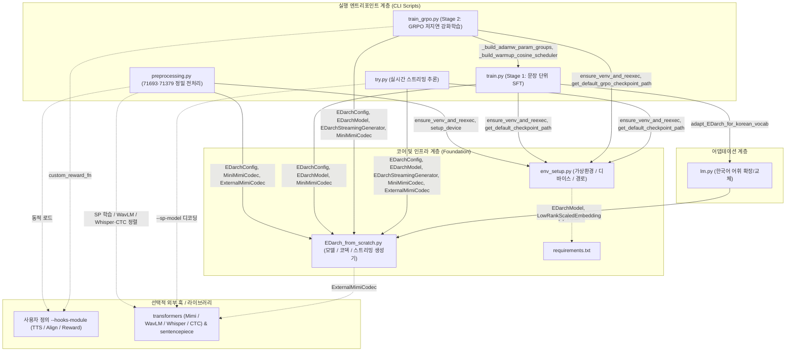
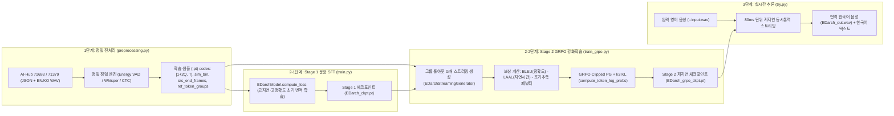

# EDarch 기반 영-한 실시간 스트리밍 동시통역 시스템 (`jang2`)

듀얼 스트림 트랜스포머 기반 실시간 음성-음성/텍스트 동시통역 아키텍처인 **EDarch**를 PyTorch로 밑바닥부터 구현하고, **Hibiki-Zero 방식의 2단계 파이프라인(AI-Hub 71693·71379 정밀 전처리 → Stage 1 문장 단위 SFT 학습 → Stage 2 GRPO 저지연 강화학습 → 실시간 스트리밍 추론)** 전 과정을 수행하는 코드베이스입니다.

---

## 1. 프로젝트 파일 구조 요약

```text
jang2/
├── env_setup.py            # 가상환경 자동 구축(OneDrive 외부 경로), 패키지 설치, CUDA/TF32 디바이스 설정
├── EDarch_from_scratch.py  # 핵심 아키텍처: EDarchModel(Temporal+Depformer+LogProb), Mimi 코덱, 스트리밍 생성기
├── lm.py                   # 사전학습된 EDarch 모델의 텍스트/Depformer 임베딩 및 헤드를 한국어 어휘 크기로 변환
├── preprocessing.py        # AI-Hub 71693 & 71379 통합 전처리 + Inner Monologue 정밀 정렬(Energy/Whisper/CTC)
├── train.py                # [Stage 1] 문장 정렬 지도학습(SFT) 루프 (AMP, Grad Checkpointing, Warmup-Cosine LR)
├── train_grpo.py           # [Stage 2] Hibiki-Zero 방식 GRPO 동시통역 강화학습 (BLEU 품질 보상 vs LAAL 지연시간 단축)
├── try.py                  # 체크포인트 로드 및 프레임 단위 실시간 스트리밍 음성·텍스트 번역 추론 스크립트
└── requirements.txt        # PyTorch(>=2.7.0, CUDA 12.8 권장), torchaudio(<2.9.0), soundfile 의존성 명시
```

| 파일명 | 계층 구분 | 단독 실행(CLI) | 핵심 역할 |
| :--- | :--- | :---: | :--- |
| `env_setup.py` | 인프라 / 공통 유틸 | X | 가상환경 자동 생성·재실행(`EDARCH_REEXEC`), 기본 체크포인트(`EDarch_ckpt.pt` / `EDarch_grpo_ckpt.pt`) 경로 관리 |
| `EDarch_from_scratch.py` | 코어 모델 엔진 | O (자체 검증) | `EDarchConfig`, `EDarchModel`(`compute_loss`, `compute_token_log_probs`), `MiniMimiCodec`, `ExternalMimiCodec`, `EDarchStreamingGenerator` 정의 |
| `lm.py` | 모델 어댑테이션 | X | `adapt_EDarch_for_korean_vocab()`으로 특수 토큰(BOS/EOS/PAD)을 보존하며 한국어 어휘 크기에 맞게 레이어 재구성 |
| `preprocessing.py` | 데이터 파이프라인 | O | AI-Hub 71693·71379 통합 파싱, 음향 에너지/Whisper/CTC 기반 **Inner Monologue 정밀 정렬**, Stage 2 메타데이터 포함 `.pt` 생성 |
| `train.py` | Stage 1 SFT 학습 | O | `.pt` 데이터셋 기반 문장 단위 인과 정렬 지도학습(Cross-Entropy), 한국어 어휘 적응 연동 |
| `train_grpo.py` | Stage 2 GRPO 강화학습 | O | 단어 정렬 없이 그룹 롤아웃($G$개) 샘플링 후 **Smoothed/Process BLEU 보상 - LAAL 지연시간 페널티 + k3 KL 정규화**로 저지연 정책 학습 |
| `try.py` | 추론 엔트리포인트 | O | Stage 1 또는 Stage 2 체크포인트를 로드하여 80ms(12.5Hz) 단위 스트리밍 음성 합성 및 한국어 텍스트 디코딩 수행 |

---

## 2. 모듈 간 상호 참조 관계 (Cross-Reference Architecture)

### 2.1 파이썬 모듈 Import 의존성 그래프



### 2.2 모듈별 상세 심볼 참조 매트릭스

| 호출(Import) 주체 | 피호출(Target) 모듈 | 참조하는 클래스 / 함수 / 상수 | 사용 목적 |
| :--- | :--- | :--- | :--- |
| `lm.py` | `EDarch_from_scratch` | `EDarchModel`, `LowRankScaledEmbedding` | 텍스트 임베딩(`text_emb`, `depformer_text_emb`)과 출력층(`text_linear`)을 한국어 어휘 크기로 교체 |
| `preprocessing.py` | `env_setup`, `EDarch_from_scratch` | `setup_device`, `EDarchConfig`, `ExternalMimiCodec`, `MiniMimiCodec` | 71693·71379 오디오 리샘플링, Inner Monologue 정밀 정렬, Mimi RVQ 인코딩 |
| `train.py` | `env_setup`, `EDarch_from_scratch`, `lm` | `EDarchConfig`, `EDarchModel`, `MiniMimiCodec`, `adapt_EDarch_for_korean_vocab` | Stage 1 지도학습(`compute_loss`), 한국어 어휘 어댑테이션, 체크포인트 저장 |
| `train_grpo.py` | `env_setup`, `EDarch_from_scratch`, `train` | `EDarchModel`(`compute_token_log_probs`), `EDarchStreamingGenerator`, `_build_adamw_param_groups` | Stage 2 배치 그룹 롤아웃 샘플링, Smoothed BLEU/LAAL 보상 평가, Clipped GRPO + k3 KL 업데이트 |
| `try.py` | `env_setup`, `EDarch_from_scratch` | `EDarchConfig`, `EDarchModel`, `EDarchStreamingGenerator`, `ExternalMimiCodec`, `MiniMimiCodec` | Stage 1/2 체크포인트 추론 전용 로드(`load_state_dict_for_inference`), 스트리밍 음성 합성 및 텍스트 디코딩 |

---

## 3. Hibiki-Zero 방식 3단계 파이프라인 데이터 흐름도



---

## 4. 전처리 정밀화 및 Stage 2 GRPO 핵심 설계

### 4.1 Inner Monologue 정밀 정렬 ([`preprocessing.py`](./preprocessing.py))
기존 단순 등간격 분배의 한계를 해결하기 위해 `compute_aligned_token_placement()`에서 4가지 정렬 모드를 지원합니다:
- **`energy` (`--align-mode auto` 기본 폴백)**: 외부 ASR 없이 12.5Hz 프레임별 RMS 에너지 포락선과 적응형 VAD 임계값(`-35dB`)으로 앞뒤 무음과 문장 내 쉼표 휴지기를 감지하고, 서브워드 글자 길이에 비례해 실제 유성음 발화 구간에 토큰을 배치합니다.
- **`whisper` (`--whisper-align-model`)**: HuggingFace Whisper(`return_timestamps="word"`)로 단어별 발화 시작·종료 시각을 추출하여 SentencePiece 토큰에 매핑합니다.
- **`ctc` (`--ctc-align-model`)**: 한국어 Wav2Vec2/MMS CTC 모델과 순수 PyTorch Viterbi 강제 정렬(`_viterbi_ctc_forced_align`)로 전사 오류 없이 정답 한국어 음절을 오디오 프레임에 직접 정렬합니다.
- **선행 오프셋 (`--monologue-lead-frames 1`)**: 각 텍스트 토큰이 해당 어절의 실제 발음 프레임보다 1프레임(80ms) 앞서 출력되도록 배치하여 Depformer 오디오 생성을 직접 가이드합니다.
- **Stage 2 메타데이터 저장**: `.pt` 파일 내에 `src_start_frames`, `src_end_frames`, `ref_token_groups`를 함께 기록하여(`train.py`와 100% 하위 호환) Stage 2 GRPO에서 다중 발화 중간 보상(Process Reward)과 정밀 지연시간 계산에 활용합니다.

### 4.2 Stage 2 GRPO 동시통역 강화학습 ([`train_grpo.py`](./train_grpo.py))
단어 단위 영-한 정렬 데이터 없이도 모델이 스스로 적절한 대기/발화 타이밍을 학습하도록 구성되어 있습니다:
- **배치 그룹 롤아웃 (`rollout_group_trajectories`)**: 동일한 영어 음성 프롬프트에 대해 `EDarchStreamingGenerator(batch_size=G)`로 $G$개의 서로 다른 동시통역 궤적을 병렬 스트리밍 생성하고, `EOS` 이후 구간을 인과적으로 마스킹합니다.
- **복합 보상 함수 (`evaluate_rollout_group_rewards`)**:
  - **번역 품질 보상**: 토큰 시퀀스 Smoothed BLEU(및 `--sp-model` 제공 시 디코딩 문자열 문자 n-gram BLEU 결합) + 다중 발화 윈도우에서의 발화 경계별 누적 Prefix BLEU(Process Reward).
  - **동시통역 지연시간 페널티**: 표준 동시통역 지표인 **LAAL (Length-Adaptive Average Lagging, 초 단위)**을 계산하여 일찍 정확하게 번역할수록 높은 보상을 부여합니다.
  - **보상 해킹(Reward Hacking) 방지 가드**: 원문 발화 시작 직후 최소 청취 프레임(`--min-wait-frames`) 이전에 추측성 토큰을 뱉거나 빈 번역을 출력하는 꼼수에 페널티를 부과하고, 의미 오디오 코드북(`cb=0`) 단일 토큰 붕괴를 억제합니다.
- **메모리 효율적 GRPO 손실 (`compute_token_log_probs` & `compute_grpo_loss`)**:
  - 거대 어휘 로짓 전체에 `log_softmax` 텐서를 할당하지 않고 커널 융합된 `-F.cross_entropy`로 샘플링된 행동의 로그 확률만 추출합니다.
  - 그룹 내 평균·표준편차로 정규화된 상대 우위 $A_g$에 대해 PPO 클리핑 목적함수와 음수가 되지 않는 **Schulman k3 KL 페널티**(Stage 1 기준 모델은 기본 `--ref-device cpu` 오프로드로 GPU VRAM 절약)를 결합해 업데이트합니다.

---

## 5. 실행 방법 (Quick Start)

모든 CLI 스크립트(`preprocessing.py`, `train.py`, `train_grpo.py`, `try.py`)는 최초 실행 시 가상환경 구축을 자동 처리합니다(현재 환경 즉시 실행 시 `--no-venv` 추가).

### 5.1 정밀 전처리 (`preprocessing.py`)
```powershell
# 음향 에너지/VAD 정밀 정렬(기본값) + AI-Hub 71693/71379 자동 감지 전처리
python preprocessing.py --json-dir ./raw/json --wav-dir ./raw/wav --output-dir ./data_pt `
    --preset 1b --sp-model ./ko_spm.model --train-sp-if-missing --mimi-model kyutai/mimi --align-mode energy

# 한국어 CTC 강제 정렬(Forced Alignment) 사용 시
python preprocessing.py --root-71379 ./raw/71379 --output-dir ./data_pt `
    --preset 1b --sp-model ./ko_spm.model --mimi-model kyutai/mimi `
    --align-mode ctc --ctc-align-model kresnik/wav2vec2-large-xlsr-korean
```

### 5.2 Stage 1: 문장 단위 지도학습 (`train.py`)
```powershell
python train.py --preset 1b --ko-vocab-size 32000 --data-dir ./data_pt `
    --grad-checkpointing --batch-size 2 --grad-accum-steps 8 --epochs 10
```

### 5.3 Stage 2: Hibiki-Zero 방식 GRPO 저지연 강화학습 (`train_grpo.py`)
```powershell
# 합성 데모 프롬프트로 GRPO 루프 동작 검증
python train_grpo.py --preset 1b --grad-checkpointing --group-size 4 --steps-per-epoch 3

# Stage 1 체크포인트(EDarch_ckpt.pt)로부터 전처리 데이터셋 기반 Stage 2 GRPO 학습
python train_grpo.py --init-from ./EDarch_ckpt.pt --data-dir ./data_pt --sp-model ./ko_spm.model `
    --grad-checkpointing --group-size 4 --kl-coef 0.02 --reward-bleu-weight 1.0 --reward-latency-weight 0.15 `
    --lr 1e-5 --epochs 2 --save-path ./EDarch_grpo_ckpt.pt
```

### 5.4 실시간 스트리밍 추론 (`try.py`)
```powershell
# Stage 2 GRPO 체크포인트 로드 및 단일 패스(--cfg-coef 1.0) 저지연 추론
python try.py --checkpoint ./EDarch_grpo_ckpt.pt --mimi-model kyutai/mimi --sp-model ./ko_spm.model `
    --input-wav ./sample_en.wav --output-wav ./outputs/EDarch_out.wav --cfg-coef 1.0
```
