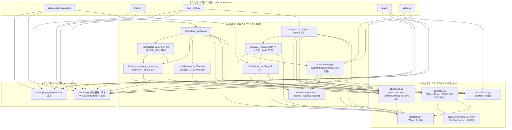
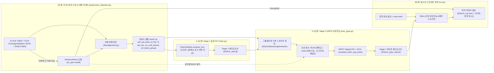
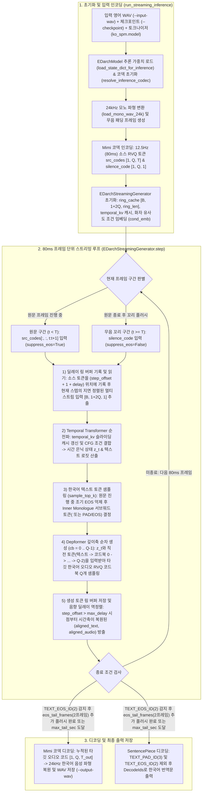

# 영-한 실시간 스트리밍 동시통역 시스템

듀얼 스트림 계층형 트랜스포머(Temporal Transformer + Depformer) 기반의 영→한 실시간 음성-음성/텍스트 동시통역 아키텍처인 **EDarch**를 모듈형 파이썬 라이브러리(`libs/`)와 경량 실행 스크립트 구조로 구현한 코드베이스입니다.

**Hibiki-Zero** 패러다임을 적용하여 단어 단위 영-한 수동 정렬 데이터 없이도 다음 전체 파이프라인을 수행합니다:
1. **한국어 SentencePiece 토크나이저 구축 & Inner Monologue 정밀 정렬 전처리** (`verify.py` + `preprocess_datasets.py`)
2. **Stage 1: 문장 단위 인과 정렬 지도학습 (SFT)** (`train.py`)
3. **Stage 2: GRPO(Group Relative Policy Optimization) 저지연 동시통역 강화학습** (`train_grpo.py`)
4. **80ms(12.5Hz) 프레임 단위 실시간 스트리밍 추론** (`run.py`)

---

## 1. 프로젝트 디렉터리 및 모듈 구조 (총 22개 파이썬 모듈)

```text
jang2/
├── preprocess_datasets.py          # [실행 전용] AI-Hub 71693 & 71379 Training/Validation 분할 일괄 전처리 진입점
├── train.py                        # [실행 전용] Stage 1 문장 단위 지도학습(SFT) 진입점
├── train_grpo.py                   # [실행 전용] Stage 2 GRPO 동시통역 강화학습 진입점
├── run.py                          # [실행 전용] 실시간 스트리밍 음성·텍스트 추론 진입점
├── verify.py                       # [실행 전용] 토크나이저·코어 모델 자체 검증 및 단독 토크나이저 학습 진입점
├── requirements.txt                # 필수 의존성: PyTorch(>=2.7.0, CUDA 12.8 권장), torchaudio(<2.9.0), soundfile, sentencepiece
└── libs/                           # [코어 라이브러리 패키지] 모든 클래스·함수·통합 유틸리티 보관
    ├── __init__.py                 # PEP 562 지연 로드(Lazy Export) 기반 패키지 공개 API
    ├── env.py                      # 가상환경 부트스트랩, 디바이스 설정, 원자적 저장(atomic_torch_save), 공통 CLI 인자
    ├── cli.py                      # 가상환경 재실행 전 동작하는 순수 표준 라이브러리 기반 CLI ArgumentParser 빌더
    ├── config.py                   # EDarchConfig (1B/2B 프리셋, 스트림 수, 음향 딜레이 규격)
    ├── tokenizer.py                # 한국어 SentencePiece(.model) 토크나이저 학습·로더 및 공통 텍스트/JSON 정규화기
    ├── layers.py                   # RMSNormFP32, RoPE, SwiGLU, StepIndexed 모듈, KV 캐시, 딜레이 연산, 화자 조건화
    ├── codec.py                    # 통합 WAV 로더/리샘플러, CausalConv, Split RVQ, MiniMimiCodec, ExternalMimiCodec
    ├── model.py                    # EDarchModel (Temporal + Depformer, SFT 손실, GRPO 로그확률), 한국어 어휘 어댑테이션
    ├── optim.py                    # 통합 AMP 컨텍스트, 임베딩 제외 AdamW 파라미터 그룹, Warmup-Cosine 스케줄러, Grad Clip 스텝
    ├── alignment.py                # Inner Monologue 정밀 정렬(Energy VAD / Whisper / 벡터화 CTC Viterbi) 및 WavLM 화자 유사도
    ├── preprocessing_common.py     # [공통 전처리 코어] 발화 구조체, 슬라이서, MMS/Edge TTS, 오버랩 Mimi 인코딩, 타임라인 조립기
    ├── dataset_parsing.py          # AI-Hub 71693·71379 Training/Validation 디렉터리 탐색 및 저메모리 병렬 JSON 파서
    ├── dataset_builder.py          # Training/Validation 저메모리 배치 분할 .pt 변환 및 전처리 빌더 (run_preprocess_datasets)
    ├── training.py                 # PreprocessedPtDataset, CollatePad, 검증 평가 및 Stage 1 SFT 학습 루프(run_sft_training)
    ├── grpo_rollout.py             # GRPOPromptDataset, 배치 병렬 스트리밍 롤아웃 생성기, Smoothed/Process BLEU + LAAL 보상 평가기
    ├── grpo.py                     # GRPO Clipped Surrogate 정책 손실 + Schulman k3 KL 및 Stage 2 강화학습 루프(run_grpo_training)
    └── streaming.py                # EDarchStreamingGenerator, 실시간 스트리밍 추론(run_streaming_inference), 모델 무결성 검증
```

### 1.1 루트 실행 스크립트 (Execution Entrypoints)

| 실행 파일 | 위임 대상 라이브러리 함수 | 핵심 역할 |
| :--- | :--- | :--- |
| [`preprocess_datasets.py`](./preprocess_datasets.py) | `libs.dataset_builder.run_preprocess_datasets` | AI-Hub 71693·71379 `Training`/`Validation`(또는 단일 디렉터리) 구조를 탐색해 저메모리로 `train`/`val` 분할 `.pt` 일괄 구축 |
| [`train.py`](./train.py) | `libs.training.run_sft_training` | Stage 1 문장 단위 인과 정렬 지도학습(SFT), 검증(`--val-data-dir`) 및 `EDarch_ckpt.pt` 저장 |
| [`train_grpo.py`](./train_grpo.py) | `libs.grpo.run_grpo_training` | Stage 2 GRPO 그룹 롤아웃 저지연 강화학습, 검증(`--val-data-dir`) 및 `EDarch_grpo_ckpt.pt` 저장 |
| [`run.py`](./run.py) | `libs.streaming.run_streaming_inference` | 학습된 체크포인트 기반 실시간 영어→한국어 음성 합성 및 번역문 출력 |
| [`verify.py`](./verify.py) | `libs.tokenizer.run_tokenizer_self_test`, `libs.streaming.run_bottom_up_verification` | 한국어 SentencePiece 토크나이저 검증/학습(`tokenizer`, `train-tokenizer`) 및 코어 모델 검증(`model`, `all`) |

### 1.2 중복 제거 및 통합된 공통 기능 요약 (`libs/`)

| 통합 유틸리티 | 위치 모듈 | 통합 전 중복 위치 → 통합 효과 |
| :--- | :--- | :--- |
| `atomic_torch_save()` | [`libs/env.py`](./libs/env.py) | 전처리 `.pt` 저장 및 Stage 1·Stage 2 체크포인트 저장 시 임시 파일 기록 후 지수 백오프 원자적 교체 일원화 |
| `add_env_cli_args()` | [`libs/env.py`](./libs/env.py) | 5개 실행 스크립트에 반복되던 `--venv-dir`, `--no-venv`, `--torch-index-url`, `--cpu`, `--reinstall` 인자 등록 통합 |
| `resample_wav()`, `load_mono_wav_24k()` | [`libs/codec.py`](./libs/codec.py) | 전처리·WavLM/정렬기·실시간 추론에 분산되어 있던 다채널 다운믹스 및 24kHz/16kHz 리샘플링 통합 |
| `resolve_inference_codec()` | [`libs/codec.py`](./libs/codec.py) | 체크포인트 내장 `MiniMimiCodec` 복원과 외부 `ExternalMimiCodec`(`kyutai/mimi`) 선택 로직 일원화 |
| `resolve_amp_context()`, `step_optimizer_with_clip()`, `build_adamw_param_groups()`, `build_warmup_cosine_scheduler()` | [`libs/optim.py`](./libs/optim.py) | Stage 1(`training.py`)과 Stage 2(`grpo.py`)가 공유하는 BF16/FP16 AMP 스케일러, Grad Clipping, 옵티마이저·스케줄러 통합 |

---

## 2. 모듈 간 상호 참조 관계 (Cross-Reference Architecture)

### 2.1 실행 진입점 ↔ `libs/` 패키지 계층 의존성 다이어그램

루트 실행 스크립트들은 가상환경 부트스트랩 전까지 순수 표준 라이브러리 모듈(`libs.cli`, `libs.env`)만 임포트하며, 가상환경 진입 이후 `libs/` 내 파이프라인·학습·추론 모듈을 지연 호출합니다.



### 2.2 파이썬 코드에서 `libs` 패키지 직접 임포트 예시

루트 스크립트 실행 외에도 외부 파이썬 코드에서 `libs`를 일반 라이브러리처럼 바로 임포트해 사용할 수 있습니다(`libs/__init__.py`의 지연 로딩 적용으로 토크나이저 유틸리티나 `EDarchConfig` 단독 임포트 시에는 PyTorch가 로드되지 않습니다):

```python
from libs import (
    EDarchConfig,
    EDarchModel,
    EDarchStreamingGenerator,
    MiniMimiCodec,
    adapt_EDarch_for_korean_vocab,
    load_korean_tokenizer,
    run_preprocess_datasets,
    train_korean_sentencepiece,
)
```

---

## 3. 전체 파이프라인 및 아티팩트 흐름도 (End-to-End Workflow)



> [!IMPORTANT]
> **토크나이저(`ko_spm.model`) 운용 주의사항**
> - SentencePiece 토크나이저 생성은 GPU 딥러닝이 아니라 코퍼스의 서브워드 빈도를 집계해 단어장 번호(`0 ~ text_card-1`)를 매기는 **CPU 통계 작업(수 초~수십 초 소요)** 입니다.
> - `preprocess_datasets.py` 실행 시 `--tokenizer`로 지정한 파일(또는 `<output-dir>/ko_spm.model`)이 없으면 수집된 코퍼스로부터 자동으로 생성됩니다(또는 `python verify.py train-tokenizer --input ... --output ./ko_spm.model`로 사전 생성 가능).
> - **한 번 생성된 `ko_spm.model`은 토큰 번호 체계 고정을 위해 절대 덮어쓰지 말고 `train_grpo.py`와 `run.py`까지 동일한 파일로 재사용**해야 합니다.

---

## 4. 코어 아키텍처 및 멀티스트림 규격 (`libs/config.py`, `libs/model.py`)

### 4.1 멀티스트림 텐서 규격 (`codes: [B, 1 + 2Q, T]`)
모든 학습 데이터(`.pt`)와 모델 입출력이 공유하는 시퀀스 구조입니다.
- **스트림 `0` (`1`개)**: 타깃 한국어 텍스트 토큰 (**Inner Monologue**). 대기 프레임은 `TEXT_PAD_ID(3)`, 번역 종료 프레임은 `TEXT_EOS_ID(2)`.
- **스트림 `1 .. Q` (`Q`개)**: 타깃(한국어) 음성의 Mimi RVQ 코드북 (`1`: Semantic 코드북, `2..Q`: Acoustic 잔차 코드북).
- **스트림 `Q+1 .. 2Q` (`Q`개)**: 소스(영어) 음성의 Mimi RVQ 코드북 (`Q+1`: Semantic 코드북, `Q+2..2Q`: Acoustic 잔차 코드북).
- **Acoustic Delay 패턴 (`cfg.delays`)**: 텍스트와 각 오디오 스트림의 첫 번째(Semantic) 코드북은 지연 `0`, 나머지 `Q-1`개 Acoustic 코드북은 `1` 프레임 지연을 가집니다 (`[0] + [0, 1, ..., 1] + [0, 1, ..., 1]`).

### 4.2 모델 프리셋 비교 (`EDarchConfig`)

| 프리셋 메서드 | `--preset` 인자 | `dim` / `layers` / `heads` | `depformer_dim` / `layers` | `audio_card` | `text_card` (기본) | 스트림당 코드북 ($Q$) | 총 스트림 ($1+2Q$) |
| :--- | :---: | :---: | :---: | :---: | :---: | :---: | :---: |
| `EDarch_m_1b()` | `1b` (기본값) | 2048 / 16 / 16 | 1024 / 4 | 2048 | 32000 | 8 | 17 |
| `EDarch_2b()` | `2b` | 2560 / 24 / 20 | 1024 / 4 | 2048 | 32000 | 16 | 33 |

---

## 5. `libs/` 하위 모듈 상세 설명

- **[`libs/env.py`](./libs/env.py)**: Windows OneDrive 동기화 잠금 방지를 위해 가상환경(`%LOCALAPPDATA%\EDarch_venv`)과 기본 체크포인트(`%LOCALAPPDATA%\EDarch_checkpoints\`)를 외부 경로에 구성하고, `ensure_venv_and_reexec()`, `setup_device()`, `atomic_torch_save()`, `add_env_cli_args()`를 제공합니다.
- **[`libs/cli.py`](./libs/cli.py)**: PyTorch 설치 이전 단계에서도 즉시 동작하도록 순수 표준 라이브러리만으로 구성된 5종 실행 스크립트 전용 `ArgumentParser` 팩토리 모듈입니다.
- **[`libs/config.py`](./libs/config.py)**: `EDarchConfig` 데이터클래스를 정의하며 `1b`/`2b` 프리셋 생성 및 직렬화 복원(`from_dict`)을 담당합니다.
- **[`libs/tokenizer.py`](./libs/tokenizer.py)**: 한국어 NFC 정규화 및 UTF-8 Byte-Fallback을 지원하는 `sentencepiece` 모델 학습기(`train_korean_sentencepiece`), 로더(`load_korean_tokenizer`), AI-Hub 71693·71379 코퍼스 추출기를 제공합니다.
- **[`libs/layers.py`](./libs/layers.py)**: `RMSNormFP32`, 시간축 `RotaryEmbedding`, `StepIndexedLinear`/`StepIndexedSwiGLU`, `LayerKVCache`, `StreamingTransformerStack`, `SpeakerSimilarityConditioner`, 시퀀스 딜레이 연산을 포함합니다.
- **[`libs/codec.py`](./libs/codec.py)**: 부분 Seek를 지원하는 통합 오디오 로더(`load_mono_wav_24k`), 인과 합성곱 기반 내장 RVQ 코덱(`MiniMimiCodec`), HuggingFace `kyutai/mimi` 래퍼(`ExternalMimiCodec`)를 제공합니다.
- **[`libs/model.py`](./libs/model.py)**: 계층형 트랜스포머 `EDarchModel`(`compute_loss`, 롤아웃 샘플링 정합형 `compute_token_log_probs`, 추론 전용 가중치 로더 `load_state_dict_for_inference`)과 한국어 어휘 교체 함수 `adapt_EDarch_for_korean_vocab()`을 포함합니다.
- **[`libs/optim.py`](./libs/optim.py)**: AMP 자동 정밀도 결정(`resolve_amp_context`), 임베딩 Weight Decay 제외 `AdamW` 그룹 생성, 선형 워밍업 + 코사인 감쇠 스케줄러, Grad Clipping 스텝 헬퍼를 제공합니다.
- **[`libs/alignment.py`](./libs/alignment.py)**: 12.5Hz 프레임 RMS 에너지/적응형 VAD 정렬(`align_tokens_by_acoustic_energy`), Whisper 단어 타임스탬프 정렬, 한국어 Wav2Vec2 CTC Viterbi 강제 정렬(`_viterbi_ctc_forced_align`), WavLM 화자 유사도 계산기를 제공합니다.
- **[`libs/preprocessing_common.py`](./libs/preprocessing_common.py)**: 발화 데이터클래스(`UtteranceSpan`, `BroadcastUtterance71379`), 고속 디렉터리 스캐너(`fast_scandir_files`), 한국어 연음 로마자 변환 및 MMS/Edge TTS 합성기, 인과 오버랩 Mimi 인코딩(`encode_mimi_timeline`), 멀티스트림 타임라인 조립기(`assemble_multistream_example`), 이진 분할 윈도우 트리 인덱서를 제공합니다.
- **[`libs/dataset_parsing.py`](./libs/dataset_parsing.py)**: AI-Hub 71693(국제학술대회) 및 71379(방송콘텐츠) `Training`/`Validation` 폴더 구조를 자동 탐색(`discover_71693_splits`, `discover_71379_splits`)하고 저메모리 멀티스레드로 JSON 라벨 및 Sublabel 한국어 코퍼스를 파싱(`parse_71693_split`, `parse_71379_split`)합니다.
- **[`libs/dataset_builder.py`](./libs/dataset_builder.py)**: 파싱된 발화 그룹을 초과 길이 자동 이진 분할(`_w0000_p0`/`_p1`)과 이어하기를 적용해 `.pt` 텐서로 변환(`process_71693_to_pt`, `process_71379_to_pt`)하고 데이터셋 로더 검증을 수행하는 통합 전처리 빌더(`run_preprocess_datasets`)입니다.
- **[`libs/training.py`](./libs/training.py)**: 공통 `.pt` 검증 로더(`list_preprocessed_pt_files`, `load_and_validate_pt_item`), `PreprocessedPtDataset`, 동적 패딩 콜레이터(`CollatePad`), Stage 1 지도학습 루프(`run_sft_training`)를 제공합니다.
- **[`libs/grpo_rollout.py`](./libs/grpo_rollout.py)**: Stage 2 프롬프트 데이터셋(`GRPOPromptDataset`), 배치 병렬 스트리밍 롤아웃(`rollout_group_trajectories`), Smoothed/Process BLEU 및 실시간 LAAL 지연시간 복합 보상 산출기(`evaluate_rollout_group_rewards`)를 제공합니다.
- **[`libs/grpo.py`](./libs/grpo.py)**: Clipped Surrogate Policy Gradient + Schulman k3 KL 손실(`compute_grpo_loss`), 검증 롤아웃 평가 및 Stage 2 GRPO 강화학습 루프(`run_grpo_training`)를 제공합니다.
- **[`libs/streaming.py`](./libs/streaming.py)**: 음향 딜레이 역정렬 링 버퍼를 내장한 `EDarchStreamingGenerator`, WAV 입출력 추론 파이프라인(`run_streaming_inference`), 모델 전 과정 무결성 검증(`run_bottom_up_verification`)을 제공합니다.

---

## 6. 실행 방법 (Quick Start)

모든 루트 실행 스크립트는 최초 실행 시 가상환경 구축을 자동 수행합니다(현재 파이썬 환경에서 즉시 실행하려면 `--no-venv` 추가).

### 6.1 토크나이저 및 코어 아키텍처 검증·단독 토크나이저 생성 (`verify.py`)
```powershell
python verify.py tokenizer

python verify.py train-tokenizer --input ./raw/json --output ./ko_spm.model --vocab-size 32000

python verify.py model --preset 1b
```

### 6.2 데이터셋 정밀 전처리 및 토크나이저 자동 생성 (`preprocess_datasets.py`)
```powershell
python preprocess_datasets.py --dir-71693 D:\data --dir-71379 D:\data2 --output-dir E:\preprocessed_edarch `
    --preset 1b --tokenizer ./ko_spm.model --codec mimi --mimi-model kyutai/mimi --align-mode energy

python preprocess_datasets.py --dir-71379 ./raw/71379 --only-71379 --output-dir ./data_pt `
    --preset 1b --tokenizer ./ko_spm.model --codec mimi --mimi-model kyutai/mimi `
    --align-mode ctc --ctc-align-model kresnik/wav2vec2-large-xlsr-korean
```

### 6.3 Stage 1: 문장 단위 지도학습 (`train.py`)
```powershell
python train.py --preset 1b --grad-checkpointing --batch-size 1 --epochs 2 --steps-per-epoch 5

python train.py --preset 1b --ko-vocab-size 32000 --data-dir E:\preprocessed_edarch\train `
    --val-data-dir E:\preprocessed_edarch\val --grad-checkpointing --batch-size 2 --grad-accum-steps 8 --epochs 10
```

### 6.4 Stage 2: GRPO 저지연 동시통역 강화학습 (`train_grpo.py`)
```powershell
python train_grpo.py --preset 1b --grad-checkpointing --group-size 4 --steps-per-epoch 3

python train_grpo.py --init-from ./EDarch_ckpt.pt --data-dir E:\preprocessed_edarch\train `
    --val-data-dir E:\preprocessed_edarch\val --tokenizer ./ko_spm.model `
    --grad-checkpointing --group-size 4 --kl-coef 0.02 `
    --reward-bleu-weight 1.0 --reward-latency-weight 0.15 `
    --lr 1e-5 --epochs 2 --save-path ./EDarch_grpo_ckpt.pt
```

### 6.5 실시간 스트리밍 추론 (`run.py`)
```powershell
python run.py --checkpoint ./EDarch_grpo_ckpt.pt --mimi-model kyutai/mimi --tokenizer ./ko_spm.model `
    --input-wav ./sample_en.wav --output-wav ./outputs/EDarch_out.wav --cfg-coef 1.0
```

### 6.6 실시간 스트리밍 추론 상세 흐름도 (`run_streaming_inference` & `EDarchStreamingGenerator`)



