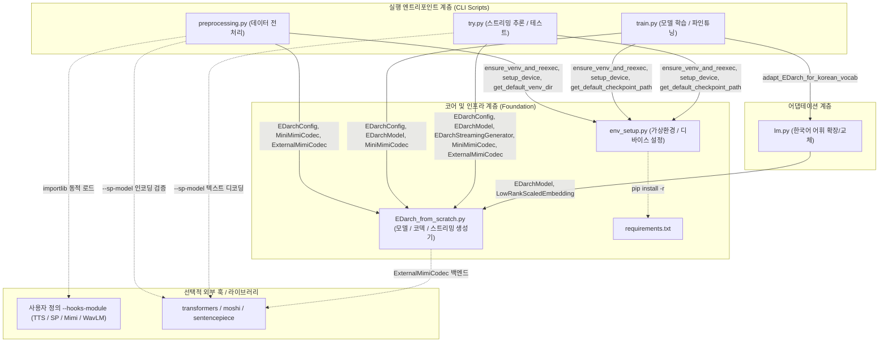
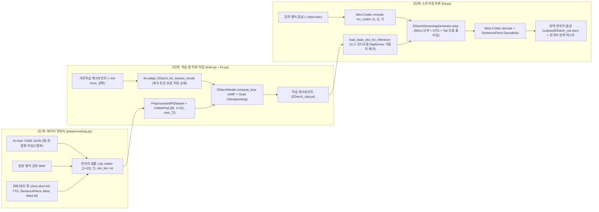
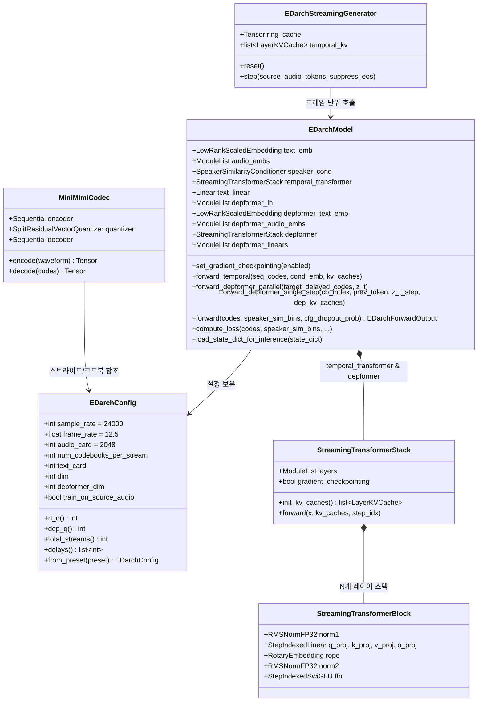

# EDarch 기반 영-한 실시간 스트리밍 동시통역 시스템 (`jang2`)

듀얼 스트림 트랜스포머 기반 실시간 음성-음성/텍스트 동시통역 아키텍처인 **EDarch**를 PyTorch로 밑바닥부터 구현하고, **AI-Hub 71693 영-한 통번역 데이터셋 전처리 → 한국어 어휘 어댑테이션 → 모델 학습 → 실시간 스트리밍 추론**까지 전 과정을 수행하는 코드베이스입니다.

---

## 1. 프로젝트 파일 구조 요약

```text
jang2/
├── env_setup.py            # 가상환경 자동 구축(OneDrive 외부 경로), 패키지 설치, CUDA/TF32 디바이스 설정
├── EDarch_from_scratch.py  # 핵심 아키텍처: EDarchModel(Temporal+Depformer), Mimi 코덱, 스트리밍 생성기
├── lm.py                   # 사전학습된 EDarch 모델의 텍스트/Depformer 임베딩 및 헤드를 한국어 어휘 크기로 변환
├── preprocessing.py        # AI-Hub 71693(JSON+WAV) 데이터를 다중 스트림 코드북 텐서(.pt)로 변환하는 전처리 파이프라인
├── train.py                # 학습/파인튜닝/재개 루프 (AMP, Grad Checkpointing, Grad Accum, Warmup-Cosine LR 지원)
├── try.py                  # 체크포인트 로드 및 프레임 단위 실시간 스트리밍 음성·텍스트 번역 추론 스크립트
└── requirements.txt        # PyTorch(>=2.7.0, CUDA 12.8 권장), torchaudio(<2.9.0), soundfile 의존성 명시
```

| 파일명 | 계층 구분 | 단독 실행(CLI) | 핵심 역할 |
| :--- | :--- | :---: | :--- |
| `env_setup.py` | 인프라 / 공통 유틸 | X | 가상환경 자동 생성·재실행(`EDARCH_REEXEC`), CUDA 12.8 및 `soundfile` 검증, 시드/TF32 초기화 |
| `EDarch_from_scratch.py` | 코어 모델 엔진 | O (자체 검증) | `EDarchConfig`, `EDarchModel`, `MiniMimiCodec`, `ExternalMimiCodec`, `EDarchStreamingGenerator` 정의 |
| `lm.py` | 모델 어댑테이션 | X | `adapt_EDarch_for_korean_vocab()`으로 특수 토큰(BOS/EOS/PAD)을 보존하며 한국어 어휘 크기에 맞게 레이어 재구성 |
| `preprocessing.py` | 데이터 파이프라인 | O | 영어 강의 음성·번역문을 인과적 타임라인으로 정렬(초과 길이 자동 분할 포함)하고 Mimi RVQ 인코딩을 거쳐 `.pt` 생성 |
| `train.py` | 학습 엔트리포인트 | O | `.pt` 데이터셋(또는 합성 데모) 기반 모델 학습, 한국어 어휘 적응, Gradient Checkpointing, 원자적 체크포인트 저장 |
| `try.py` | 추론 엔트리포인트 | O | 학습된 체크포인트에서 추론용 가중치만 추출 로드하여 80ms(12.5Hz) 단위 스트리밍 음성 합성 및 한국어 텍스트 디코딩 수행 |

---

## 2. 모듈 간 상호 참조 관계 (Cross-Reference Architecture)

### 2.1 파이썬 모듈 Import 의존성 그래프

아래 다이어그램은 파이썬 파일 간의 직접적인 `import` 참조 방향(`참조하는 스크립트 --> 참조되는 모듈`)을 나타냅니다. `env_setup.py`와 `EDarch_from_scratch.py`가 프로젝트 전체의 기반(Foundation) 계층 역할을 수행하며 순환 참조가 없는 단방향 계층 구조를 이룹니다.



### 2.2 모듈별 상세 심볼 참조 매트릭스

| 호출(Import) 주체 | 피호출(Target) 모듈 | 참조하는 클래스 / 함수 / 상수 | 사용 목적 |
| :--- | :--- | :--- | :--- |
| `lm.py` | `EDarch_from_scratch` | `EDarchModel`, `LowRankScaledEmbedding` | 모델 내 텍스트 임베딩(`text_emb`, `depformer_text_emb`)과 출력층(`text_linear`)을 한국어 어휘 크기로 교체 |
| `preprocessing.py` | `env_setup` | `DEFAULT_CUDA_INDEX_URL`, `get_default_venv_dir`, `ensure_venv_and_reexec`, `setup_device` | CLI 실행 시 자동 가상환경 전환 및 디바이스 초기화 |
| `preprocessing.py` | `EDarch_from_scratch` | `EDarchConfig`, `ExternalMimiCodec`, `MiniMimiCodec` | 프리셋별 코드북 수(`num_codebooks_per_stream`)·컨텍스트 길이 참조 및 오디오 파형 → RVQ 토큰 인코딩 |
| `train.py` | `env_setup` | `DEFAULT_CUDA_INDEX_URL`, `get_default_venv_dir`, `get_default_checkpoint_path`, `ensure_venv_and_reexec`, `setup_device` | 학습 환경 자동 구성, 기본 체크포인트(`EDarch_ckpt.pt`) 경로 결정, CUDA/TF32 활성화 |
| `train.py` | `EDarch_from_scratch` | `EDarchConfig`, `EDarchModel`, `MiniMimiCodec` | 모델 생성, `set_gradient_checkpointing()`, `compute_loss()` 역전파 학습, 데모 모드 합성 코드 생성 |
| `train.py` | `lm` | `adapt_EDarch_for_korean_vocab` | `--init-from` 사전학습 체크포인트 로드 시 `--ko-vocab-size`에 맞춰 텍스트 어휘 어댑테이션 수행 |
| `try.py` | `env_setup` | `DEFAULT_CUDA_INDEX_URL`, `PROJECT_DIR`, `get_default_venv_dir`, `get_default_checkpoint_path`, `ensure_venv_and_reexec`, `setup_device` | 추론 환경 구성, 기본 체크포인트(`EDarch_ckpt.pt`) 및 `outputs/EDarch_out.wav` 경로 설정 |
| `try.py` | `EDarch_from_scratch` | `EDarchConfig`, `EDarchModel`, `EDarchStreamingGenerator`, `ExternalMimiCodec`, `MiniMimiCodec` | `load_state_dict_for_inference()`로 추론 가중치 로드, 소스 음성 인코딩, 프레임별 스트리밍 생성 및 타깃 음성 복원 |

---

## 3. 전체 파이프라인 및 데이터 흐름도 (End-to-End Workflow)

파일 간 코드 참조뿐만 아니라 **디스크 아티팩트(`.pt`, `EDarch_ckpt.pt`, `EDarch_out.wav`)와 텐서 차원(Shape)**을 매개로 파이프라인 전체가 연결됩니다.



### 멀티스트림 텐서 규격 (`codes: [B, 1 + 2Q, T]`)
모델과 데이터셋 전반에서 공유하는 핵심 시퀀스 텐서 구조입니다 ($Q = \text{num\_codebooks\_per\_stream}$, 프레임 레이트 $12.5\text{Hz} = 80\text{ms/frame}$):
- **스트림 `0` (`1`개)**: 타깃 한국어 텍스트 토큰 (**Inner Monologue**). 대기 구간은 `TEXT_PAD_ID(3)`, 번역 종료 시점에는 `TEXT_EOS_ID(2)`가 배치됨.
- **스트림 `1 .. Q` (`Q`개)**: 타깃(한국어) 음성의 Mimi RVQ 코드북 (`1`: Semantic 코드북, `2..Q`: Acoustic 잔차 코드북).
- **스트림 `Q+1 .. 2Q` (`Q`개)**: 소스(영어) 음성의 Mimi RVQ 코드북 (`Q+1`: Semantic 코드북, `Q+2..2Q`: Acoustic 잔차 코드북).
- **Acoustic Delay 패턴 (`cfg.delays`)**: 텍스트와 각 오디오 스트림의 첫 번째(Semantic) 코드북은 지연이 `0`이고, 나머지 `Q-1`개 Acoustic 코드북은 `1` 프레임 지연을 가집니다 (`[0] + [0, 1, ..., 1] + [0, 1, ..., 1]`).

---

## 4. 코어 아키텍처 내부 구조 (`EDarch_from_scratch.py`)

`EDarch_from_scratch.py` 내부의 클래스 구성 및 순전파/스트리밍 호출 관계는 다음과 같습니다.



### 모델 프리셋 비교 (`EDarchConfig`)

| 프리셋 메서드 | `--preset` 인자 | `dim` / `layers` / `heads` | `depformer_dim` / `layers` | `audio_card` | 스트림당 코드북 ($Q$) | 총 스트림 ($1+2Q$) | 용도 |
| :--- | :---: | :---: | :---: | :---: | :---: | :---: | :--- |
| `EDarch_m_1b()` | `1b` (기본값) | 2048 / 16 / 16 | 1024 / 4 | 2048 | 8 | 17 | 약 1B급 표준 동시통역 모델 |
| `EDarch_2b()` | `2b` | 2560 / 24 / 20 | 1024 / 4 | 2048 | 16 | 33 | 풀 스케일(약 2B급) 고품질 동시통역 모델 |

---

## 5. 파일별 상세 코드 분석

### 5.1 [`env_setup.py`](./env_setup.py) — 실행 환경 자동화 및 디바이스 관리
- **OneDrive 경로 회피 설계**: 프로젝트가 OneDrive 동기화 폴더 내에 위치할 때 대용량 가상환경이나 체크포인트 파일 잠금 충돌이 발생하지 않도록, Windows에서는 기본적으로 `%LOCALAPPDATA%\EDarch_venv` 및 `%LOCALAPPDATA%\EDarch_checkpoints\EDarch_ckpt.pt`를 사용합니다 (`EDARCH_VENV_DIR`, `EDARCH_CKPT_DIR` 환경변수로 재정의 가능).
- **자가 부트스트랩 (`ensure_venv_and_reexec`)**: 스크립트를 일반 시스템 파이썬으로 실행하더라도 가상환경 존재 여부 및 `torch` / `torchaudio` / `soundfile` 설치·CUDA 백엔드 일치 여부를 자동 점검(`_probe_torch_backend`)한 뒤, 필요 시 `pip install` 후 `EDARCH_REEXEC=1` 플래그와 함께 가상환경 파이썬으로 프로세스를 재실행합니다.
- **디바이스 최적화 (`setup_device`)**: 난수 시드를 고정하고, CUDA 사용 가능 시 Ampere 이상 GPU의 연산 가속을 위해 `allow_tf32 = True` 및 `float32_matmul_precision("high")`를 자동 적용합니다.

### 5.2 [`EDarch_from_scratch.py`](./EDarch_from_scratch.py) — 코어 모델 및 스트리밍 생성기
- **계층형 트랜스포머 구조 (`EDarchModel`)**:
  - **Temporal Transformer**: 시간축($T$) 방향으로 동작하며 RoPE 위치 인코딩과 슬라이딩 윈도우(`context_frames=1000`, 80초) Causal Attention을 사용합니다. 매 프레임의 모든 스트림 임베딩 합과 화자 유사도 조건(`SpeakerSimilarityConditioner`)을 받아 은닉 상태 `z_t`와 타깃 텍스트 로짓을 예측합니다.
  - **Depformer (Depth Transformer)**: 각 시간 스텝의 `z_t`와 직전 코드북 토큰을 입력받아 깊이축(코드북 스텝 방향)으로 오디오 코드북을 예측합니다. `StepIndexedLinear`와 `StepIndexedSwiGLU`를 통해 `depformer_weights_schedule`에 정의된 코드북별 가중치 공유/분리 스케줄을 처리합니다.
  - **Gradient Checkpointing (`set_gradient_checkpointing`)**: 1B/2B 모델 학습 시 VRAM 사용량을 절감할 수 있도록 `StreamingTransformerStack` 단위에서 Activation Checkpointing(`use_reentrant=False`)을 지원합니다.
- **지연 공간 직접 손실 계산 (`_forward_delayed` & `compute_loss`)**:
  - 학습 시 `undelay_sequence`로 거대 로짓 텐서를 재복사하지 않고, `_forward_delayed()`가 반환한 지연 공간(delayed space) 텐서 위에서 직접 마스크를 계산해 메모리 효율을 높였습니다.
- **학습 vs 추론 Depformer 비대칭 처리**:
  - 학습 시(`train_on_source_audio=True`)에는 타깃 오디오($Q$개)뿐 아니라 소스 오디오($Q$개)까지 총 $2Q$개를 예측하도록 보조 손실(`source_audio_weight=0.2`)을 부여합니다 (`--no-source-audio-loss`로 비활성화 가능).
  - 추론 시(`train_on_source_audio=False`)에는 `load_state_dict_for_inference()`가 소스 오디오 예측용 가중치 슬라이스를 자동으로 걸러내고 타깃 오디오 $Q$개만 생성합니다.
- **코덱 이중화 (`MiniMimiCodec` & `ExternalMimiCodec`)**:
  - `MiniMimiCodec`: 인과적 합성곱과 의미/음향 분리형 RVQ(`SplitResidualVectorQuantizer`)를 직접 구현한 내장 코덱입니다.
  - `ExternalMimiCodec`: Hugging Face `transformers`(`MimiModel`) 또는 `moshi` 패키지의 사전학습 `kyutai/mimi` 코덱을 래핑하며, 코드북 크기(`audio_card=2048`), 최대 코드북 수, 샘플레이트 호환성을 자동 검증합니다.
- **실시간 스트리밍 엔진 (`EDarchStreamingGenerator`)**:
  - 순환 버퍼(`ring_cache`)로 스트림별 입출력 지연(`delays`)을 관리하며, 매 스텝 `[B, Q, 1]` 크기의 소스 오디오 1프레임을 입력받아 Classifier-Free Guidance(`cfg_coef`)가 적용된 텍스트·오디오 토큰을 방출합니다.

### 5.3 [`lm.py`](./lm.py) — 한국어 어휘 어댑테이션
- `adapt_EDarch_for_korean_vocab()`은 사전학습된 `EDarchModel`의 백본(Temporal Transformer, 오디오 임베딩, 오디오 Depformer) 가중치는 그대로 유지하면서, 텍스트 어휘 크기(`cfg.text_card`)에 의존하는 3개 모듈(`text_emb`, `text_linear`, `depformer_text_emb`)만 새 한국어 토크나이저 크기로 교체합니다.
- 새 가중치는 기존 분포의 평균/표준편차로 초기화하며, `preserve_special_tokens=True`일 때 `EOS(2)`, `PAD(3)`, `BOS(text_card)` 임베딩과 `depformer_text_emb.low_rank_proj` 투영 행렬을 기존 모델에서 그대로 복사합니다.

### 5.4 [`preprocessing.py`](./preprocessing.py) — 동시통역 타임라인 정렬 및 전처리
- **세그먼트 단절 감지 및 적응형 윈도우 분할**:
  - `load_and_group_71693_json()`은 번역이 누락된 원문 구간(`skipped_intervals`)이 발화 사이에 존재할 경우 `segment_break=True`를 표시하여 미번역 영어 음성이 윈도우 내부에 섞여 들어가지 않도록 분리합니다.
  - `preprocess_71693_dataset()`은 생성된 샘플이 `max_context_frames`를 초과할 경우 작업 큐(`deque`)에서 발화 리스트를 절반씩 재귀 분할하며, 이미 합성된 한국어 TTS 파형과 토큰은 `tts_cache`로 재사용합니다.
- **인과적(Causal) 동시통역 정렬 (`build_EDarch_training_example`)**:
  - 각 한국어 문장의 텍스트 토큰 시작 프레임(`text_start_frame`)을 **해당 영어 발화가 끝난 프레임(`en_end_frame`) 이후**로 배치하여 미래 발화 정보 누수(Leakage)를 원천 차단합니다.
- **SentencePiece 정합성 검증 및 플러그형 훅**: `--sp-model` 지정 시 `eos_id == 2`, `pad_id == 3` 일치 여부와 어휘 크기를 자동 검증·동기화하며, `--hooks-module` 또는 `--demo-hooks`를 지원합니다.

### 5.5 [`train.py`](./train.py) — 모델 학습 스크립트
- **데이터 검증 (`PreprocessedPtDataset`)**: `.pt` 파일 로드 시 스트림 개수(`1b`는 17, `2b`는 33), 텍스트·오디오 토큰 범위, `sim_bin` 범위를 검증하고, `crop_frames` 절단으로 인해 `EOS`가 잘릴 경우 경고를 출력합니다.
- **VRAM 최적화 및 학습 안정성**: `--init-from` 로드 시 CPU에서 먼저 가중치 필터링 및 한국어 어휘 어댑테이션을 마친 뒤 GPU로 이동하여 피크 메모리를 절약하며, `--grad-checkpointing`, `--no-source-audio-loss`, CUDA BF16/FP16 AMP, Gradient Accumulation, 원자적 체크포인트 저장(`_atomic_save_checkpoint`)을 지원합니다.

### 5.6 [`try.py`](./try.py) — 스트리밍 동시통역 추론 스크립트
- **2단계 스트리밍 루프**:
  1. **소스 음성 유입 구간**: 입력 영어 음성의 각 프레임을 순차 공급하면서 `suppress_eos=True`로 설정해 원문이 진행 중일 때 번역 스트림이 조기 종료되는 현상을 방지합니다.
  2. **꼬리(Tail) 플러싱 구간**: 원문 종료 후 최대 `--max-tail-sec`(기본 10초) 동안 무음 프레임(`silence_code`)을 흘려보내며 `suppress_eos=False`로 전환해 `TEXT_EOS_ID(2)`가 방출될 때까지 남은 한국어 번역을 완성합니다.
- **텍스트 디코딩 연동**: `--sp-model` 지정 시 방출된 Inner Monologue 토큰 시퀀스에서 `PAD`/`EOS`를 제외하고 SentencePiece로 디코딩한 한국어 번역 문장을 함께 출력합니다.

---

## 6. 실행 방법 (Quick Start)

모든 실행 스크립트(`preprocessing.py`, `train.py`, `try.py`)는 최초 실행 시 가상환경 생성 및 패키지 설치를 자동으로 수행합니다. 현재 활성화된 파이썬 환경을 그대로 쓰려면 `--no-venv` 옵션을 추가하세요.

### 6.1 코어 아키텍처 단독 무결성 검증 (`EDarch_from_scratch.py`)
```powershell
python EDarch_from_scratch.py
```

### 6.2 데이터셋 전처리 (`preprocessing.py`)
```powershell
# 데모 훅으로 전처리 파이프라인 검증
python preprocessing.py --json-dir ./raw/json --wav-dir ./raw/wav --output-dir ./data_pt --preset 1b --demo-hooks

# 실제 SentencePiece 및 사전학습 Mimi 코덱 + 커스텀 TTS/WavLM 훅 모듈 연동
python preprocessing.py --json-dir ./raw/json --wav-dir ./raw/wav --output-dir ./data_pt `
    --preset 1b --ko-vocab-size 32000 --sp-model ./ko_spm.model --mimi-model kyutai/mimi --hooks-module my_hooks
```

### 6.3 모델 학습 및 파인튜닝 (`train.py`)
```powershell
# 데이터셋 없이 합성 데이터로 빠른 학습 루프 테스트 (1b 프리셋 + Gradient Checkpointing)
python train.py --preset 1b --grad-checkpointing --batch-size 1 --epochs 2 --steps-per-epoch 5

# 전처리된 .pt 데이터셋으로 본 학습
python train.py --preset 1b --ko-vocab-size 32000 --data-dir ./data_pt --grad-checkpointing --batch-size 2 --grad-accum-steps 8 --epochs 10

# 사전학습 체크포인트에서 한국어 어휘 어댑테이션(lm.py) 적용 후 파인튜닝
python train.py --init-from ./pretrained_EDarch.pt --ko-vocab-size 32000 --data-dir ./data_pt --grad-checkpointing --lr 5e-5
```

### 6.4 스트리밍 음성·텍스트 번역 추론 (`try.py`)
```powershell
# 합성 입력으로 데모 스트리밍 추론 테스트
python try.py --preset 1b

# 입력 영어 WAV 파일을 스트리밍 번역하여 한국어 WAV 저장 + SentencePiece 번역문 출력
python try.py --checkpoint ./EDarch_ckpt.pt --mimi-model kyutai/mimi --sp-model ./ko_spm.model `
    --input-wav ./sample_en.wav --output-wav ./outputs/EDarch_out.wav --cfg-coef 3.0
```
